# 1. Introducción

**iTickets** es el sistema de la Vicerrectoría de Orientación y Asuntos Estudiantiles (VOAE) de la UNAH para pedir, producir y aprobar piezas de diseño y comunicación. Cada pedido es un **ticket** con un código único (por ejemplo `AOAA-0001`).

Este manual es para el rol **Administrador**. Tú configuras el sistema para que los demás puedan trabajar:

- **Usuarios**: crear cuentas, asignar el área o la coordinación, dar y quitar roles, indicar jefaturas adicionales y activar o desactivar cuentas.
- **Catálogos**: áreas, coordinaciones y tipos de solicitud con su formulario.
- **Feriados**: los días que no cuentan para los plazos.
- **Bitácora**: el historial de roles, feriados y asignaciones.
- **KPIs** y **Estadísticas** de todas las solicitudes.

El administrador puede trabajar **a cualquier hora**: el horario hábil no lo limita.

# 2. Acceso al sistema

## 2.1 Iniciar sesión

Entra a la dirección de iTickets en tu navegador.

1. Escribe tu **Correo**.
2. Escribe tu **Contraseña**. Para verla mientras la escribes, pulsa el ojo que está a la derecha del campo.
3. Pulsa **Ingresar**.

Si el correo o la contraseña no coinciden, aparece el aviso **"Correo o contraseña incorrectos."**.

> ¿Olvidaste tu contraseña? Pulsa **¿Olvidaste tu contraseña?**, escribe tu correo y pulsa **Enviar enlace**.

## 2.2 Primer ingreso y cambio de contraseña

La primera vez entras con una **contraseña temporal**. iTickets te pide crear una propia: escribe la **Contraseña nueva**, repítela en **Confirmar contraseña** y pulsa **Guardar contraseña**. Lo mismo les pasará a las personas a las que crees una cuenta.

## 2.3 Conoce la pantalla

- **Menú lateral**, sección **Administración**: **KPIs**, **Usuarios**, **Catálogos**, **Feriados**, **Bitácora** y **Estadísticas**. Si además tienes otros roles, verás una sección por cada uno.
- **Campana**, **tu nombre** y el botón para **cerrar sesión**, arriba a la derecha.

> Por seguridad, la sesión se cierra sola después de **20 minutos** sin actividad.

# 3. KPIs

**KPIs** es una vista general de todas las solicitudes: el total, los retrasados, los aprobados automáticamente y las áreas activas, más tres resúmenes **Por estado**, **Por área** y **Por tipo de solicitud**.

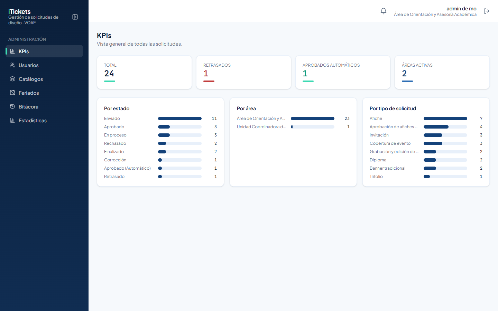

# 4. Usuarios

**Usuarios** lista todas las cuentas con su nombre completo, correo, área o coordinación, roles, jefaturas y estado.

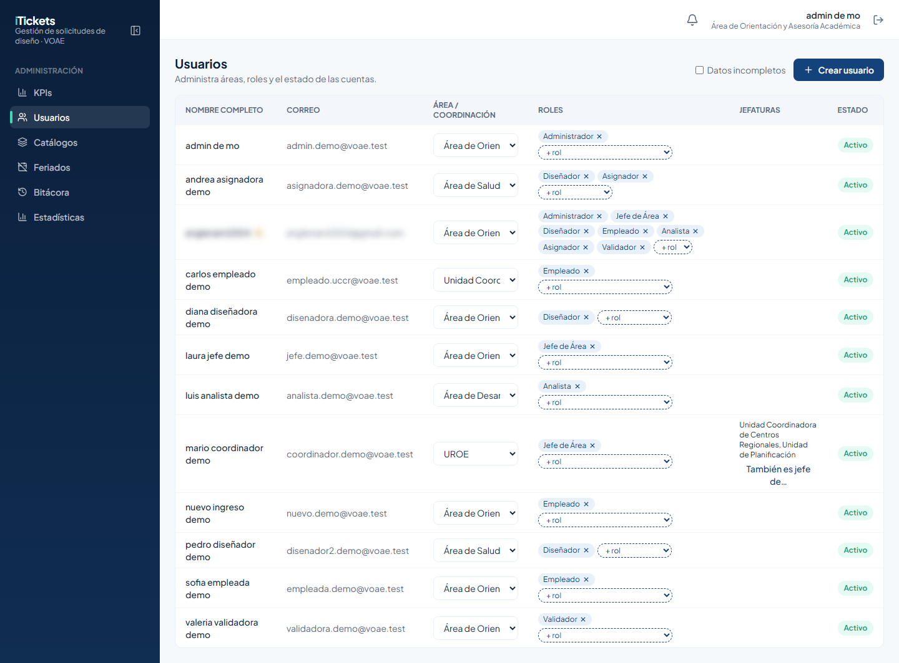

> Marca **Datos incompletos** para ver solo las cuentas a las que les falta información (por ejemplo, los apellidos). Esas cuentas tienen un ⚠️ junto al nombre.

## 4.1 Crear un usuario

1. Pulsa **Crear usuario**.
2. Escribe los **Nombres**, el **Primer apellido** y el **Segundo apellido**. Los tres son obligatorios.
3. Escribe el **Correo institucional**.
4. En **Área**, elige el área **o** la coordinación a la que pertenece. Cada persona pertenece a una sola.
5. Elige el **Rol inicial**.
6. Pulsa **Crear usuario**.

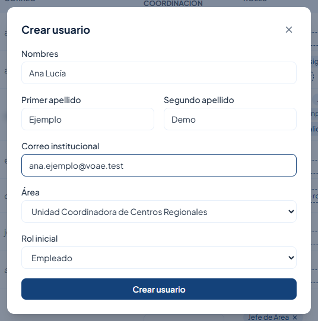

Al crearla, iTickets muestra la **contraseña temporal** de la cuenta **una sola vez**. Cópiala con el botón de copiar y entrégasela a la persona por un medio seguro. Pulsa **Cerrar**. En su primer ingreso, el sistema le pedirá cambiarla.

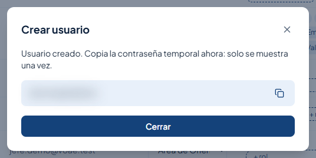

> Si cierras la ventana sin copiar la contraseña temporal, no podrás volver a verla.

## 4.2 Cambiar el área o la coordinación

En la columna **Área / Coordinación**, elige la nueva opción en el selector de la fila. El cambio se guarda en ese momento.

## 4.3 Dar y quitar roles

- **Dar un rol**: en la columna **Roles**, abre **+ rol** y elige el rol. Se agrega en ese momento.
- **Quitar un rol**: pulsa la **×** junto al nombre del rol y confirma.

| Rol | Qué hace |
|---|---|
| **Empleado** | Envía solicitudes y las sigue. |
| **Jefe de Área** | Dictamina los diseños de su área, envía excepcionales y solicitudes normales. |
| **Diseñador** | Toma tickets y sube entregables. |
| **Asignador** | Distribuye el trabajo de diseño y responde las excepcionales. **Requiere también el rol Diseñador.** |
| **Validador** | Revisa los afiches con IA y las coberturas de evento. |
| **Analista** | Consulta las estadísticas y envía solicitudes. |
| **Administrador** | Configura el sistema. |

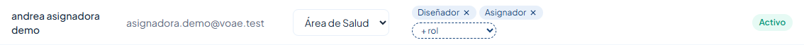

> Si quitas el rol **Diseñador** a alguien que tiene tickets activos, la ventana de confirmación lista esos tickets: al confirmar, vuelven a la cola **sin asignar**.

## 4.4 Jefes de varias coordinaciones

Un jefe de coordinación puede dirigir otras coordinaciones además de la suya:

1. En la fila de esa persona, pulsa **También es jefe de…** (columna **Jefaturas**).
2. Marca las coordinaciones que también dirige. Cada casilla se guarda en cuanto la marcas o desmarcas, y aparece un aviso de confirmación.
3. Cierra la ventana.

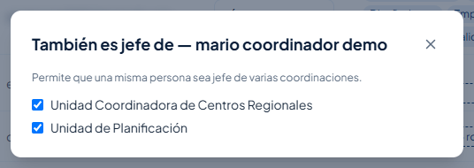

Esa persona verá y dictaminará los tickets de todas esas coordinaciones.

## 4.5 Desactivar y reactivar cuentas

En la columna **Estado**, pulsa **Activo** para desactivar una cuenta o **Inactivo** para reactivarla. Siempre se pide confirmación.

Si la cuenta es de alguien del equipo de diseño con tickets activos, la ventana los lista. Al pulsar **Desactivar y liberar tickets**, esos tickets vuelven a la cola **sin asignar** con la etiqueta **Liberado**, y se avisa a quien distribuye el trabajo. Los tickets finalizados que esperan dictamen se quedan como están.

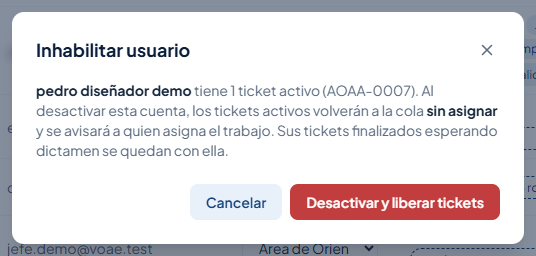

# 5. Catálogos

**Catálogos** tiene tres secciones: **Áreas**, **Coordinaciones** y **Tipos de solicitud**.

## 5.1 Áreas y coordinaciones

Cada área o coordinación tiene un nombre y un **prefijo** (por ejemplo `AOAA` o `UCCR`) que se usa en los códigos de sus tickets.

- **Crear área** o **Crear coordinación**: escribe el **Nombre**, el **Prefijo** (de 2 a 6 letras mayúsculas) y, si quieres, una descripción.
- **Editar**: cambia el nombre o la descripción, o desactívala.

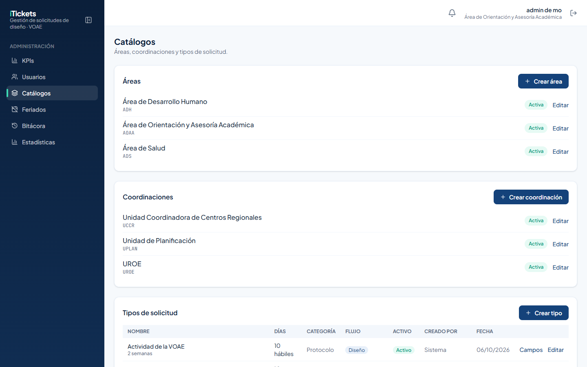

> El prefijo **no se puede cambiar** después de crearlo, y no puede repetirse ("Ese prefijo ya está en uso.").

## 5.2 Tipos de solicitud

La tabla muestra cada tipo con sus días, su categoría, su flujo, si está activo y quién lo creó. Desde cada fila puedes abrir sus **Campos** o **Editar** el tipo.

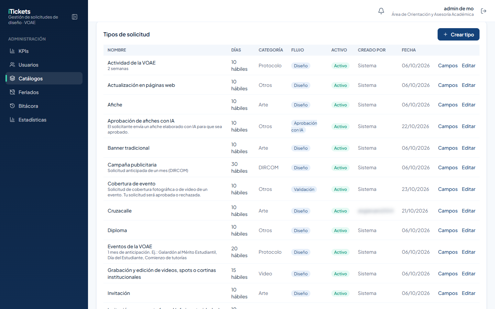

Para crear un tipo, pulsa **Crear tipo** y llena:

- **Nombre**.
- **Días estimados** (mínimo 10) y **¿Días hábiles?** (si cuentan solo de lunes a viernes sin feriados).
- **Flujo**: **Diseño** (lo produce el equipo de diseño y lo dictamina el jefe de área), **Aprobación con IA** o **Validación**. **No se puede cambiar después.**
- **Categoría**: Arte, Video, DIRCOM, Protocolo u Otros. Solo agrupa las tarjetas en **Nueva solicitud**.
- **Descripción**: nota que aparece bajo el nombre del tipo.
- **Aviso destacado (opcional)**: se muestra resaltado arriba del formulario y, al enviar, en la ventana **Antes de enviar**.
- **Nombres visibles de las generalidades**: cambia, solo para este tipo, el nombre de **Título**, **Fecha del evento**, **Dirigido a** o **Alcance**. Por ejemplo, Trifolio usa "Fecha de entrega".

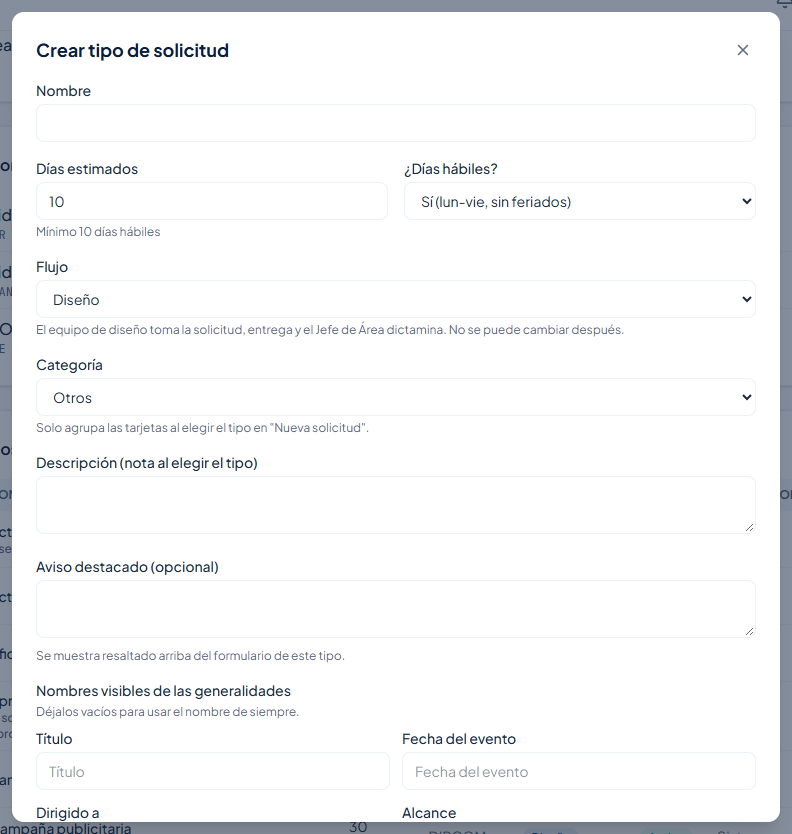

## 5.3 Campos del formulario

Cada tipo tiene, además de las generalidades, sus propios campos. Pulsa **Campos** en la fila del tipo:

- Ordena los campos con las flechas.
- Pulsa **Editar** para cambiar un campo, o **Agregar campo** para crear uno.
- **Copiar campos de otro tipo…** trae los campos de otro tipo.
- **Vista previa** muestra cómo verá el formulario el solicitante.

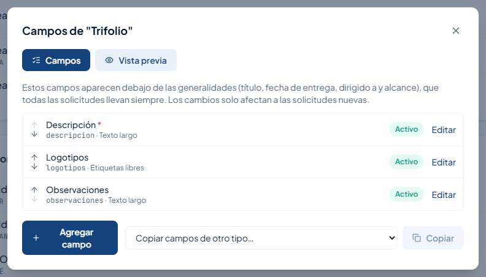

En el editor de un campo defines la **Etiqueta** (lo que ve el solicitante), el **Tipo de campo**, si es **Obligatorio**, un texto de ejemplo, una ayuda y, en los campos de texto, la **Longitud máxima (caracteres)**. Ese valor viene con un **predeterminado** que puedes cambiar o volver a poner con **Restablecer**.

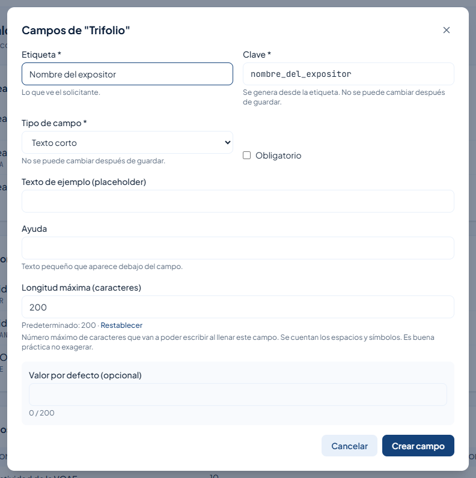

> La **Clave** se genera sola desde la etiqueta. La clave y el tipo de campo **no se pueden cambiar** después de guardar. Los campos no se borran: se desactivan. Los cambios solo afectan a las solicitudes nuevas.

> Los campos numéricos no aceptan números negativos y no cambian de valor con la rueda del ratón.

# 6. Feriados

Los feriados son rangos de días que **no cuentan** como días hábiles para calcular las fechas límite y el calendario de las solicitudes.

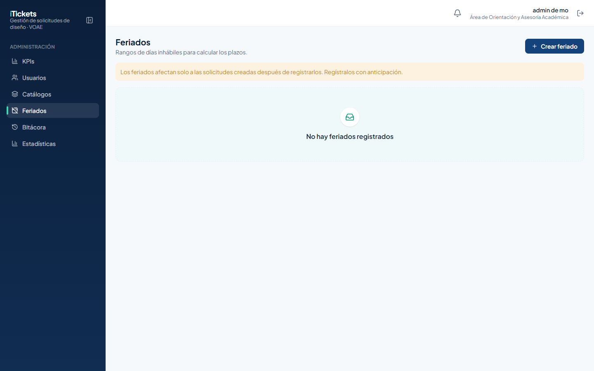

1. Pulsa **Crear feriado**.
2. Escribe el **Nombre** (por ejemplo, Semana Morazánica).
3. Elige las fechas **Desde** y **Hasta**.
4. Guarda.

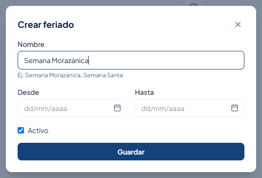

> Los feriados **solo afectan a las solicitudes creadas después de registrarlos**. Regístralos con anticipación.

# 7. Bitácora

**Bitácora** guarda el historial de cambios, en tres pestañas:

- **Roles**: qué rol se asignó o quitó, a quién, quién lo hizo y cuándo.
- **Feriados**: altas y cambios de feriados.
- **Asignaciones**: acciones **Tomado**, **Asignado**, **Reasignado**, **Desasignado** (por ejemplo, al desactivar a alguien del equipo de diseño) y **Excepcional aceptada**.

En todas puedes **Buscar**, filtrar por **Rango**, **Acción** y **Realizado por** (en Asignaciones, también por **Diseñador** y **Área**), **Limpiar filtros** y **Exportar CSV**.

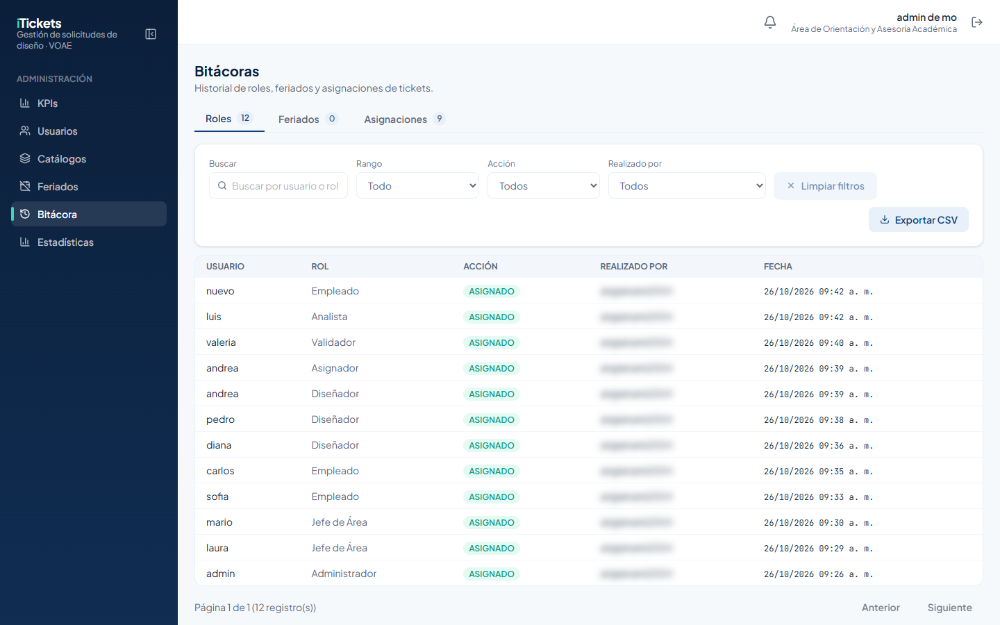

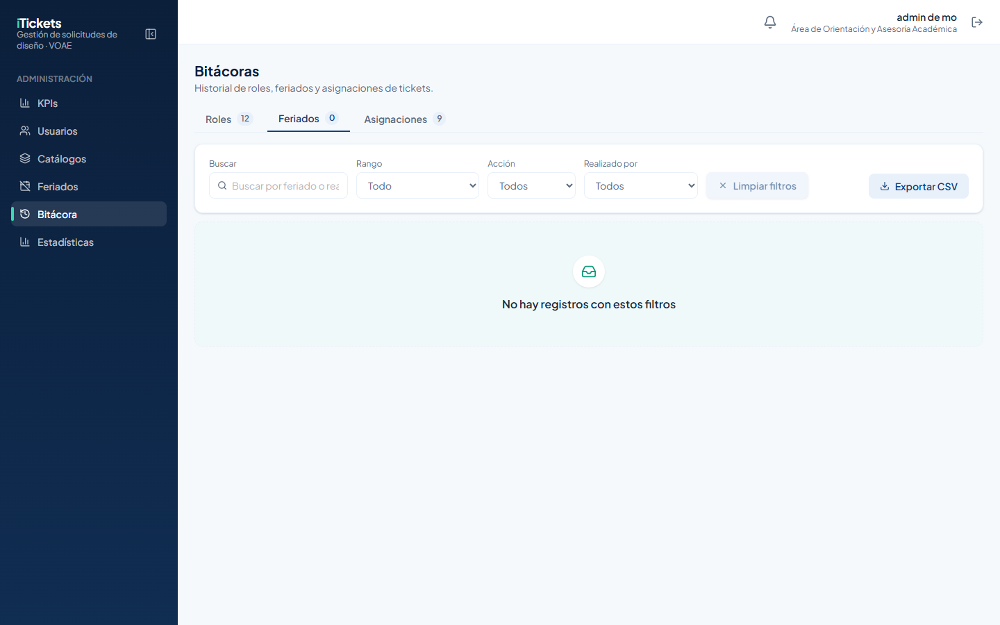

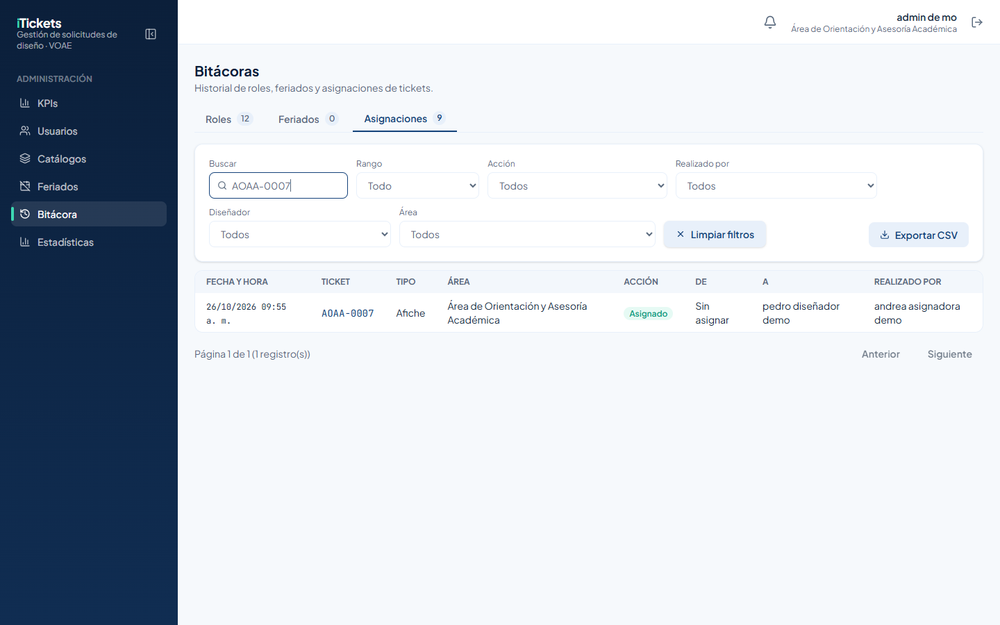

> Cuando un cambio lo hace el propio sistema (por ejemplo, una aprobación automática), aparece como **Sistema**.

# 8. Estadísticas

**Estadísticas** muestra indicadores, gráficas y una tabla de detalle de todas las solicitudes, con filtros por rango, área, tipo, flujo, estado y diseñador, y exportación a PDF y CSV. Como administrador, también ves la columna **Diseñador** y la gráfica **Carga por diseñador**.

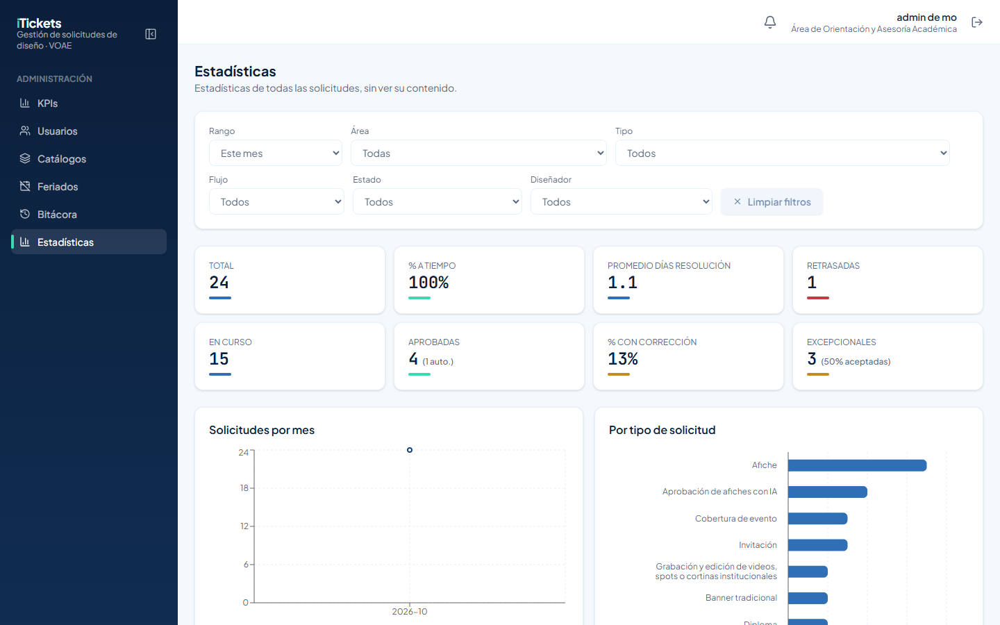

Para el detalle de cada filtro, indicador y gráfica, consulta el **Manual de Usuario – Rol: Analista**.

# 9. Reglas importantes

| Tema | Regla |
|---|---|
| Usuarios | Nombre y dos apellidos obligatorios. Cada persona pertenece a un área **o** a una coordinación. |
| Contraseña temporal | Se muestra una sola vez al crear la cuenta. En el primer ingreso hay que cambiarla. |
| Rol Asignador | Requiere también el rol Diseñador. |
| Jefaturas | **También es jefe de** permite que un jefe de coordinación dirija varias. |
| Desactivar a alguien del equipo de diseño | Sus tickets activos vuelven a la cola con la etiqueta Liberado. |
| Prefijos | De 2 a 6 letras mayúsculas, únicos, no se cambian. |
| Tipos de solicitud | Mínimo 10 días de producción. El flujo no se cambia después de crearlo. |
| Campos | La clave y el tipo no se cambian; los campos se desactivan, no se borran. |
| Feriados | Solo afectan a las solicitudes creadas después de registrarlos. |
| Horario | El administrador no está limitado por el horario hábil. |

# 10. Preguntas frecuentes y problemas comunes

| Situación | Qué hacer |
|---|---|
| Perdí la contraseña temporal de una cuenta nueva | La persona puede usar **¿Olvidaste tu contraseña?** en el inicio de sesión. |
| No puedo dar el rol Asignador | Primero dale el rol **Diseñador**. |
| "Ese prefijo ya está en uso." | Elige otro prefijo para el área o coordinación. |
| Un jefe de coordinación no ve los tickets de otra coordinación | Márcala en **También es jefe de…** en su fila. |
| Registré un feriado y no cambió la fecha de una solicitud ya enviada | Es normal: los feriados solo cuentan para solicitudes nuevas. |
| Quiero quitar un campo de un formulario | Edítalo y desactívalo. Las solicitudes anteriores lo conservan. |
| Una cuenta tiene ⚠️ | Le faltan datos. Completa sus apellidos o su área. |

# 11. Glosario

| Término | Significado |
|---|---|
| **Área / Coordinación** | Unidad a la que pertenece cada usuario (AOAA, ADH, ADS / UROE, UCCR, UPLAN). |
| **Prefijo** | Letras con las que empiezan los códigos de los tickets de un área o coordinación. |
| **Rol** | Conjunto de permisos de una cuenta. Una persona puede tener varios. |
| **Jefatura adicional** | Coordinación extra que dirige un jefe, además de la suya. |
| **Tipo de solicitud** | Clase de pieza (Afiche, Video…) con su flujo, días y formulario. |
| **Flujo** | Camino de un tipo: Diseño, Aprobación con IA o Validación. |
| **Generalidades** | Datos comunes a toda solicitud: título, fecha, dirigido a y alcance. |
| **Feriado** | Rango de días que no cuenta como hábil. |
| **Bitácora** | Historial de cambios de roles, feriados y asignaciones. |
| **Liberado** | Ticket que volvió a la cola porque su responsable fue desactivado. |
