# 1. Introducción

**iTickets** es el sistema de la Vicerrectoría de Orientación y Asuntos Estudiantiles (VOAE) para
pedir, diseñar y aprobar solicitudes de diseño y comunicación: afiches, banners, videos, invitaciones,
señalización y más. Cada solicitud se convierte en un **ticket** con un código único (por ejemplo
`ADH-0001`) que se puede seguir de principio a fin.

Como **Administrador** tienes acceso a todo el sistema. Este manual explica lo que solo tú puedes
hacer:

- Crear y administrar las cuentas de todos los usuarios, sus áreas y sus roles.
- Configurar los catálogos: áreas y tipos de solicitud.
- Registrar los feriados que alargan los plazos de producción.
- Revisar las bitácoras (roles, feriados y asignaciones de tickets).
- Ver las estadísticas completas del sistema.

Además, al tener también el rol **Analista**, **Jefe de Área** y **Diseñador** de forma implícita en
los permisos de visibilidad, ves todo lo que ellos ven. Si necesitas instrucciones detalladas para
enviar una solicitud, dictaminar un ticket o diseñarlo, consulta el manual del rol correspondiente
(Empleado, Jefe de Área, Diseñador).

# 2. Acceso al sistema

## 2.1 Iniciar sesión

Entra a la dirección del sistema en tu navegador. Verás el boleto **iTickets** a la izquierda (en
pantallas grandes) y el formulario de inicio de sesión a la derecha:

1. Escribe tu **correo** y tu **contraseña**.
2. Pulsa **Ingresar**.

> Importante: usa el correo y la contraseña que te asignó otro Administrador. Si olvidaste tu
> contraseña, usa el enlace **¿Olvidaste tu contraseña?** de la pantalla de inicio de sesión.

## 2.2 Primer ingreso y cambio de contraseña

La primera vez que entras con la contraseña temporal que te dieron, el sistema **te obliga a
cambiarla** antes de dejarte usar el resto de la aplicación. Escribe una contraseña nueva y
confírmala para continuar.

## 2.3 Conoce la pantalla

Una vez dentro verás:

- A la izquierda, el **menú lateral** con las secciones de tu rol (puedes plegarlo con el ícono de
  la esquina superior para ganar espacio).
- Arriba a la derecha, la **campana de notificaciones** (te avisa en tiempo real de lo que pasa en
  el sistema) y tu nombre con el área a la que perteneces.
- Un botón para **cerrar sesión**, junto a tu nombre.

Como Administrador, tu menú tiene seis secciones: **KPIs**, **Usuarios**, **Catálogos**,
**Feriados**, **Bitácora** y **Estadísticas**.

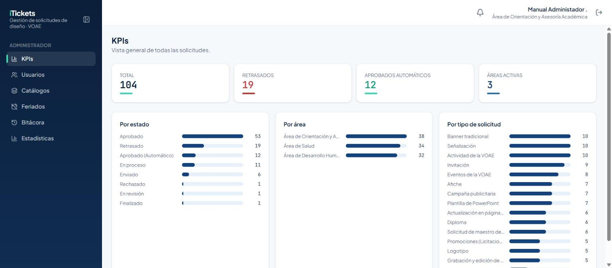

# 3. Usuarios

## 3.1 Ver y filtrar usuarios

La pantalla **Usuarios** lista a todas las personas con cuenta en el sistema: nombre, correo, área,
roles y estado (Activo/Inactivo).

- El ícono ⚠️ junto a un nombre significa que a esa cuenta **le faltan apellidos** (algún apellido
  quedó vacío al crearla). Marca la casilla **Datos incompletos** para ver solo esas cuentas y
  corregirlas.

## 3.2 Crear un usuario

1. Pulsa **Crear usuario**.
2. Completa **Nombres**, **Primer apellido** y **Segundo apellido** — los tres son obligatorios.
3. Escribe el **correo institucional**.
4. Elige el **Área** y el **Rol inicial**.
5. Pulsa **Crear usuario**.

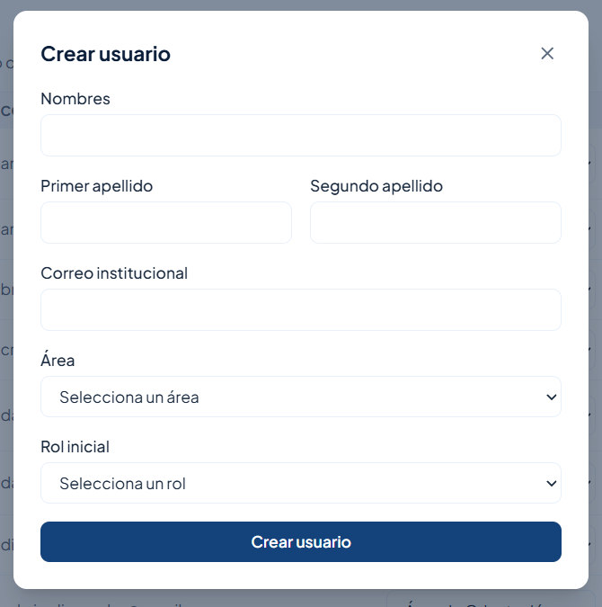
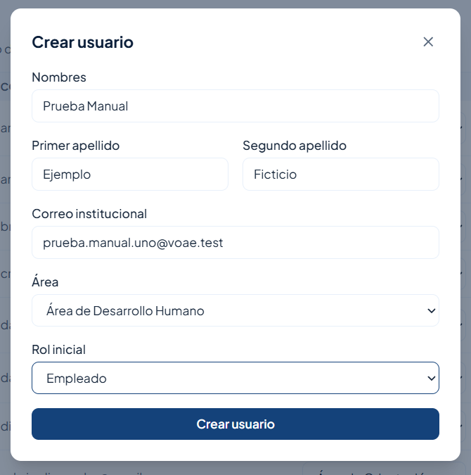

Al guardar, el sistema genera una **contraseña temporal** y la muestra una sola vez: cópiala antes
de cerrar el cuadro, porque no se puede volver a ver. Entrégasela a la persona para que inicie sesión
y la cambie en su primer ingreso (sección 2.2).

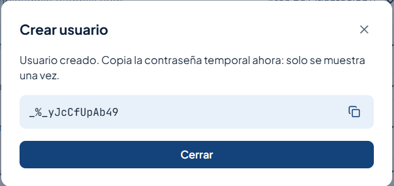

> Importante: la contraseña temporal solo se muestra una vez. Si la pierdes, no hay forma de
> recuperarla desde aquí; tendrás que crear otra cuenta o pedirle soporte a Supabase.

## 3.3 Cambiar el área

En la columna **Área** de cada fila hay un selector: elige la nueva área y el cambio se guarda de
inmediato, sin confirmación adicional.

## 3.4 Asignar y quitar roles

Cada fila muestra los roles actuales como etiquetas con una "×" para quitarlos, y un selector
**+ rol** para agregar uno nuevo.

- Un usuario puede tener **varios roles** a la vez (por ejemplo, Jefe de Área y Diseñador).
- El rol **Asignador** solo se puede dar a alguien que **ya tiene el rol Diseñador**. Si no lo
  tiene, la opción aparece deshabilitada en el selector con el texto *"(requiere Diseñador)"*.
  Agrega primero Diseñador y después Asignador.
- Al quitar el rol **Diseñador** a alguien, si esa persona tenía tickets activos (En revisión, En
  proceso, Corrección o Retrasado), esos tickets **vuelven a "Sin asignar"** automáticamente — el
  sistema te avisa antes con los códigos de esos tickets.

## 3.5 Inhabilitar y reactivar una cuenta

El botón de la columna **Estado** alterna entre Activo e Inactivo.

- **Inhabilitar:** te pide confirmación. Si la persona tiene el rol **Diseñador** y tickets activos
  asignados, el aviso lista los **códigos de esos tickets** y te explica que volverán a
  "Sin asignar" (se avisa a los Asignadores y a los solicitantes); sus tickets **Finalizados**
  esperando dictamen se quedan con ella hasta que el jefe decida.

  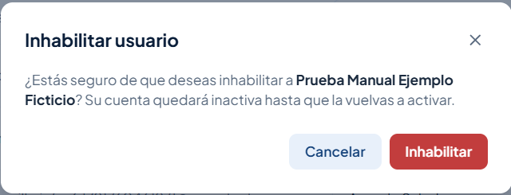

- **Reactivar:** también pide confirmación, y te recuerda que **los tickets que tenía no se le
  devuelven solos** — el Asignador tiene que asignárselos de nuevo si corresponde.

  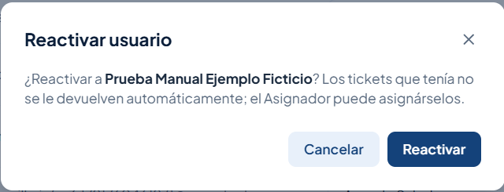

> Importante: inhabilitar a alguien no borra su historial ni sus tickets ya finalizados. Solo le
> quita el acceso y libera lo que tenía pendiente.

# 4. Catálogos

La pantalla **Catálogos** tiene dos tablas: **Áreas** y **Tipos de solicitud**.

## 4.1 Áreas

Las tres áreas del sistema (Desarrollo Humano, Orientación y Asesoría Académica, y Salud) se activan
o inhabilitan con el botón **Activa/Inactiva** de cada fila. Una vez creadas, las áreas no se
renombran desde aquí.

## 4.2 Tipos de solicitud

Cada tipo de solicitud (Afiche, Banner tradicional, Campaña publicitaria, etc.) define cuántos
**días de producción** necesita, si se cuentan en días **hábiles** o corridos, y qué **formulario**
usa (Arte, Video, DIRCOM, Protocolo u Otros).

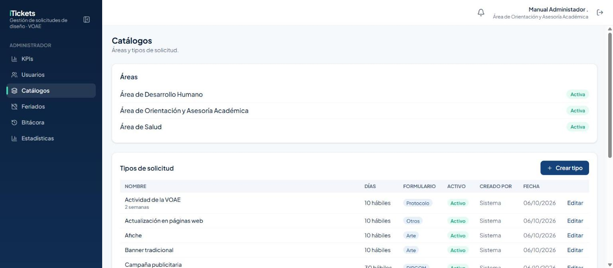

Para crear un tipo nuevo:

1. Pulsa **Crear tipo**.
2. Escribe el nombre, los días de producción, si son hábiles o corridos, y elige el formulario.
3. Guarda.

> Importante: los días de producción son el plazo mínimo que tiene el equipo de diseño. Casi todos
> los tipos piden al menos **10 días hábiles**; Campaña publicitaria y Logotipo, por ser de DIRCOM,
> piden solicitud anticipada de un mes.

Para editar un tipo existente, pulsa **Editar** en su fila. Puedes desactivarlo en lugar de
borrarlo, para que deje de ofrecerse en "Nueva solicitud" sin perder el historial de los tickets que
ya lo usaron.

# 5. Feriados

Los feriados son rangos de días que **no cuentan** al calcular la fecha límite de los tickets con
días hábiles.

## 5.1 Registrar un feriado

1. Entra a **Feriados** y pulsa **Crear feriado**.
2. Escribe el **nombre**, la fecha **Desde** y la fecha **Hasta**.
3. Dejas la casilla **Activo** marcada para que cuente de inmediato.
4. Guarda.

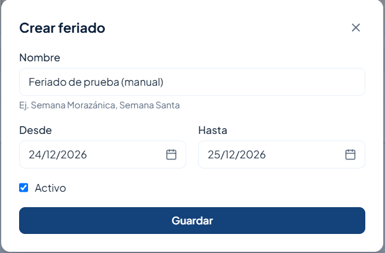

El feriado aparece en la lista con quién lo registró y cuántos días abarca:

> Importante: un feriado **solo afecta a las solicitudes que se crean después de registrarlo**. No
> hay recálculo retroactivo de los tickets que ya tenían su fecha límite calculada. Por eso conviene
> registrar los feriados con anticipación, apenas se conozcan.

## 5.2 Editar o desactivar un feriado

Pulsa **Editar** en la fila para cambiar sus fechas o desactivarlo. El historial de cambios queda
en Bitácora → Feriados (sección 6.2).

# 6. Bitácora

La Bitácora tiene tres pestañas con el historial completo del sistema: **Roles**, **Feriados** y
**Asignaciones**. Las tres comparten el mismo tipo de herramientas: un buscador, un rango de fechas
con atajos, filtros por columna, un botón **Limpiar filtros** y **Exportar CSV**.

## 6.1 Roles

Quién le dio o le quitó un rol a quién, y cuándo. Filtra por usuario, rol, acción o quién hizo el
cambio.

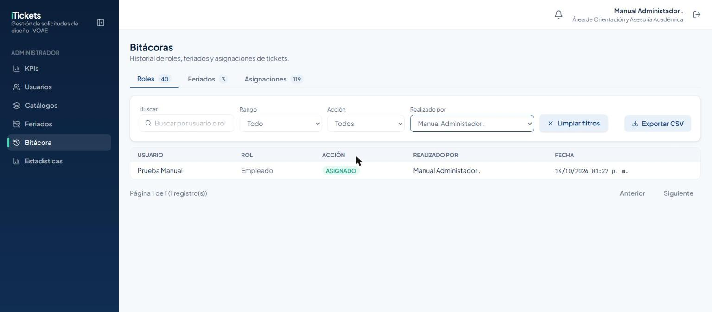

## 6.2 Feriados

Cada feriado creado, editado o desactivado, con las fechas anteriores y las nuevas cuando aplica.

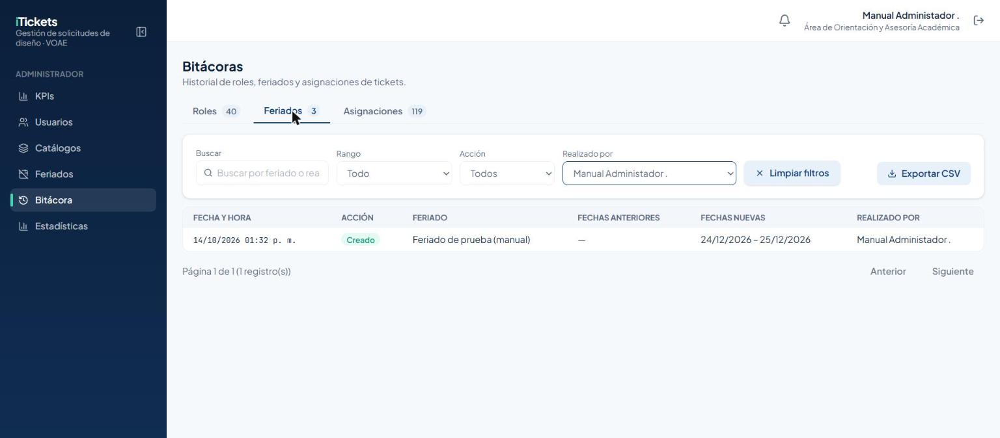

## 6.3 Asignaciones

El historial de a quién se le asignó, reasignó, desasignó o quitó cada ticket: incluye las acciones
**Asignado**, **Desasignado**, **Tomado**, **Reasignado** y **Excepcional aceptada**. Puedes filtrar
por ticket, tipo de acción, quién la hizo, diseñador o área.

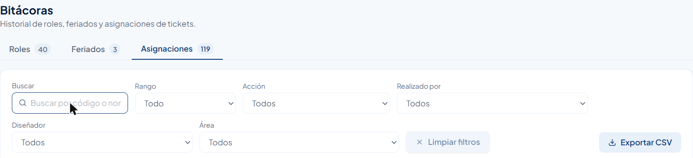

> Importante: cuando se desactiva a un diseñador (o se le quita el rol) y sus tickets vuelven a
> "Sin asignar", esa acción queda registrada aquí como **Desasignado**, con tu usuario como
> responsable.

## 6.4 Buscar y exportar

- El buscador de cada pestaña ignora mayúsculas, tildes y, para los códigos de ticket, también
  guiones y espacios: escribir "adh1" encuentra `ADH-0001`.
- **Exportar CSV** descarga exactamente las filas que ves filtradas en ese momento, listas para
  abrir en Excel.

# 7. Estadísticas

La pantalla **Estadísticas** (la misma que usa el Analista) te da una vista completa de todas las
solicitudes, sin que tengas que abrir cada ticket.

1. Ajusta los filtros de arriba: **Rango** de fechas (con atajos como "Este mes"), **Área**,
   **Tipo**, **Estado** y **Diseñador**. Quedan fijos en pantalla aunque bajes con el cursor.
2. Revisa los indicadores (KPIs): total, % a tiempo, promedio de días de resolución, retrasadas, en
   curso, aprobadas (y cuántas automáticas), % con corrección y excepcionales.

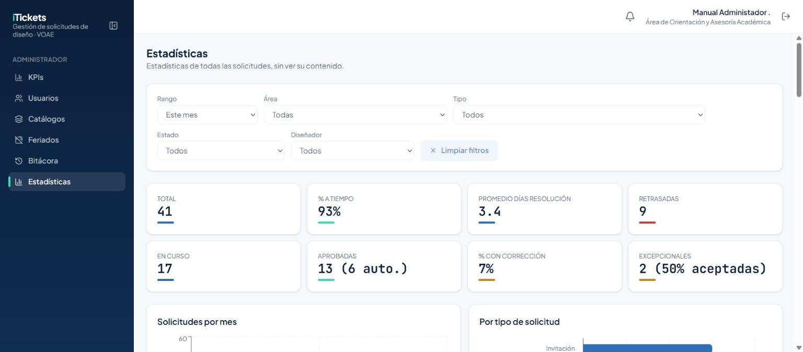

3. Debajo están las gráficas: solicitudes por mes, por tipo, por área, por estado, cumplimiento a
   tiempo por tipo y carga por diseñador. La de "Por tipo de solicitud" es horizontal para que los
   nombres largos (como "Grabación y edición de videos, spots o cortinas institucionales") se lean
   completos, partidos en dos líneas si hace falta.

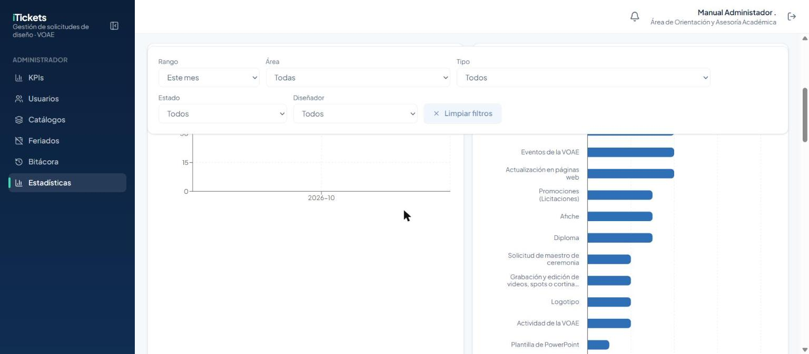

4. Más abajo hay una tabla de detalle con cada ticket, buscador por código (acepta con o sin guion)
   y dos botones para **exportar**: CSV y PDF.

> Importante: "Limpiar filtros" en la parte de arriba borra el rango, área, tipo, estado, diseñador
> y el texto de búsqueda de un solo clic.

# 8. Reglas importantes

| Tema | Regla |
|---|---|
| Nombre y apellidos | Al crear un usuario, nombre, primer apellido y segundo apellido son obligatorios. |
| Contraseña temporal | Se muestra **una sola vez** al crear la cuenta. Cópiala de inmediato. |
| Rol Asignador | Requiere que la cuenta ya tenga el rol **Diseñador**. |
| Desactivar un Diseñador | Sus tickets activos (En revisión, En proceso, Corrección, Retrasado) vuelven a "Sin asignar". Los Finalizados esperando dictamen se quedan con él. |
| Reactivar una cuenta | No le devuelve los tickets que tenía; el Asignador debe reasignarlos. |
| Feriados | Solo afectan a solicitudes creadas **después** de registrarlos. |
| Tipos de solicitud | Casi todos piden mínimo 10 días hábiles; Campaña publicitaria y Logotipo piden un mes de anticipación (DIRCOM). |
| Búsqueda de códigos | Ignora mayúsculas, tildes, guiones y espacios: "adh1" encuentra `ADH-0001`. |
| Horario hábil | Lunes a viernes, 8:00 a. m. a 4:00 p. m. (hora de Honduras). El Administrador puede trabajar en el sistema a cualquier hora. |

# 9. Preguntas frecuentes y problemas comunes

| Situación | Qué hacer |
|---|---|
| No veo la opción de darle el rol Asignador a alguien | Revisa que ya tenga el rol Diseñador; sin él, la opción aparece deshabilitada con *"(requiere Diseñador)"*. |
| Creé un usuario pero perdí la contraseña temporal | No se puede recuperar desde la pantalla de Usuarios; crea una cuenta nueva o pide ayuda técnica. |
| Desactivé a un diseñador y ahora hay tickets "Sin asignar" que antes no estaban ahí | Es el comportamiento esperado: sus tickets activos se liberaron. Pide al Asignador que los reparta de nuevo. |
| Reactivé a un diseñador y no le volvieron sus tickets | También es esperado: tiene que pedírselo al Asignador. |
| Un feriado no afectó la fecha límite de un ticket que ya existía | Los feriados no son retroactivos: solo valen para tickets creados después de registrarlos. |
| El solicitante no tiene un área válida asignada | Mensaje real del sistema al crear un ticket: revisa que el usuario tenga un área asignada en Usuarios. |
| Busco un código y no aparece nada | Prueba sin el guion ni espacios (por ejemplo "adh1" en vez de "ADH-0001"); el buscador los ignora igual. |

# 10. Glosario

- **Ticket:** una solicitud de diseño o comunicación, con su propio código (p. ej. `ADH-0001`).
- **Días hábiles:** lunes a viernes, sin contar los feriados activos registrados antes de crear el
  ticket.
- **Dictamen:** la decisión del Jefe de Área sobre un diseño entregado: Aprobar o pedir Corrección.
- **Excepcional:** una solicitud urgente que solo puede enviar un Jefe de Área, y que acepta o
  rechaza el Asignador.
- **Sin asignar:** un ticket que todavía no tiene diseñador, ya sea porque es nuevo o porque su
  diseñador fue desactivado.
- **Liberado:** un ticket que volvió a "Sin asignar" porque a su diseñador se le desactivó la
  cuenta o se le quitó el rol Diseñador (y no porque sea nuevo).
- **Asignado:** etiqueta que indica que el Asignador (no el propio diseñador) le puso ese ticket a
  alguien.
- **Bitácora:** el historial de cambios del sistema (roles, feriados, asignaciones).
