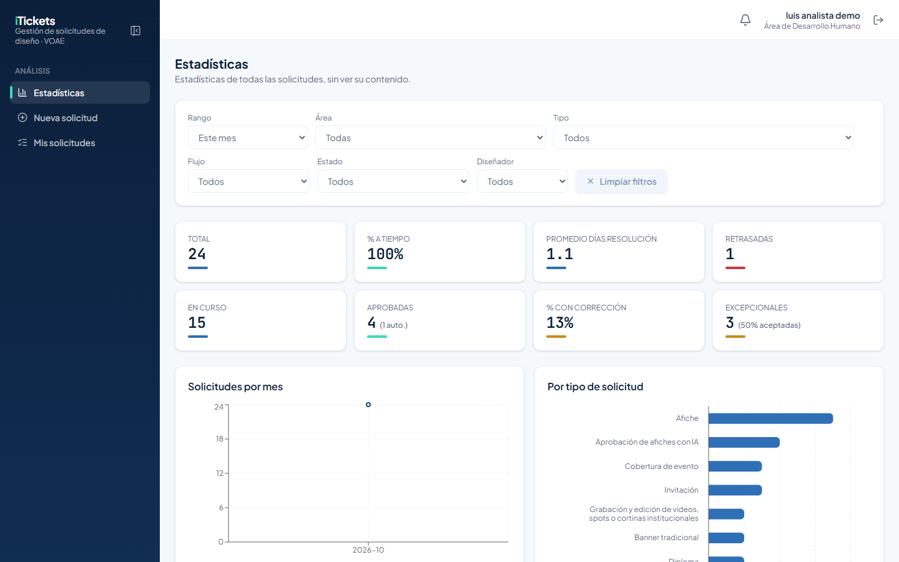
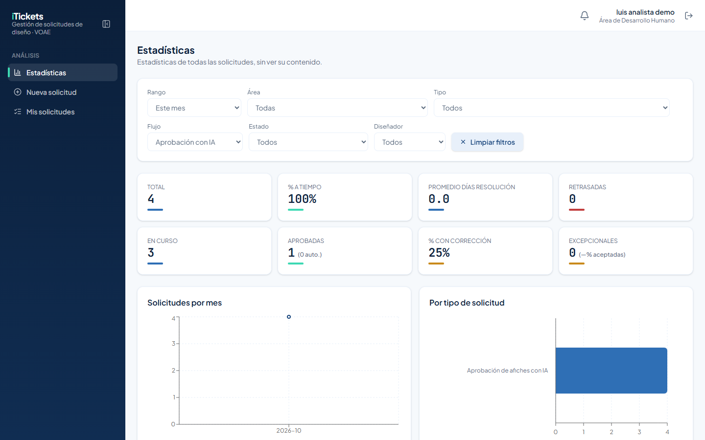
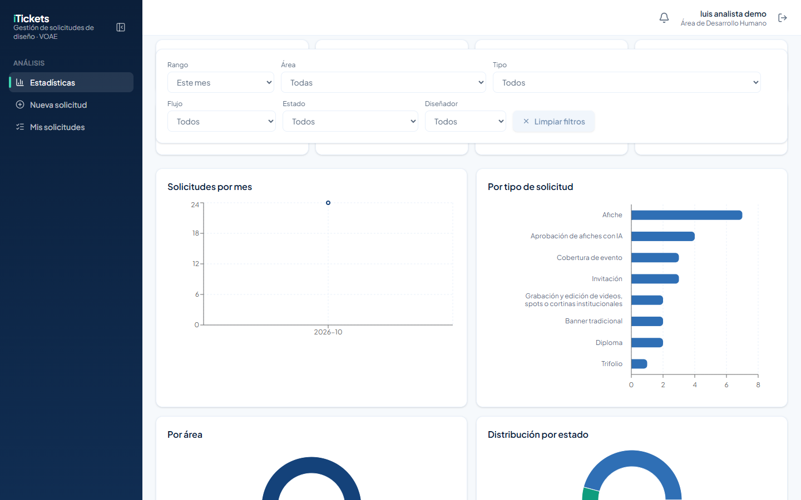
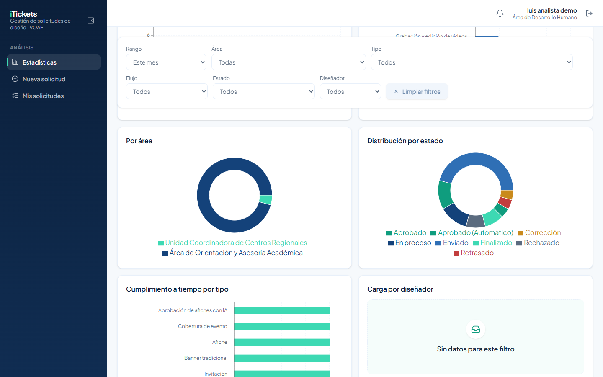
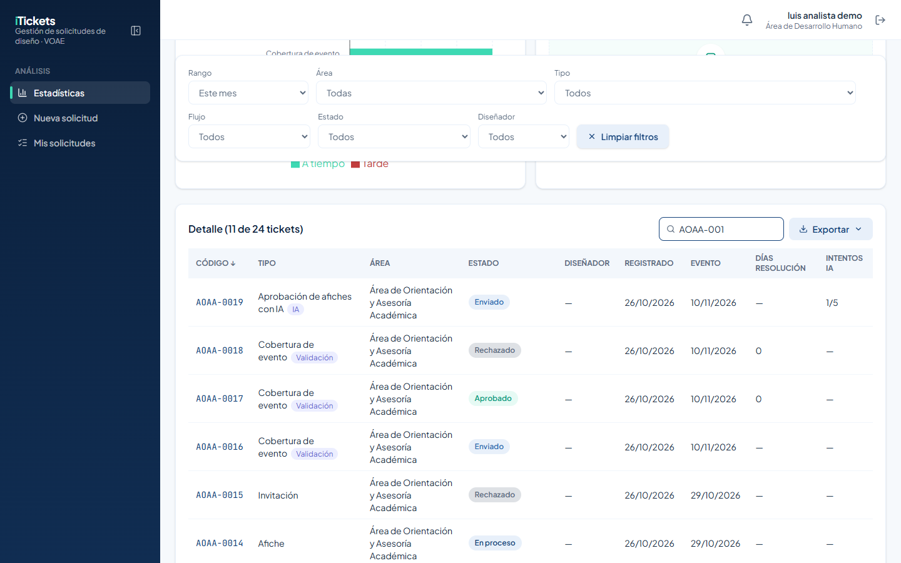
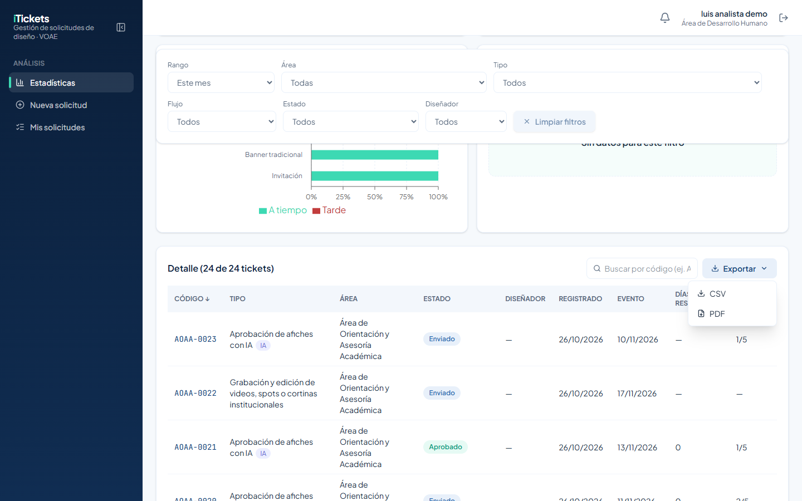
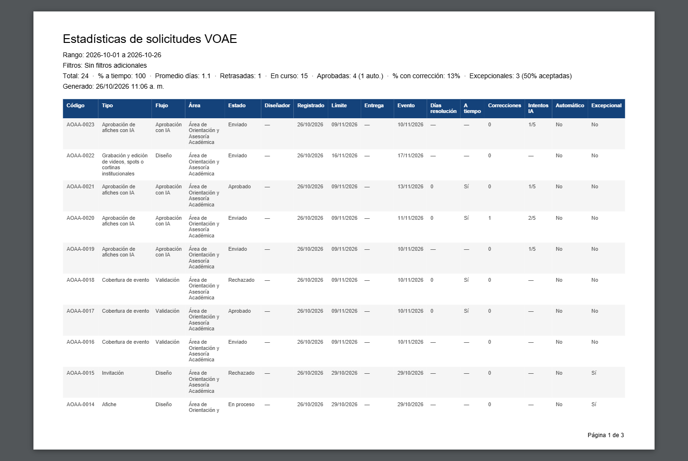
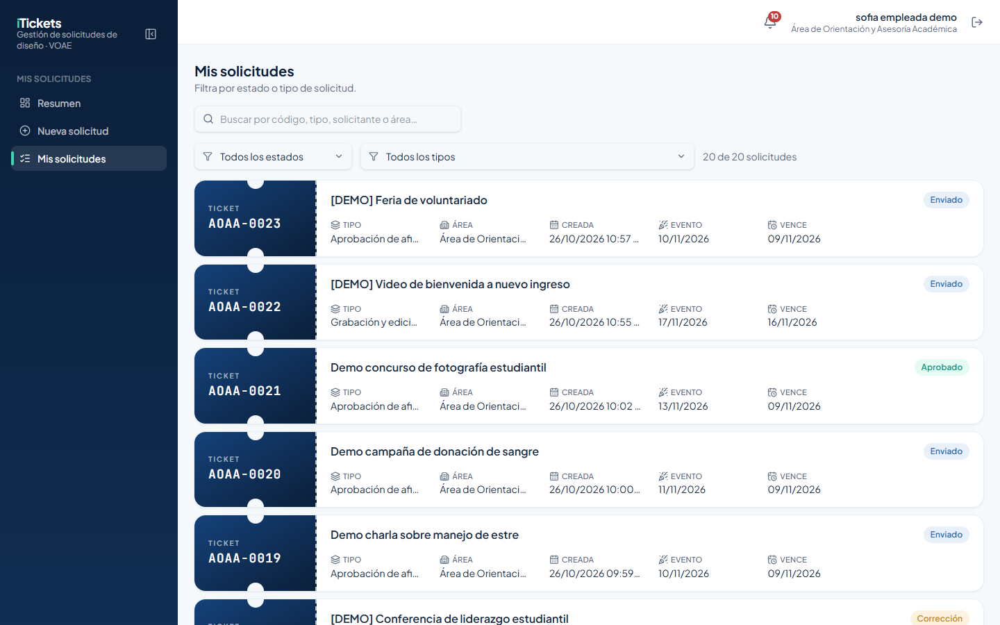

# 1. Introducción

**iTickets** es el sistema de la Vicerrectoría de Orientación y Asuntos Estudiantiles (VOAE) de la UNAH para pedir, producir y aprobar piezas de diseño y comunicación. Cada pedido es un **ticket** con un código único (por ejemplo `AOAA-0019`).

Este manual es para el rol **Analista**. Con iTickets puedes:

- Consultar las **Estadísticas** de todas las solicitudes, con filtros, indicadores y gráficas.
- Buscar tickets en la tabla de detalle y **exportarla** a PDF o CSV.
- Enviar tus propias solicitudes y seguirlas en **Mis solicitudes**.

Las estadísticas muestran cifras y estados, **no el contenido** de las solicitudes.

# 2. Acceso al sistema

## 2.1 Iniciar sesión

Entra a la dirección de iTickets en tu navegador.

1. Escribe tu **Correo**.
2. Escribe tu **Contraseña**. Para verla mientras la escribes, pulsa el ojo que está a la derecha del campo.
3. Pulsa **Ingresar**.

Si el correo o la contraseña no coinciden, aparece el aviso **"Correo o contraseña incorrectos."**.

> ¿Olvidaste tu contraseña? Pulsa **¿Olvidaste tu contraseña?**, escribe tu correo y pulsa **Enviar enlace**.

## 2.2 Primer ingreso y cambio de contraseña

La primera vez entras con una **contraseña temporal**. iTickets te pide crear una propia: escribe la **Contraseña nueva**, repítela en **Confirmar contraseña** y pulsa **Guardar contraseña**.

## 2.3 Conoce la pantalla

- **Menú lateral**, sección **Análisis**: **Estadísticas**, **Nueva solicitud** y **Mis solicitudes**. Con el botón junto a la palabra iTickets puedes plegarlo.
- **Campana**: te avisa de los cambios en tus propias solicitudes. Al hacer clic en una notificación se abre el ticket.
- **Tu nombre y tu área**, y el botón para **cerrar sesión**.

> Por seguridad, la sesión se cierra sola después de **20 minutos** sin actividad.

# 3. Estadísticas

**Estadísticas** es tu pantalla principal. Arriba están los filtros, después los indicadores, las gráficas y la tabla de detalle.

## 3.1 Filtros

| Filtro | Para qué sirve |
|---|---|
| **Rango** | Periodo de registro: **Este mes**, **Mes anterior**, **Últimos 3 meses**, **Este año** o **Personalizado** (eliges las fechas). |
| **Área** | Un área o coordinación en particular. |
| **Tipo** | Un tipo de solicitud (Afiche, Video, Trifolio…). |
| **Flujo** | **Diseño**, **Aprobación con IA** o **Validación** (coberturas de evento). |
| **Estado** | Enviado, En proceso, Aprobado, etc. |
| **Diseñador** | La persona del equipo de diseño. |

Cuando aplicas un filtro, todo se recalcula: indicadores, gráficas y tabla. **Limpiar filtros** los quita todos a la vez.

> Los filtros quedan **fijos** en la parte de arriba mientras bajas por la página, para que puedas cambiarlos sin volver al inicio. Además, se guardan en la dirección de la página: si la copias y la compartes, la otra persona ve la misma vista.

## 3.2 Indicadores

| Indicador | Qué mide |
|---|---|
| **Total** | Solicitudes en el periodo y filtros elegidos. |
| **% a tiempo** | Porcentaje entregado antes de su fecha límite. |
| **Promedio días resolución** | Días que tarda, en promedio, una solicitud en resolverse. |
| **Retrasadas** | Solicitudes que pasaron su fecha límite. |
| **En curso** | Solicitudes todavía abiertas. |
| **Aprobadas** | Solicitudes aprobadas (entre paréntesis, las aprobadas automáticamente). |
| **% con corrección** | Porcentaje que tuvo al menos una corrección. |
| **Excepcionales** | Solicitudes excepcionales y el porcentaje que fue aceptado. |

## 3.3 Gráficas

- **Solicitudes por mes**: cuántas se registraron cada mes.
- **Por tipo de solicitud**: barras horizontales, con el nombre completo de cada tipo.
- **Por área**: reparto entre áreas y coordinaciones.
- **Distribución por estado**: cuántas hay en cada estado.
- **Cumplimiento a tiempo por tipo**: a tiempo frente a tarde, por tipo.
- **Carga por diseñador**: tickets por persona del equipo de diseño.

> Para proteger la información del equipo, tu vista no muestra los nombres de quién diseña cada ticket: la columna **Diseñador** aparece con "—" y **Carga por diseñador** dice "Sin datos para este filtro".

## 3.4 Tabla de detalle

Al final está **Detalle**, con una fila por ticket: código, tipo, área, estado, fechas de registro y evento, días de resolución e intentos (en los afiches con IA). El título indica cuántos tickets se muestran de los que hay.

Escribe en el buscador un código (por ejemplo `AOAA-001`), un tipo o un área para encontrar un ticket:

# 4. Exportar

1. Aplica los filtros y la búsqueda que necesites.
2. Pulsa **Exportar**, a la derecha de la tabla.
3. Elige **CSV** (para abrirlo en Excel) o **PDF**.

El archivo se descarga con la tabla tal como la estás viendo. El PDF incluye arriba el rango, los filtros aplicados, los indicadores principales y la fecha en que se generó:

# 5. Enviar tus propias solicitudes

Como analista también puedes pedir trabajos al equipo de diseño:

1. En el menú, pulsa **Nueva solicitud** y elige el tipo.
2. Llena el formulario. El calendario solo deja elegir días hábiles posteriores a los días de producción del tipo.
3. Agrega los adjuntos (hasta 10, entre archivos y enlaces).
4. Revisa y pulsa **Enviar solicitud**.

En **Mis solicitudes** ves solo las tuyas, como boletos, con filtros por estado y tipo:

> Las solicitudes solo se envían en horario hábil: de lunes a viernes, de 8:00 a. m. a 4:00 p. m.

# 6. Reglas importantes

| Tema | Regla |
|---|---|
| Alcance | Ves las cifras de todas las solicitudes, pero no su contenido ni quién las diseña. |
| Filtros | Se recalcula todo con cada filtro. Quedan fijos al bajar y se guardan en la dirección de la página. |
| Exportación | CSV y PDF exportan la tabla filtrada. |
| Tus solicitudes | Solo en horario hábil, respetando los días de producción del tipo. |

# 7. Preguntas frecuentes y problemas comunes

| Situación | Qué hacer |
|---|---|
| Los indicadores salen en 0 | Revisa el **Rango** y los demás filtros; pulsa **Limpiar filtros**. |
| "Carga por diseñador" dice "Sin datos para este filtro" | Es normal en tu vista: esa información no se muestra a este rol. |
| El archivo CSV muestra caracteres raros en Excel | Ábrelo con **Datos > Desde texto/CSV** y elige UTF-8. |
| No encuentro un ticket en la tabla | Quita los filtros y busca por el código completo (por ejemplo `AOAA-0019`). |
| Quiero compartir una vista | Copia la dirección de la página: guarda los filtros. |

# 8. Glosario

| Término | Significado |
|---|---|
| **Flujo** | Camino de una solicitud: Diseño, Aprobación con IA o Validación. |
| **% a tiempo** | Porcentaje de solicitudes resueltas antes de su fecha límite. |
| **Días de resolución** | Días entre el registro y la resolución de un ticket. |
| **Excepcional** | Solicitud urgente enviada por un jefe de área. |
| **Intentos IA** | Envíos de un afiche con IA (máximo 5). |
| **CSV** | Archivo de texto con la tabla, para abrir en Excel. |
