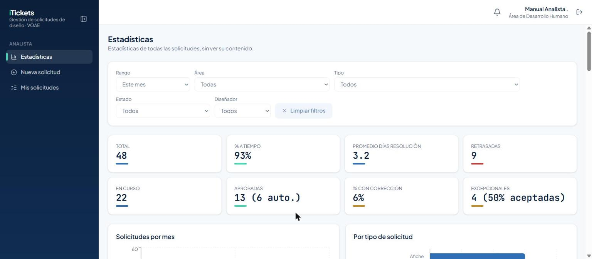
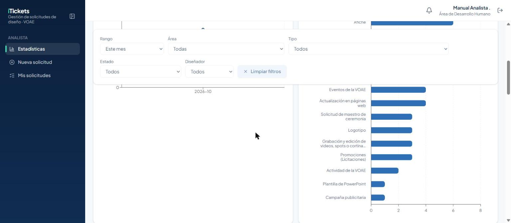
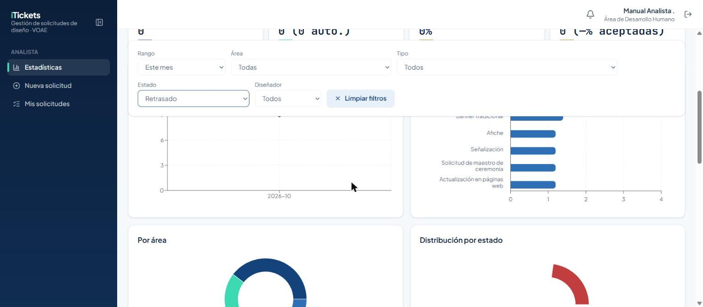
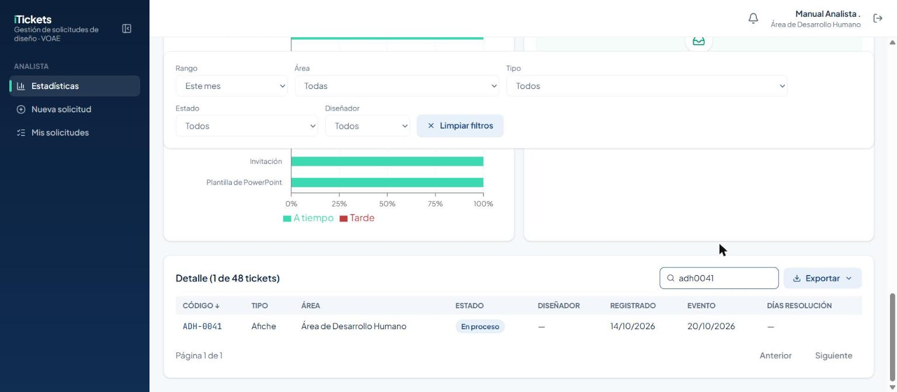
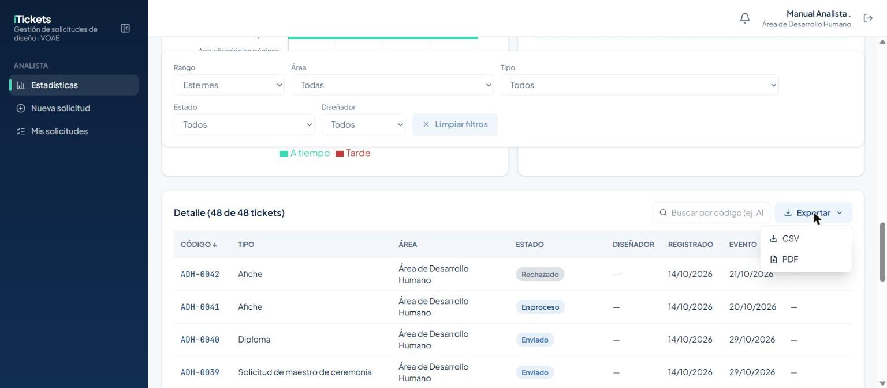
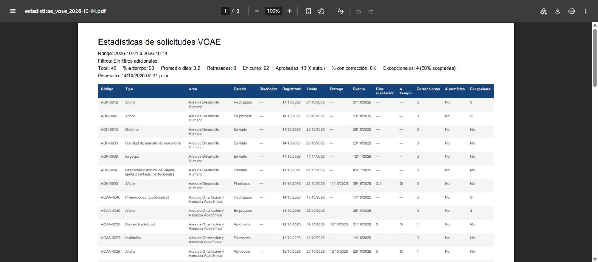

# 1. Introducción

**iTickets** es el sistema de la Vicerrectoría de Orientación y Asuntos Estudiantiles (VOAE) para
pedir, diseñar y aprobar solicitudes de diseño y comunicación: afiches, banners, videos, invitaciones,
señalización y más. Cada solicitud se convierte en un **ticket** con un código único (por ejemplo
`ADH-0001`) que se puede seguir de principio a fin.

Como **Analista** tienes una vista completa de las estadísticas del sistema, sin entrar al contenido
de cada solicitud. Este manual explica lo que solo tú puedes hacer:

- Consultar indicadores y gráficas de todas las solicitudes del sistema.
- Filtrar, buscar y exportar esos datos a CSV o PDF.

Además, como Analista también puedes **enviar solicitudes** y ver **"Mis solicitudes"**, igual que
un Empleado — para esa parte, consulta el manual del rol **Empleado**.

# 2. Acceso al sistema

## 2.1 Iniciar sesión

Entra a la dirección del sistema en tu navegador. Verás el boleto **iTickets** a la izquierda (en
pantallas grandes) y el formulario de inicio de sesión a la derecha:

1. Escribe tu **correo** y tu **contraseña**.
2. Pulsa **Ingresar**.

> Importante: usa el correo y la contraseña que te asignó el Administrador. Si olvidaste tu
> contraseña, usa el enlace **¿Olvidaste tu contraseña?** de la pantalla de inicio de sesión.

## 2.2 Primer ingreso y cambio de contraseña

La primera vez que entras con la contraseña temporal que te dieron, el sistema **te obliga a
cambiarla** antes de dejarte usar el resto de la aplicación. Escribe una contraseña nueva y
confírmala para continuar.

## 2.3 Conoce la pantalla

Una vez dentro verás:

- A la izquierda, el **menú lateral** con tres secciones: **Estadísticas**, **Nueva solicitud** y
  **Mis solicitudes**.
- Arriba a la derecha, la **campana de notificaciones** y tu nombre con el área a la que perteneces.
- Un botón para **cerrar sesión**, junto a tu nombre.

# 3. Estadísticas

La pantalla **Estadísticas** es la razón de ser de tu rol: una vista de todas las solicitudes del
sistema, sin importar el área, con indicadores, gráficas y una tabla de detalle.

## 3.1 Filtros e indicadores (KPIs)

Arriba tienes los filtros — **Rango** (con atajos como "Este mes"), **Área**, **Tipo**, **Estado** y
**Diseñador** — y debajo, ocho indicadores: total de solicitudes, % a tiempo, promedio de días de
resolución, retrasadas, en curso, aprobadas (y cuántas fueron automáticas), % con corrección y
excepcionales (con el % que fueron aceptadas).

Los filtros se quedan **fijos en pantalla** aunque bajes con el cursor por las gráficas o la tabla,
así siempre los tienes a mano.

Para quitar todos los filtros a la vez, pulsa **Limpiar filtros**.

## 3.2 Gráficas

Debajo de los indicadores hay seis gráficas: **Solicitudes por mes**, **Por tipo de solicitud**
(en barras horizontales, para que los nombres largos se lean completos), **Por área**,
**Distribución por estado**, **Cumplimiento a tiempo por tipo** y **Carga por diseñador**.

> Como Analista no ves quién tiene asignado cada ticket: la columna **Diseñador** de la tabla
> siempre muestra "—" y la gráfica **Carga por diseñador** aparece vacía. Es el mismo permiso que
> oculta esa información a cualquier rol que no sea Diseñador, Asignador, Jefe de Área o
> Administrador.

## 3.3 Tabla de detalle, búsqueda y exportación

Al final de la página, la tabla **Detalle** lista cada ticket que cumple los filtros, con paginación.
El buscador acepta el código con o sin guion.

El botón **Exportar** te deja elegir entre **CSV** y **PDF** — ambos descargan exactamente las filas
que ves en ese momento, ya filtradas.

El PDF incluye el rango de fechas, los filtros aplicados, los indicadores y la tabla completa, listo
para imprimir o compartir:

# 4. Reglas importantes

| Tema | Regla |
|---|---|
| Alcance | Ves estadísticas de **todas** las áreas y tipos de solicitud, sin ver el contenido de cada una. |
| Visibilidad de asignación | No ves quién tiene asignado cada ticket (columna Diseñador vacía, gráfica "Carga por diseñador" sin datos). |
| Búsqueda de códigos | Acepta con o sin guion: "adh41" no encuentra `ADH-0041` si falta el cero; usa "adh0041" o el código completo. |
| Exportar | CSV y PDF descargan exactamente las filas visibles con los filtros aplicados en ese momento. |
| Limpiar filtros | Borra rango, área, tipo, estado, diseñador y la búsqueda de un solo clic. |
| Horario | Consultas Estadísticas a cualquier hora; para enviar solicitudes aplican las mismas reglas que a un Empleado. |

# 5. Preguntas frecuentes y problemas comunes

| Situación | Qué hacer |
|---|---|
| Busco un código y no aparece nada | Revisa que los dígitos coincidan exactamente (con ceros incluidos); el buscador ignora guiones y espacios, no dígitos. |
| La gráfica "Carga por diseñador" aparece vacía | Es el comportamiento esperado: tu rol no ve esa información. |
| Exporté un PDF y no trae los filtros que esperaba | Revisa los filtros activos arriba antes de exportar; el PDF solo lleva lo que ves filtrado en ese momento. |
| Necesito enviar una solicitud o ver las mías | Usa **Nueva solicitud** o **Mis solicitudes** en el menú — funcionan igual que para un Empleado. |

# 6. Glosario

- **Ticket:** una solicitud de diseño o comunicación, con su propio código (p. ej. `ADH-0001`).
- **KPI:** indicador clave (total, % a tiempo, retrasadas, etc.) que resume el estado del sistema.
- **Excepcional:** una solicitud urgente que envía un Jefe de Área y acepta o rechaza el Asignador.
- **Aprobado (Automático):** un ticket que se aprobó solo porque el Jefe de Área no dictaminó a
  tiempo.
