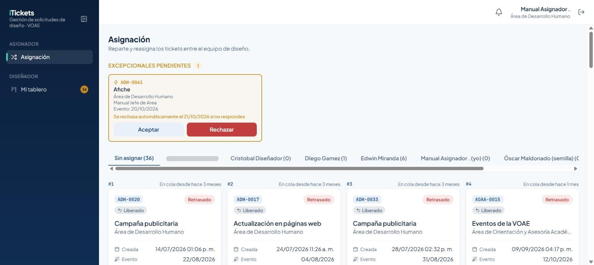
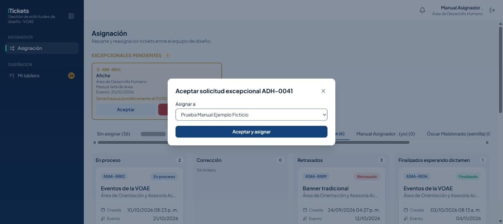
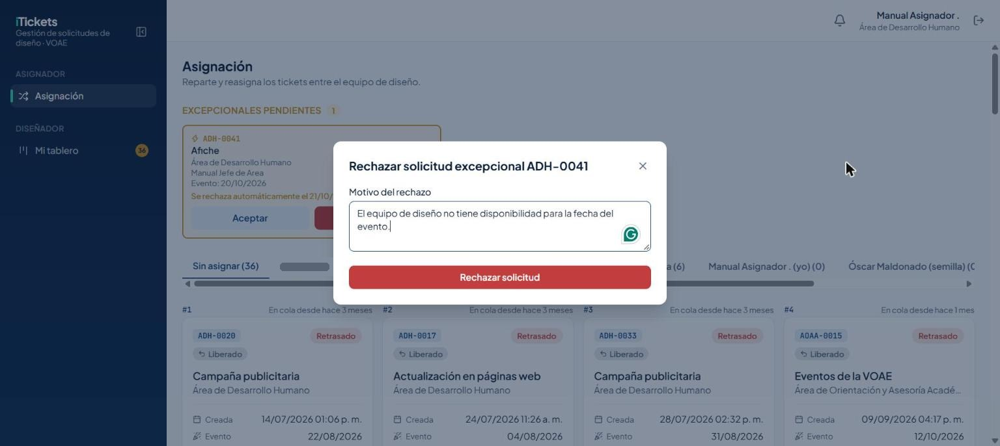
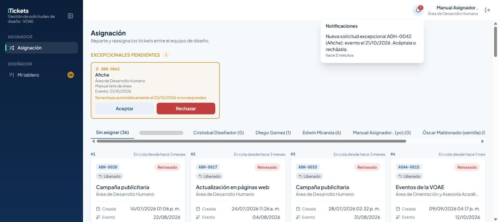
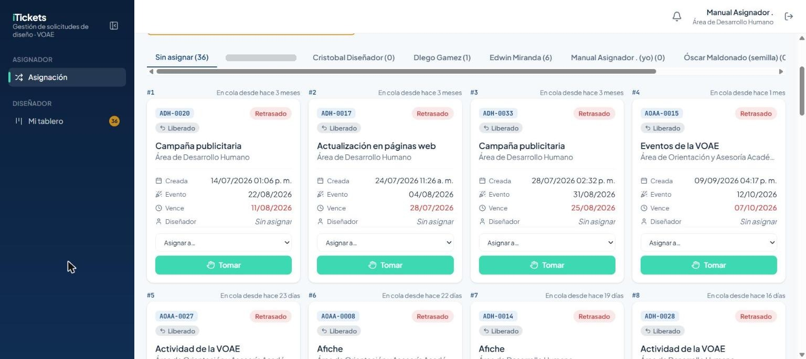
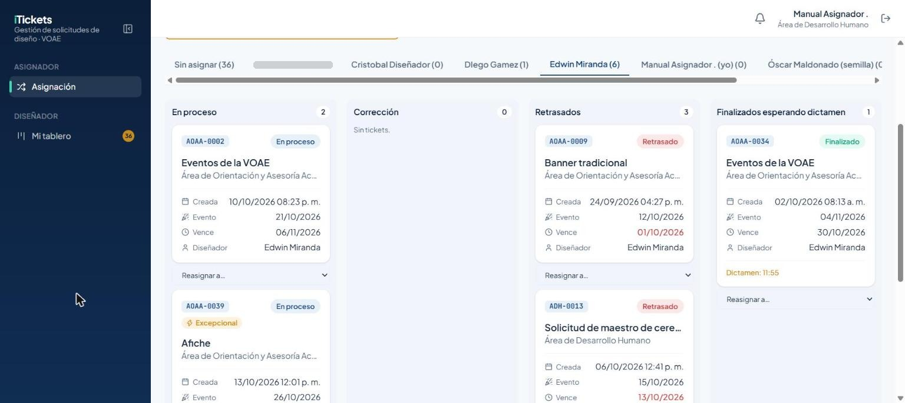
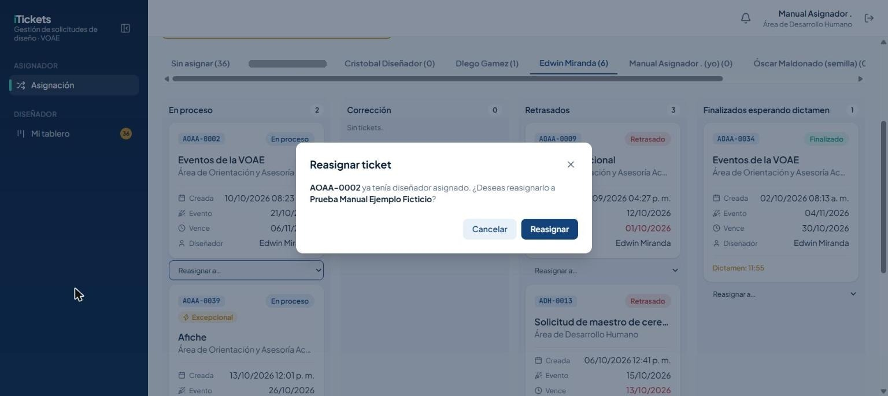

# 1. Introducción

**iTickets** es el sistema de la Vicerrectoría de Orientación y Asuntos Estudiantiles (VOAE) para
pedir, diseñar y aprobar solicitudes de diseño y comunicación: afiches, banners, videos, invitaciones,
señalización y más. Cada solicitud se convierte en un **ticket** con un código único (por ejemplo
`ADH-0001`) que se puede seguir de principio a fin.

Como **Asignador** reparte el trabajo entre el equipo de diseño. Este manual explica lo que solo tú
puedes hacer:

- Repartir los tickets nuevos entre los diseñadores disponibles.
- Reasignar un ticket de un diseñador a otro.
- Aceptar o rechazar las solicitudes excepcionales que envían los Jefes de Área.

El rol Asignador **siempre viene junto con el rol Diseñador**: tu cuenta también tiene la sección
**Mi tablero**, donde trabajas tus propios tickets igual que cualquier diseñador. Para esa parte,
consulta el manual del rol **Diseñador** — aquí solo se explica lo que es exclusivo de Asignación.

# 2. Acceso al sistema

## 2.1 Iniciar sesión

Entra a la dirección del sistema en tu navegador. Verás el boleto **iTickets** a la izquierda (en
pantallas grandes) y el formulario de inicio de sesión a la derecha:

1. Escribe tu **correo** y tu **contraseña**.
2. Pulsa **Ingresar**.

> Importante: usa el correo y la contraseña que te asignó el Administrador. Si olvidaste tu
> contraseña, usa el enlace **¿Olvidaste tu contraseña?** de la pantalla de inicio de sesión.

## 2.2 Primer ingreso y cambio de contraseña

La primera vez que entras con la contraseña temporal que te dieron, el sistema **te obliga a
cambiarla** antes de dejarte usar el resto de la aplicación. Escribe una contraseña nueva y
confírmala para continuar.

## 2.3 Conoce la pantalla

Una vez dentro verás:

- A la izquierda, el **menú lateral** con dos secciones: **Asignación** (lo tuyo como Asignador) y
  **Mi tablero** (lo tuyo como Diseñador), con el conteo de tus tickets activos.
- Arriba a la derecha, la **campana de notificaciones** (te avisa en tiempo real de lo que pasa en
  el sistema) y tu nombre con el área a la que perteneces.
- Un botón para **cerrar sesión**, junto a tu nombre.

# 3. Solicitudes excepcionales

Un **Jefe de Área** puede enviar una solicitud **excepcional** cuando tiene una urgencia: la envía
a cualquier hora y día, con al menos 2 días hábiles de anticipación a la fecha del evento. Mientras
nadie responda, queda **pendiente** en la parte de arriba de tu pantalla de Asignación, con un
contador de cuánto falta para que se rechace sola.

> Importante: si nadie la acepta ni la rechaza antes de la fecha del evento, el sistema la
> **rechaza automáticamente**.

## 3.1 Aceptar una excepcional

1. En la tarjeta **Excepcionales pendientes**, pulsa **Aceptar**.
2. Elige a qué diseñador se la vas a asignar.
3. Pulsa **Aceptar y asignar**.

El ticket pasa a **En proceso** (o se queda en el estado que tenía) con la etiqueta **Excepcional**,
y el diseñador elegido la ve de inmediato en "Mi tablero".

## 3.2 Rechazar una excepcional

1. En la tarjeta, pulsa **Rechazar**.
2. Escribe el **motivo del rechazo** — es obligatorio, y el Jefe de Área lo verá.
3. Pulsa **Rechazar solicitud**.

> Importante: ni aceptar ni rechazar se pueden deshacer. Revisa bien el diseñador o el motivo antes
> de confirmar.

## 3.3 Aviso de una nueva excepcional

La campana de notificaciones te avisa apenas llega una solicitud excepcional nueva, con el código y
la fecha del evento, para que no se te pase el plazo de respuesta.

# 4. Repartir los tickets sin asignar

La pestaña **Sin asignar** lista, en orden de llegada (el más antiguo primero, numerado #1, #2…),
todos los tickets que todavía no tienen diseñador.

Para cada ticket tienes dos formas de repartirlo:

- **Asignar a…**: elige un diseñador del selector. El ticket pasa a su lista de inmediato, sin pedir
  confirmación.
- **Tomar**: te lo asignas a ti mismo, igual que cualquier diseñador lo haría desde su propio
  tablero.

> Importante: respeta el orden de llegada (#1, #2…) salvo que haya una razón para saltarte la fila
> (por ejemplo, la carga de trabajo de cada diseñador).

Un ticket con la etiqueta **Liberado** volvió a esta lista porque al diseñador que lo tenía se le
desactivó la cuenta o se le quitó el rol Diseñador — no es un ticket nuevo.

# 5. Ver y reasignar el trabajo de un diseñador

Cada diseñador del equipo tiene su propia pestaña, con el número de tickets activos entre
paréntesis. La tuya aparece marcada con **"(yo)"**.

Dentro de la pestaña de un diseñador, sus tickets activos se agrupan en cuatro columnas: **En
proceso**, **Corrección**, **Retrasados** y **Finalizados esperando dictamen**.

Para pasarle un ticket a otro diseñador:

1. En la tarjeta del ticket, abre el selector **Reasignar a…**.
2. Elige el nuevo diseñador.
3. Como el ticket ya tenía dueño, el sistema te pide confirmación antes de mover.

Debajo de las columnas, el enlace **Aprobados y rechazados (últimos 30 días)** despliega el
historial reciente de ese diseñador, para revisar su trabajo ya cerrado sin salir de la pestaña.

# 6. Reglas importantes

| Tema | Regla |
|---|---|
| Quién puede ser Asignador | Solo una cuenta que ya tiene el rol **Diseñador** (lo asigna el Administrador). |
| Solicitud excepcional | La envía un Jefe de Área, con al menos 2 días hábiles de anticipación al evento. |
| Plazo de respuesta | Si nadie la acepta ni la rechaza antes de la fecha del evento, se **rechaza automáticamente**. |
| Motivo del rechazo | Obligatorio; el Jefe de Área que la envió lo ve. |
| Orden de "Sin asignar" | FIFO: el ticket que lleva más tiempo esperando aparece primero (#1). |
| Etiqueta Liberado | El ticket volvió a "Sin asignar" porque su diseñador fue desactivado, no porque sea nuevo. |
| Reasignar | Si el ticket ya tenía diseñador, el sistema pide confirmación antes de mover. |
| Horario | Trabajas a cualquier hora, incluso fuera del horario hábil. |

# 7. Preguntas frecuentes y problemas comunes

| Situación | Qué hacer |
|---|---|
| Acepté o rechacé una excepcional y la tarjeta sigue en "pendientes" | Recarga la página; la lista no se actualiza sola todavía. |
| No encuentro a un diseñador en el selector | Solo aparecen los usuarios con el rol Diseñador activo; pide al Administrador que revise su cuenta. |
| Reasigné un ticket por error | Vuelve a abrir su pestaña actual y reasígnalo de nuevo al diseñador correcto. |
| Una excepcional se rechazó sola sin que nadie la viera | Pasó la fecha límite de respuesta (2 días hábiles antes del evento) sin que nadie la aceptara ni la rechazara. |
| Tomé un ticket de "Sin asignar" y sigue apareciendo ahí | Igual que con las excepcionales: recarga la página para ver la lista al día. |

# 8. Glosario

- **Ticket:** una solicitud de diseño o comunicación, con su propio código (p. ej. `ADH-0001`).
- **Excepcional:** una solicitud urgente que solo puede enviar un Jefe de Área, y que tú aceptas o
  rechazas.
- **Sin asignar:** un ticket que todavía no tiene diseñador, ya sea porque es nuevo o porque su
  diseñador fue desactivado.
- **Liberado:** un ticket que volvió a "Sin asignar" porque a su diseñador se le desactivó la
  cuenta o se le quitó el rol Diseñador (y no porque sea nuevo).
- **Asignado:** etiqueta que indica que tú (el Asignador), y no el propio diseñador, le pusiste ese
  ticket a alguien.
- **FIFO:** "primero en entrar, primero en salir" — el orden en que aparecen los tickets en "Sin
  asignar", del más antiguo al más nuevo.
