# 1. Introducción

**iTickets** es el sistema de la Vicerrectoría de Orientación y Asuntos Estudiantiles (VOAE) de la UNAH para pedir, producir y aprobar piezas de diseño y comunicación. Cada pedido es un **ticket** con un código único (por ejemplo `AOAA-0007`).

Este manual es para el rol **Asignador**. Eres parte del equipo de diseño, con permisos extra para **distribuir el trabajo**:

- Ver todos los tickets del equipo de diseño en la pantalla **Asignación**.
- **Asignar** un ticket sin asignar a una persona del equipo, o **reasignarlo**.
- **Aceptar o rechazar** las solicitudes excepcionales. Al aceptarlas, eliges quién las hace.
- Además, haces todo lo que hace cualquier persona del equipo de diseño: tomar tickets, subir entregables y atender correcciones.

# 2. Acceso al sistema

## 2.1 Iniciar sesión

Entra a la dirección de iTickets en tu navegador.

1. Escribe tu **Correo**.
2. Escribe tu **Contraseña**. Para verla mientras la escribes, pulsa el ojo que está a la derecha del campo.
3. Pulsa **Ingresar**.

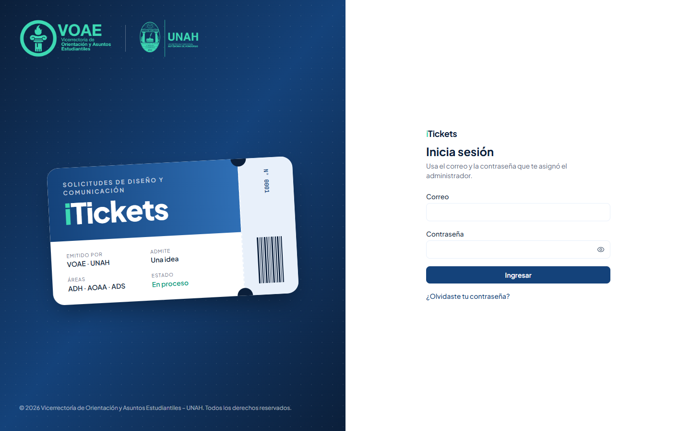

Si el correo o la contraseña no coinciden, aparece el aviso **"Correo o contraseña incorrectos."**.

> ¿Olvidaste tu contraseña? Pulsa **¿Olvidaste tu contraseña?**, escribe tu correo y pulsa **Enviar enlace**.

## 2.2 Primer ingreso y cambio de contraseña

La primera vez entras con una **contraseña temporal**. iTickets te pide crear una propia: escribe la **Contraseña nueva**, repítela en **Confirmar contraseña** y pulsa **Guardar contraseña**.

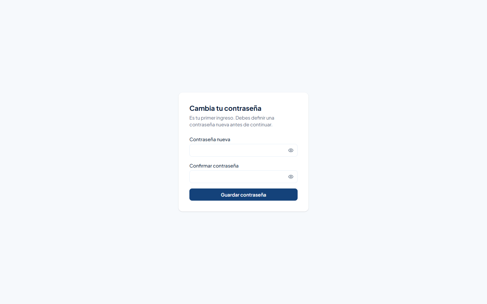

## 2.3 Conoce la pantalla

- **Menú lateral**, con dos secciones: **Distribución** (**Asignación**) y **Producción** (**Mi tablero**). El número amarillo junto a **Mi tablero** indica cuántos tickets sin asignar hay.
- **Campana**: te avisa de nuevas solicitudes excepcionales, de tickets que vuelven a la cola y de lo que pasa con tus propios tickets. Al hacer clic en una notificación se abre el ticket.
- **Tu nombre**, y el botón para **cerrar sesión**.

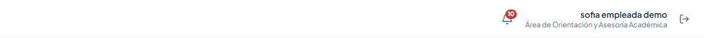

> Por seguridad, la sesión se cierra sola después de **20 minutos** sin actividad.

# 3. La pantalla Asignación

**Asignación** reúne todo el trabajo del equipo de diseño:

- Arriba, **Excepcionales pendientes**: las urgencias que esperan tu respuesta.
- Debajo, una pestaña **Sin asignar** y una pestaña por cada persona del equipo, con el número de tickets activos de cada una. La tuya dice **(yo)**.

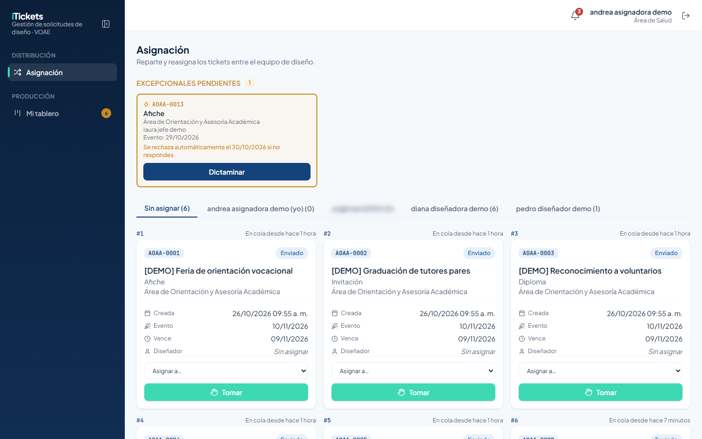

# 4. Responder solicitudes excepcionales

Una **solicitud excepcional** la envía un jefe de área para una urgencia, con al menos 2 días hábiles de anticipación. Solo tú puedes aceptarla o rechazarla.

> Cada tarjeta indica la fecha en que la solicitud **se rechaza automáticamente** si nadie responde. Atiéndelas primero.

## 4.1 Aceptar

1. En la tarjeta de la excepcional, pulsa **Dictaminar**.
2. Deja elegida la opción **Aceptar**.
3. En **Asignar a**, elige a la persona que la va a trabajar (puedes ser tú).
4. Pulsa **Aceptar y asignar**.

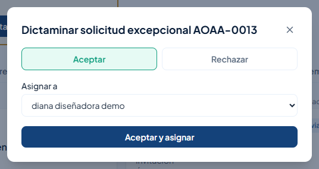

El ticket pasa a **En proceso** con las etiquetas **Excepcional** y **Asignado**, y la persona elegida recibe un aviso.

## 4.2 Rechazar

1. Pulsa **Dictaminar**.
2. Elige **Rechazar**.
3. Escribe el **Motivo del rechazo**. Es obligatorio; el jefe del área lo verá.
4. Pulsa **Rechazar solicitud**.

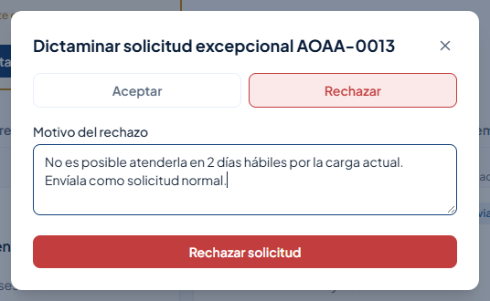

> Cada excepcional se responde **una sola vez**. Si ya fue respondida, verás "Esta solicitud ya fue respondida.".

# 5. Asignar tickets sin asignar

La pestaña **Sin asignar** muestra los tickets que nadie ha tomado, **en orden de llegada**: **#1** es el que lleva más tiempo esperando. Cada tarjeta indica cuánto tiempo lleva **en cola**.

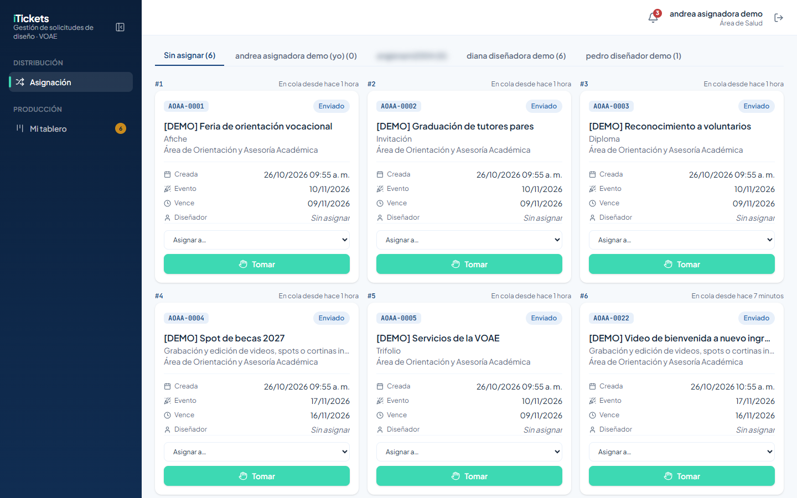

En cada tarjeta tienes dos opciones:

- **Asignar a…**: elige a una persona del equipo y el ticket queda asignado **en ese momento**. Pasa a **En proceso** con la etiqueta **Asignado**.
- **Tomar**: te quedas con el ticket para trabajarlo tú.

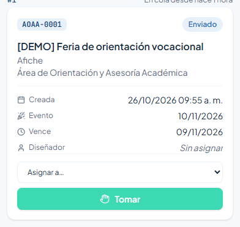

> **Asignar a…** no pide confirmación: en cuanto eliges un nombre, el ticket se asigna. Revisa bien el nombre antes de soltar el selector.

# 6. Ver y reasignar el trabajo de una persona

Pulsa la pestaña de una persona para ver sus tickets organizados en **En proceso**, **Corrección**, **Retrasados** y **Finalizados esperando dictamen**. Al final, **Aprobados y rechazados (últimos 30 días)** muestra lo que ya cerró.

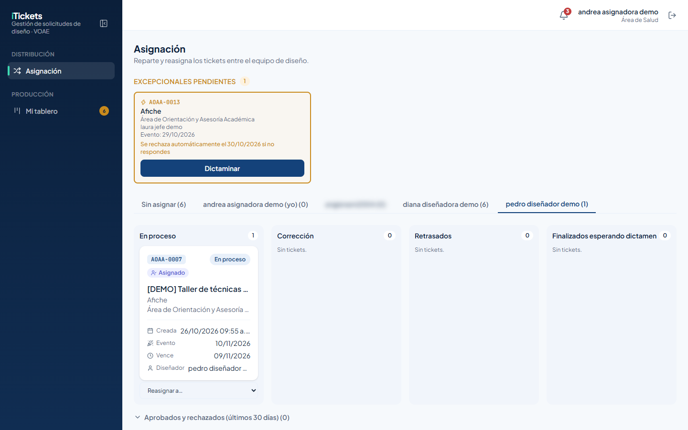

Para pasarle un ticket a otra persona:

1. En la tarjeta, abre **Reasignar a…** y elige a la persona.
2. Aparece la ventana **Reasignar ticket**. Pulsa **Reasignar** para confirmar, o **Cancelar**.

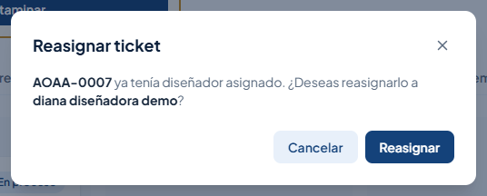

La persona nueva recibe un aviso y el cambio queda registrado en la bitácora de asignaciones.

## 6.1 Tickets que vuelven a la cola

Si el administrador desactiva la cuenta de una persona del equipo, sus tickets activos vuelven a **Sin asignar** con la etiqueta **Liberado**, y tú recibes una notificación. Asígnalos de nuevo lo antes posible.

# 7. Tus propias tareas de diseño

Como parte del equipo de diseño, también usas **Mi tablero**. Resumen:

1. En **Tickets sin asignación**, pulsa **Tomar** para quedarte con un ticket.
2. En **Mis tickets**, sigue tus tickets por columna.
3. Abre el ticket y pulsa **Subir entregable** para entregar un archivo o un enlace. El ticket pasa a **Finalizado**.
4. Si el jefe del área pide una corrección, lee el comentario en **Dictámenes** y sube la nueva versión.

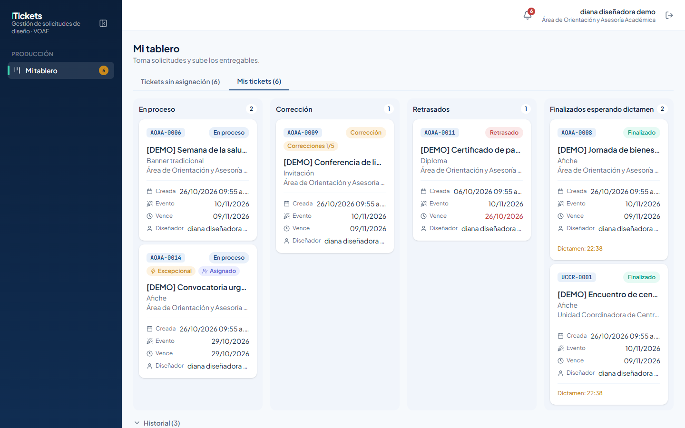

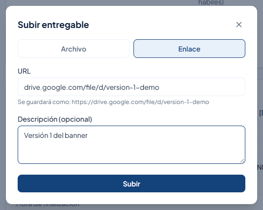

Para más detalle, consulta el **Manual de Usuario – Rol: Diseñador**.

# 8. Reglas importantes

| Tema | Regla |
|---|---|
| Excepcionales | Solo tú las aceptas o rechazas, una sola vez. Al aceptar eliges quién la hace; al rechazar, el motivo es obligatorio. |
| Rechazo automático | Si nadie responde una excepcional antes de la fecha indicada, se rechaza sola. |
| Asignar | **Asignar a…** asigna al instante, sin confirmación. |
| Reasignar | **Reasignar a…** pide confirmación. |
| Orden | Los tickets sin asignar se numeran por orden de llegada (#1 es el más antiguo). |
| Horario | Puedes asignar, reasignar y responder excepcionales a cualquier hora. |
| Cuentas desactivadas | Sus tickets activos vuelven a Sin asignar con la etiqueta **Liberado** y te llega un aviso. |

# 9. Preguntas frecuentes y problemas comunes

| Situación | Qué hacer |
|---|---|
| Asigné un ticket a la persona equivocada | Abre la pestaña de esa persona y usa **Reasignar a…** para pasarlo a quien corresponde. |
| "Esta solicitud ya fue respondida." | Otra persona o el propio sistema ya la respondió (o se rechazó automáticamente). Recarga la página. |
| No puedo rechazar una excepcional | Escribe el **Motivo del rechazo**: es obligatorio. |
| Una persona del equipo aparece con 0 tickets y no la encuentro en Asignar a… | Puede estar desactivada. Consulta con el administrador. |
| Me llegó un aviso de tickets liberados | Revisa **Sin asignar**: los tickets con etiqueta **Liberado** necesitan una nueva persona. |

# 10. Glosario

| Término | Significado |
|---|---|
| **Asignación** | Pantalla para distribuir el trabajo del equipo de diseño. |
| **Asignar** | Darle a una persona un ticket sin asignar (al instante). |
| **Reasignar** | Pasar un ticket de una persona a otra (con confirmación). |
| **Solicitud excepcional** | Pedido urgente de un jefe de área; tú lo aceptas o rechazas. |
| **En cola** | Tiempo que un ticket lleva sin asignar. |
| **Liberado** | Ticket que volvió a la cola porque su responsable fue desactivado. |
| **Entregable** | Archivo o enlace con el diseño. |
