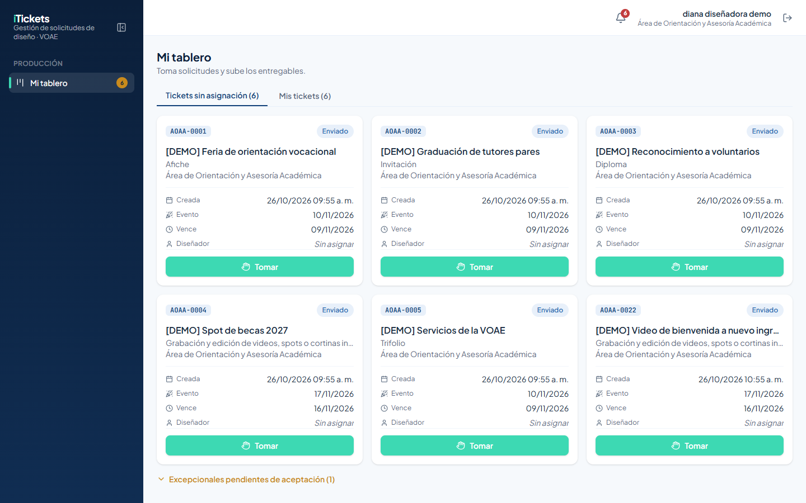
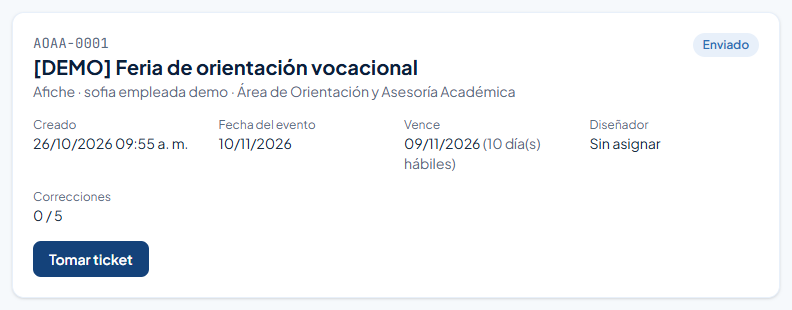
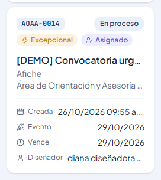
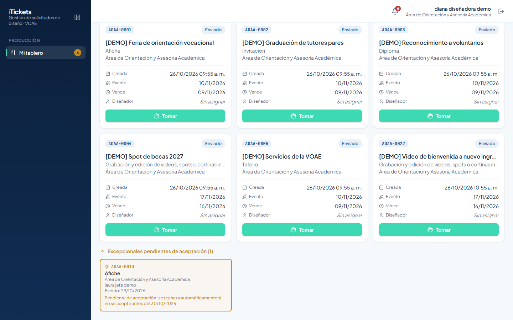
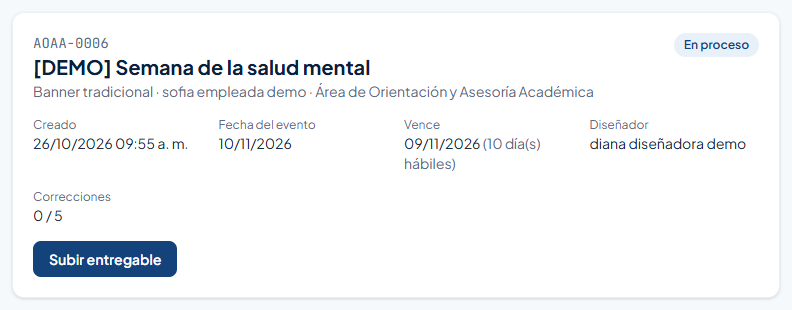
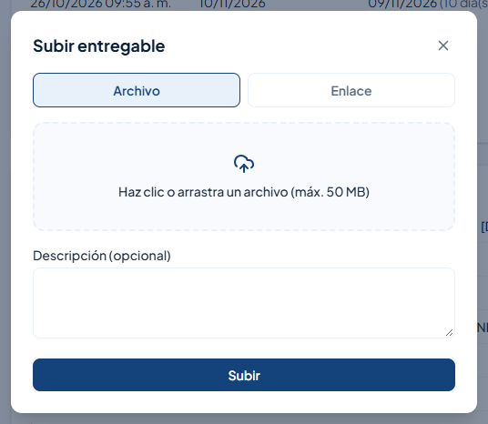
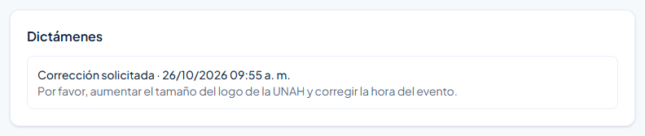
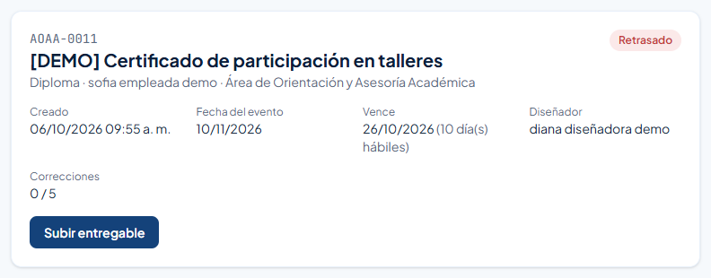

# 1. Introducción

**iTickets** es el sistema de la Vicerrectoría de Orientación y Asuntos Estudiantiles (VOAE) de la UNAH para pedir, producir y aprobar piezas de diseño y comunicación. Cada pedido es un **ticket** con un código único (por ejemplo `AOAA-0006`).

Este manual es para el rol **Diseñador**: la persona del equipo de diseño que produce las piezas. Con iTickets puedes:

- Ver las solicitudes que esperan a alguien del equipo y **tomarlas** en orden de llegada.
- Recibir los tickets que te **asignan**.
- Ver tus tickets organizados por estado en **Mis tickets**.
- **Subir los entregables** (archivo o enlace) y las nuevas versiones cuando te piden una corrección.

Tú trabajas a **cualquier hora**: tomar tickets y subir entregables no depende del horario hábil.

# 2. Acceso al sistema

## 2.1 Iniciar sesión

Entra a la dirección de iTickets en tu navegador.

1. Escribe tu **Correo**.
2. Escribe tu **Contraseña**. Para verla mientras la escribes, pulsa el ojo que está a la derecha del campo.
3. Pulsa **Ingresar**.

Si el correo o la contraseña no coinciden, aparece el aviso **"Correo o contraseña incorrectos."**.

> ¿Olvidaste tu contraseña? Pulsa **¿Olvidaste tu contraseña?**, escribe tu correo y pulsa **Enviar enlace**.

## 2.2 Primer ingreso y cambio de contraseña

La primera vez entras con una **contraseña temporal**. iTickets te pide crear una propia: escribe la **Contraseña nueva**, repítela en **Confirmar contraseña** y pulsa **Guardar contraseña**.

## 2.3 Conoce la pantalla

- **Menú lateral**, sección **Producción**: **Mi tablero**. El número amarillo junto a **Mi tablero** indica cuántos tickets sin asignar puedes tomar. Con el botón junto a la palabra iTickets puedes plegar el menú.
- **Campana**: te avisa en tiempo real cuando te asignan un ticket, cuando te piden una corrección o cuando un ticket se retrasa. Al hacer clic en una notificación se abre el ticket.
- **Tu nombre**, y el botón para **cerrar sesión**.

> Por seguridad, la sesión se cierra sola después de **20 minutos** sin actividad.

# 3. Tomar un ticket

## 3.1 Tickets sin asignación

**Mi tablero** abre en la pestaña **Tickets sin asignación**: las solicitudes que todavía no tienen a nadie del equipo, **en orden de llegada** (la más antigua primero). Cada tarjeta muestra el código, el título, el tipo, el área, las fechas y el botón **Tomar**.

Para tomar uno:

1. Pulsa **Tomar** en la tarjeta. También puedes abrir el ticket y pulsar **Tomar ticket**.
2. El ticket pasa a **En proceso**, queda a tu nombre y aparece en **Mis tickets**.

> Toma los tickets en orden: el primero de la lista es el que lleva más tiempo esperando. Si otra persona del equipo lo tomó un momento antes, verás un aviso y el ticket desaparecerá de la lista.

## 3.2 Tickets que te asignan

La persona que distribuye el trabajo de diseño también puede **asignarte** un ticket. Te llega una notificación y el ticket aparece directamente en **Mis tickets** con la etiqueta **Asignado**.

# 4. Mis tickets

La pestaña **Mis tickets** organiza tu trabajo en columnas:

| Columna | Qué contiene |
|---|---|
| **En proceso** | Tickets que estás trabajando. |
| **Corrección** | Tickets donde el jefe del área pidió cambios. Muestra "Correcciones X/5". |
| **Retrasados** | Tickets que pasaron su fecha límite sin entrega. |
| **Finalizados esperando dictamen** | Tickets que ya entregaste. Muestra el tiempo que le queda al jefe del área para dictaminar. |

Al final, **Historial** guarda los tickets ya cerrados.

## 4.1 Etiquetas

| Etiqueta | Significado |
|---|---|
| **Asignado** | Te lo asignó la persona que distribuye el trabajo de diseño. |
| **Excepcional** | Es una solicitud urgente. Atiéndela primero. |
| **Liberado** | Volvió a la cola porque la persona que lo tenía ya no está activa en el sistema. |

## 4.2 Excepcionales pendientes de aceptación

Al final de **Tickets sin asignación** está la sección **Excepcionales pendientes de aceptación**. Ahí ves las solicitudes urgentes que todavía no fueron aceptadas. **No se pueden tomar** hasta que la persona que distribuye el trabajo las acepte y elija quién las hará.

# 5. Subir un entregable

Los entregables se suben **desde el detalle del ticket**.

1. Abre el ticket (desde **Mis tickets** o desde la notificación).
2. Pulsa **Subir entregable**.

3. Elige **Archivo** y arrastra el diseño al recuadro (o haz clic para buscarlo),

   o elige **Enlace** y pega la dirección (por ejemplo, de Drive). Puedes pegarla sin `https://`: debajo verás "Se guardará como…".

4. Si quieres, escribe una **Descripción (opcional)**.
5. Pulsa **Subir**.

El ticket pasa a **Finalizado** y le llega al jefe del área para que lo dictamine. Cada entrega queda guardada como una **versión** (Versión 1, Versión 2…), y el solicitante también puede verla.

> Revisa bien antes de subir: el jefe del área tiene 24 horas hábiles para dictaminar. Si no lo hace, el ticket se aprueba solo.

# 6. Corregir un diseño

Si el jefe del área pide cambios, el ticket vuelve a ti en la columna **Corrección** y te llega una notificación. En el detalle, la sección **Dictámenes** muestra el comentario con lo que hay que cambiar:

1. Haz los cambios que se piden.
2. Pulsa **Subir entregable** y sube la nueva versión.
3. El ticket vuelve a **Finalizado** y espera un nuevo dictamen.

> Un ticket admite hasta **5 correcciones**. Después de la quinta, el jefe del área solo puede aprobarlo.

# 7. Tickets retrasados

Si un ticket pasa su fecha límite (**Vence**) sin entrega, queda **Retrasado**: aparece en la columna **Retrasados** y la fecha se marca en rojo. Todavía puedes entregarlo con **Subir entregable**.

# 8. Reglas importantes

| Tema | Regla |
|---|---|
| Horario | Tomas tickets y subes entregables a cualquier hora. |
| Orden | Los tickets sin asignación se muestran en orden de llegada: el más antiguo primero. |
| Excepcionales | No se pueden tomar hasta que se acepten; la persona que distribuye el trabajo elige quién las hace. |
| Entregables | Se suben desde el detalle del ticket, como archivo o enlace. Cada entrega es una nueva versión. |
| Correcciones | Máximo 5 por ticket. |
| Plazos | Cada tipo tiene sus días hábiles de producción. Si pasa la fecha límite, el ticket queda Retrasado. |
| Dictamen | El jefe del área tiene 24 horas hábiles para dictaminar; si no, se aprueba solo. |

# 9. Preguntas frecuentes y problemas comunes

| Situación | Qué hacer |
|---|---|
| Pulsé **Tomar** y salió un aviso de que otra persona ya lo tomó | Alguien del equipo lo tomó antes. Toma el siguiente de la lista. |
| No puedo tomar una excepcional | Todavía no la aceptan. Espera a que te la asignen. |
| "El ticket … no puede pasar a "Finalizado" sin un entregable de diseño." | Sube al menos un archivo o un enlace con **Subir entregable**. |
| No encuentro un ticket que tenía | Si ya se cerró, está en **Historial**, al final de **Mis tickets**. |
| Mi ticket dice **Liberado** | Volvió a la cola porque quien lo tenía ya no está activo. Si lo tomas, revisa los entregables anteriores. |
| El enlace que pegué no empieza con `https://` | No pasa nada: el sistema lo completa. Revisa "Se guardará como…". |

# 10. Glosario

| Término | Significado |
|---|---|
| **Mi tablero** | Tu pantalla principal, con las pestañas Tickets sin asignación y Mis tickets. |
| **Tomar** | Quedarte con un ticket sin asignar para trabajarlo. |
| **Entregable** | Archivo o enlace con el diseño. Cada entrega es una versión. |
| **Dictamen** | La decisión del jefe del área: aprobar o pedir corrección. |
| **Corrección** | Cambios que pide el jefe del área, con un comentario. Máximo 5. |
| **Retrasado** | Ticket que pasó su fecha límite sin entrega. |
| **Asignado / Excepcional / Liberado** | Etiquetas de las tarjetas (ver sección 4.1). |
