# 1. Introducción

**iTickets** es el sistema de la Vicerrectoría de Orientación y Asuntos Estudiantiles (VOAE) para
pedir, diseñar y aprobar solicitudes de diseño y comunicación: afiches, banners, videos, invitaciones,
señalización y más. Cada solicitud se convierte en un **ticket** con un código único (por ejemplo
`ADH-0001`) que se puede seguir de principio a fin.

Como **Diseñador** eres quien convierte las solicitudes en el diseño final. Este manual explica lo
que solo tú puedes hacer:

- Tomar tickets de la cola de "Sin asignación".
- Subir tus entregables (archivos o enlaces).
- Seguir tus tickets activos hasta que el Jefe de Área los dictamine.

# 2. Acceso al sistema

## 2.1 Iniciar sesión

Entra a la dirección del sistema en tu navegador. Verás el boleto **iTickets** a la izquierda (en
pantallas grandes) y el formulario de inicio de sesión a la derecha:

1. Escribe tu **correo** y tu **contraseña**.
2. Pulsa **Ingresar**.

> Importante: usa el correo y la contraseña que te asignó el Administrador. Si olvidaste tu
> contraseña, usa el enlace **¿Olvidaste tu contraseña?** de la pantalla de inicio de sesión.

## 2.2 Primer ingreso y cambio de contraseña

La primera vez que entras con la contraseña temporal que te dieron, el sistema **te obliga a
cambiarla** antes de dejarte usar el resto de la aplicación. Escribe una contraseña nueva y
confírmala para continuar.

## 2.3 Conoce la pantalla

Una vez dentro verás:

- A la izquierda, el **menú lateral** con una sola sección: **Mi tablero**, con el número de tus
  tickets activos en una burbuja.
- Arriba a la derecha, la **campana de notificaciones** (te avisa en tiempo real de asignaciones,
  correcciones y aprobaciones) y tu nombre con el área a la que perteneces.
- Un botón para **cerrar sesión**, junto a tu nombre.

> Si además tienes el rol **Asignador**, verás una sección más arriba del menú para repartir el
> trabajo del equipo; eso se explica en el manual del Asignador.

# 3. Tomar un ticket

En **Mi tablero**, la pestaña **Tickets sin asignación** lista, en orden de llegada (el más antiguo
primero, numerado #1, #2…), todos los tickets que todavía no tiene nadie.

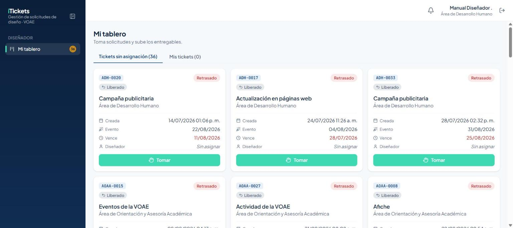

1. Revisa el código, el tipo de solicitud y la fecha límite de la tarjeta que te interese.
2. Pulsa **Tomar**.

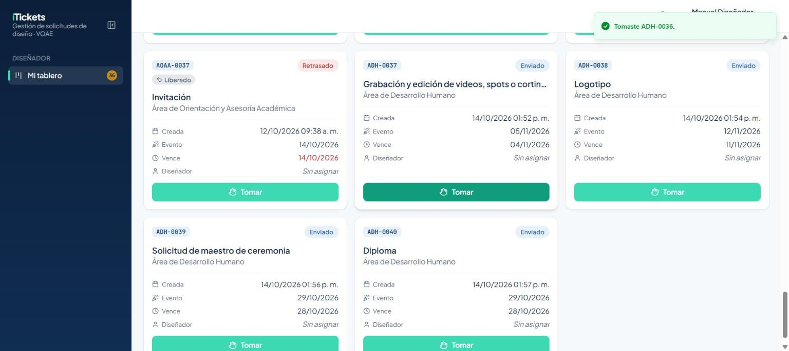

> Importante: si otro diseñador toma el mismo ticket un segundo antes que tú, el sistema te avisa
> con el mensaje "Otro diseñador ya tomó …" y la tarjeta desaparece de la cola. No es un error: solo
> significa que llegaste tarde.

Una etiqueta **Liberado** en una tarjeta significa que ese ticket ya tuvo diseñador antes, pero
volvió a la cola porque a esa persona se le desactivó la cuenta o se le quitó el rol Diseñador — no
es un ticket nuevo. Una etiqueta **Excepcional** marca una solicitud urgente que aceptó el Asignador.
Si el Asignador te asignó un ticket directamente (sin que tú lo tomaras), lo verás con la etiqueta
**Asignado**.

# 4. Mis tickets

La pestaña **Mis tickets** organiza tu trabajo activo en cuatro columnas: **En proceso**,
**Corrección**, **Retrasados** y **Finalizados esperando dictamen**.

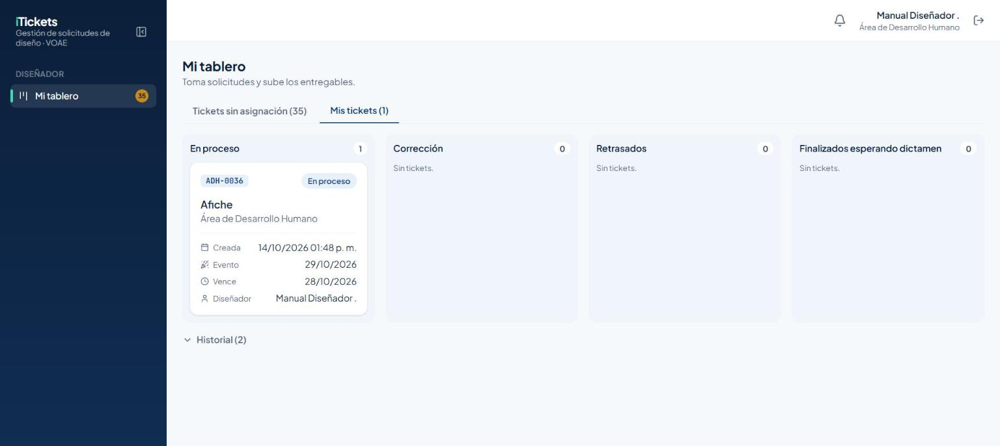

Debajo de las columnas, el enlace **Historial** despliega tus tickets ya cerrados (aprobados o
rechazados) de los últimos días, para que puedas consultarlos sin que estorben en tu tablero activo.

# 5. Subir un entregable

Abre el ticket desde cualquiera de sus tarjetas para ver el detalle completo: el título, la fecha
límite (con los días hábiles u corridos que le quedan), el conteo de correcciones usadas y el botón
**Subir entregable**.

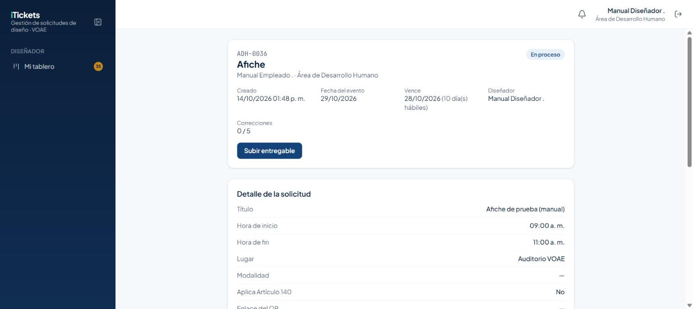

Al pulsar **Subir entregable**, eliges entre dos pestañas:

- **Archivo**: arrastra o elige el archivo desde tu equipo y, si quieres, agrega una descripción.

  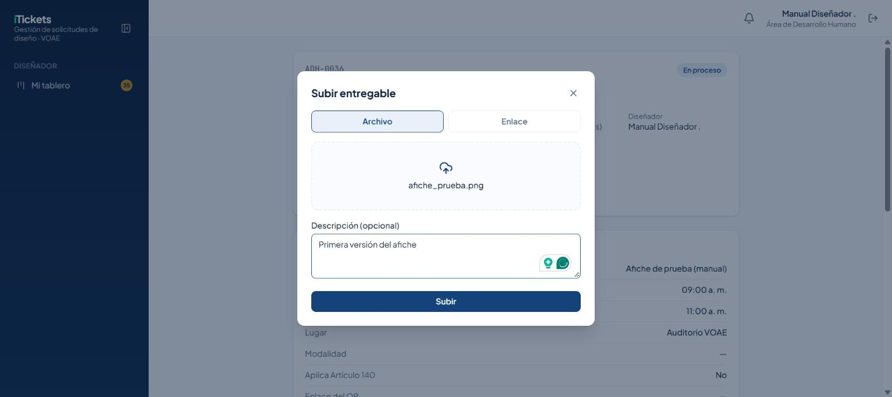

- **Enlace**: pega la URL (por ejemplo, a una carpeta de Drive o Figma) y, si quieres, una
  descripción.

  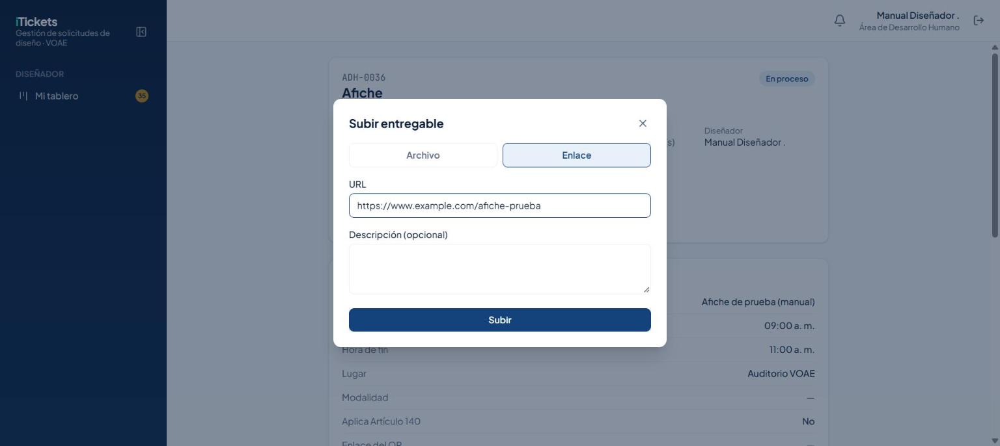

Al guardar, tu entrega aparece en la sección **Entregables** del ticket, agrupada como
**Versión 1**, junto a los **Adjuntos del solicitante** (lo que la persona que pidió el ticket anexó
al enviarlo) y el **Progreso de la solicitud**, que avanza al paso "Dictamen del jefe".

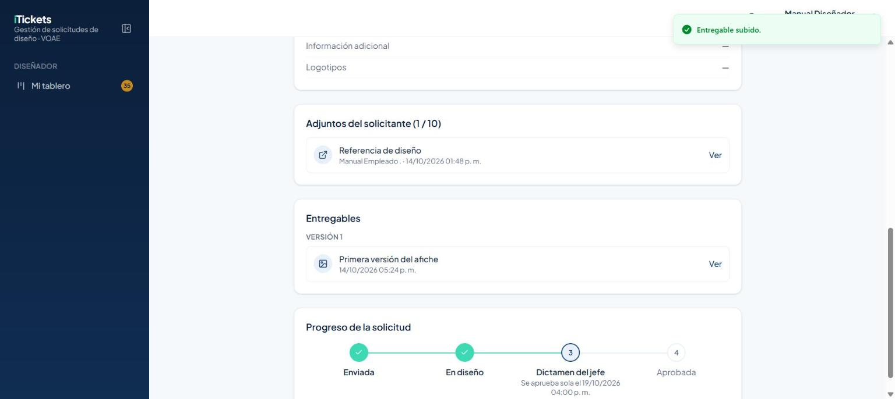

> Importante: subir el primer entregable de un ticket lo pasa automáticamente a **Finalizado**, en
> espera del dictamen del Jefe de Área — ya no puedes editarlo ni seguir trabajándolo hasta que el
> jefe pida una corrección.

El ticket ya Finalizado muestra un cronómetro con las horas hábiles que le quedan al Jefe de Área
para dictaminar: si no dictamina a tiempo, el ticket **se aprueba solo**.

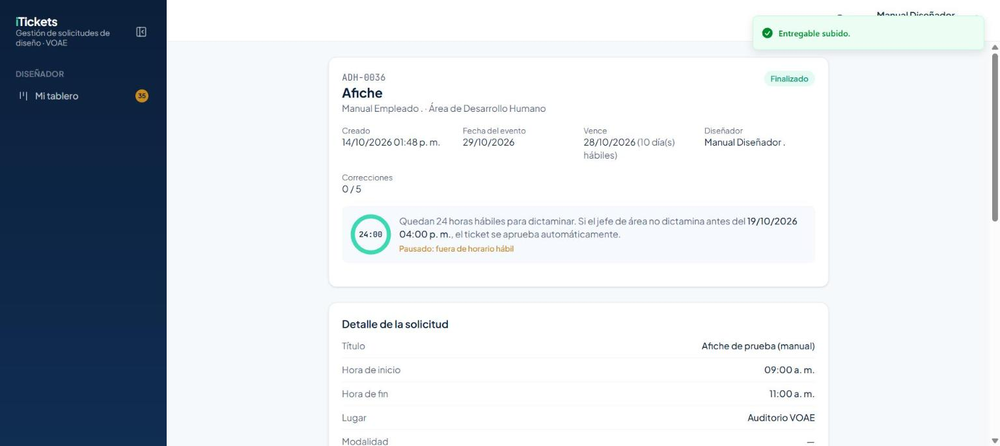

Y en tu tablero, la tarjeta pasa a la columna **Finalizados esperando dictamen**:

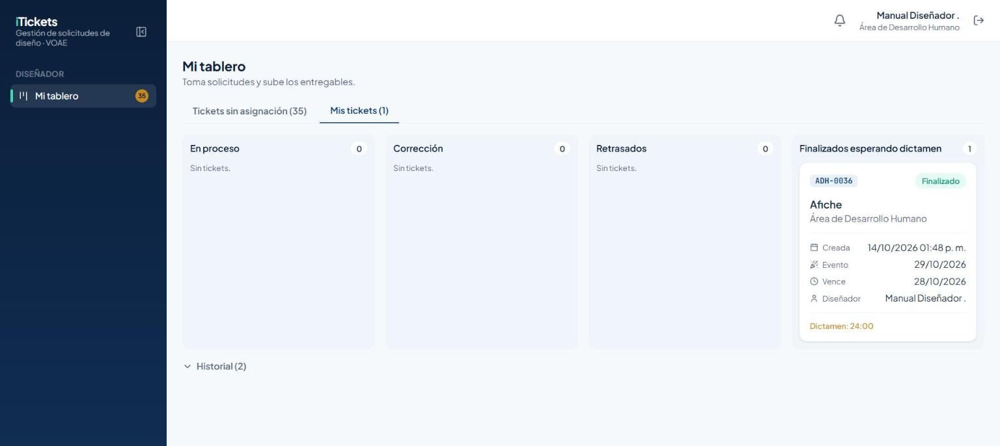

> El cronómetro **se pausa fuera del horario hábil** (lunes a viernes, 8:00 a. m. a 4:00 p. m., hora
> de Honduras) y sigue corriendo cuando vuelve a empezar la jornada.

# 6. Si el Jefe de Área pide una corrección

Si el jefe no aprueba el diseño, el ticket vuelve a tu tablero en la columna **Corrección**, con la
etiqueta de correcciones usadas:

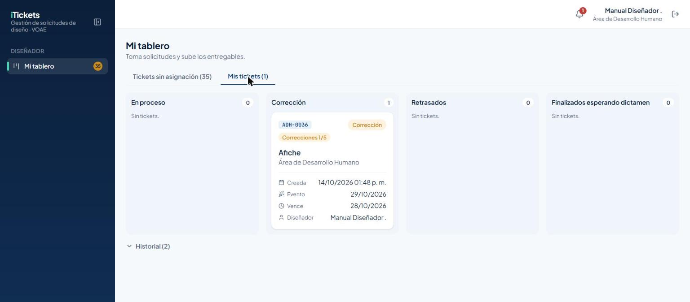

Abre el ticket y repite los pasos de la sección 5 para subir la **siguiente versión**: el
entregable nuevo se agrega como **Versión 2** (y así sucesivamente), siempre debajo de las
anteriores, que no se borran. El comentario del jefe explicando qué hay que cambiar queda en la
sección **Dictámenes** del ticket, justo encima de la barra de progreso.

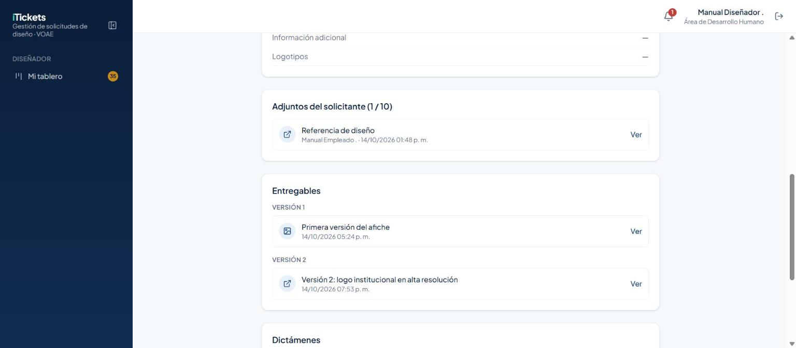

> Importante: cada ticket tiene un máximo de **5 correcciones**. El contador del detalle (por
> ejemplo "2/5") te avisa cuántas lleva. Después de la quinta, el jefe ya solo puede **aprobar** —
> no puede pedir una corrección más.

# 7. Reglas importantes

| Tema | Regla |
|---|---|
| Orden de "Sin asignación" | FIFO: el ticket que lleva más tiempo esperando aparece primero (#1). |
| Subir el primer entregable | Pasa el ticket a **Finalizado** y arranca el plazo de dictamen del jefe. |
| Dictamen del jefe | Tiene 24 horas hábiles desde que subes el entregable. Si no dictamina, el ticket se **aprueba solo**. |
| Correcciones | Máximo 5 por ticket. Cada versión nueva se agrega sin borrar las anteriores. |
| Etiqueta Liberado | El ticket volvió a la cola porque su diseñador anterior fue desactivado. |
| Etiqueta Asignado | El Asignador te puso este ticket directamente, sin que lo tomaras tú. |
| Etiqueta Excepcional | Es una solicitud urgente que aceptó el Asignador. |
| Horario | Trabajas a cualquier hora, incluso fuera del horario hábil. |

# 8. Preguntas frecuentes y problemas comunes

| Situación | Qué hacer |
|---|---|
| Pulsé "Tomar" y me dice que otro diseñador ya lo tomó | Alguien te ganó por segundos; elige otro ticket de la cola. |
| Subí un entregable y ya no puedo editar el ticket | Es correcto: al subirlo, el ticket pasa a Finalizado, a la espera del dictamen. |
| El cronómetro del dictamen no avanza | Está fuera del horario hábil; se pausa de 4:00 p. m. a 8:00 a. m. y los fines de semana. |
| Un ticket volvió a mi tablero con comentario del jefe | Te pidió corrección: revisa el comentario y sube la siguiente versión. |
| No veo la opción de pedir más de 5 correcciones | Es el límite del sistema; a partir de la quinta, el jefe solo puede aprobar. |

# 9. Glosario

- **Ticket:** una solicitud de diseño o comunicación, con su propio código (p. ej. `ADH-0001`).
- **Entregable:** el archivo o enlace que subes como resultado de tu trabajo en un ticket.
- **Versión:** cada entrega sucesiva de un mismo ticket (Versión 1, Versión 2…), cuando hay
  correcciones de por medio.
- **Dictamen:** la decisión del Jefe de Área sobre un diseño entregado: Aprobar o pedir Corrección.
- **Liberado:** un ticket que volvió a "Sin asignación" porque a su diseñador se le desactivó la
  cuenta o se le quitó el rol Diseñador.
- **Asignado:** etiqueta que indica que el Asignador, y no tú, le puso ese ticket a alguien.
- **Excepcional:** una solicitud urgente que envió un Jefe de Área y aceptó el Asignador.
