# 1. Introducción

**iTickets** es el sistema de la Vicerrectoría de Orientación y Asuntos Estudiantiles (VOAE) de la UNAH para pedir piezas de diseño y comunicación: afiches, banners, invitaciones, videos, trifolios, señalización, coberturas de eventos y más. Cada pedido se convierte en un **ticket** con un código único (por ejemplo `AOAA-0010`) que puedes seguir de principio a fin.

Este manual es para el rol **Empleado**: la persona que pide el trabajo. Con iTickets puedes:

- Enviar una **solicitud de diseño** y adjuntar lo que el equipo necesita (logos, textos, enlaces).
- Pedir la **aprobación de un afiche hecho con IA** que tú mismo preparaste.
- Pedir la **cobertura fotográfica o de video** de un evento.
- Seguir el estado de tus solicitudes y descargar los diseños entregados.

El código del ticket empieza con el prefijo de tu área o coordinación: `AOAA-0001`, `ADH-0001`, `ADS-0001`, `UCCR-0001`, etc.

# 2. Acceso al sistema

## 2.1 Iniciar sesión

Entra a la dirección de iTickets en tu navegador.

1. Escribe tu **Correo**.
2. Escribe tu **Contraseña**. Si quieres verla mientras la escribes, pulsa el ojo que está a la derecha del campo.
3. Pulsa **Ingresar**.

Si el correo o la contraseña no coinciden, aparece el aviso **"Correo o contraseña incorrectos."** arriba a la derecha. Revisa que no tengas activadas las mayúsculas y vuelve a intentarlo.

> ¿Olvidaste tu contraseña? Pulsa **¿Olvidaste tu contraseña?**, escribe tu correo y pulsa **Enviar enlace**. Te llegará un correo con un enlace para crear una contraseña nueva.

## 2.2 Primer ingreso y cambio de contraseña

La primera vez que entras, usas la **contraseña temporal** que te dio el administrador del sistema. Antes de dejarte continuar, iTickets te pide crear una contraseña propia:

1. Escribe la **Contraseña nueva**.
2. Repítela en **Confirmar contraseña**.
3. Pulsa **Guardar contraseña**.

> La contraseña nueva debe ser distinta de la temporal. Si es muy corta, verás "La contraseña es demasiado débil o corta.".

## 2.3 Conoce la pantalla

- **Menú lateral** (izquierda): **Resumen**, **Nueva solicitud** y **Mis solicitudes**.
- **Campana** (arriba a la derecha): te avisa en tiempo real cuando tu solicitud cambia de estado. El número rojo indica cuántas notificaciones tienes. Al hacer clic en una notificación se abre el ticket.
- **Tu nombre y tu área**, y el botón para **cerrar sesión** (la flecha que sale de la puerta).

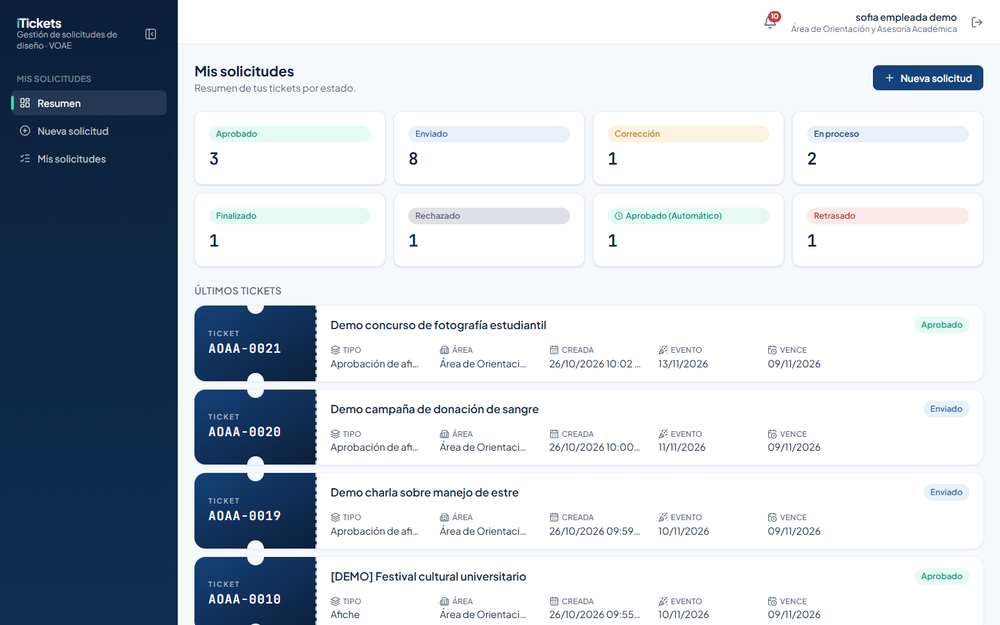

Si necesitas más espacio, pliega el menú con el botón que está junto a la palabra iTickets; quedan solo los íconos. Vuelve a pulsarlo para desplegarlo.

En el celular, el menú se abre con el botón de tres rayas de la esquina superior izquierda.

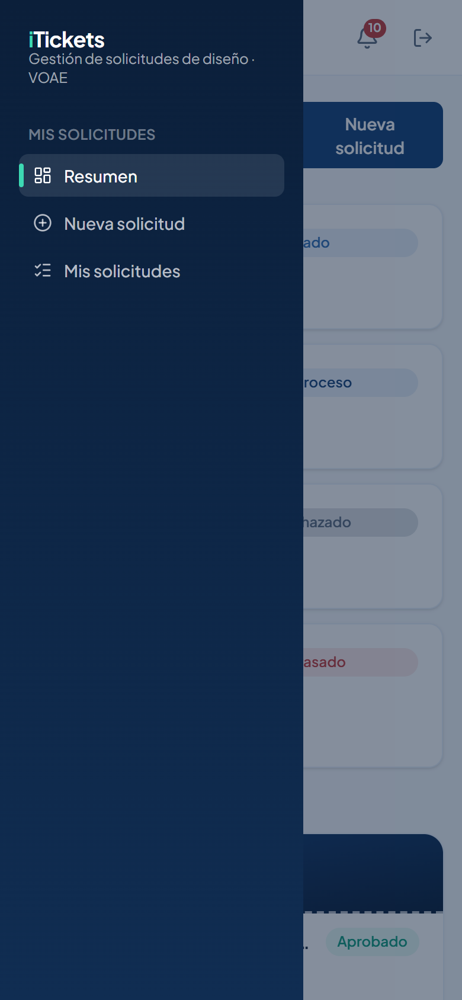

> Por seguridad, si pasas **20 minutos** sin usar iTickets, la sesión se cierra sola. Vuelve a iniciar sesión para continuar.

# 3. Resumen

**Resumen** es la primera pantalla que ves. Muestra cuántas solicitudes tienes en cada estado y tus últimos tickets. Pulsa un ticket para ver su detalle, o **Nueva solicitud** para pedir algo nuevo.

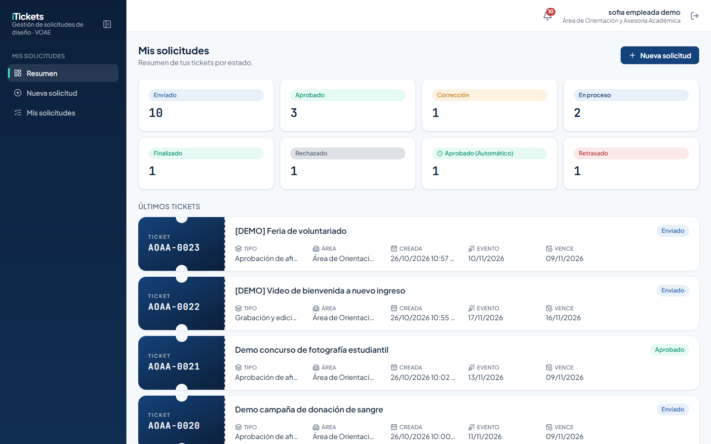

# 4. Enviar una solicitud de diseño

Una solicitud se envía en cuatro pasos: **1. Tipo**, **2. Formulario**, **3. Adjuntos** y **4. Revisar y enviar**.

> Las solicitudes solo se envían en **horario hábil**: de lunes a viernes, de 8:00 a. m. a 4:00 p. m. (hora de Honduras), sin contar feriados. Fuera de ese horario puedes llenar el formulario, pero el botón **Enviar solicitud** queda deshabilitado.

## 4.1 Elegir el tipo de solicitud

1. En el menú, pulsa **Nueva solicitud**.
2. Busca el tipo de pieza. Los tipos están agrupados en **Arte**, **Video**, **DIRCOM**, **Protocolo** y **Otros**. Debajo de cada nombre ves cuántos **días hábiles** necesita el equipo para producirla.
3. Pulsa la tarjeta del tipo que necesitas.

Si no encuentras el tipo, escribe parte del nombre en **Buscar tipo de solicitud…**:

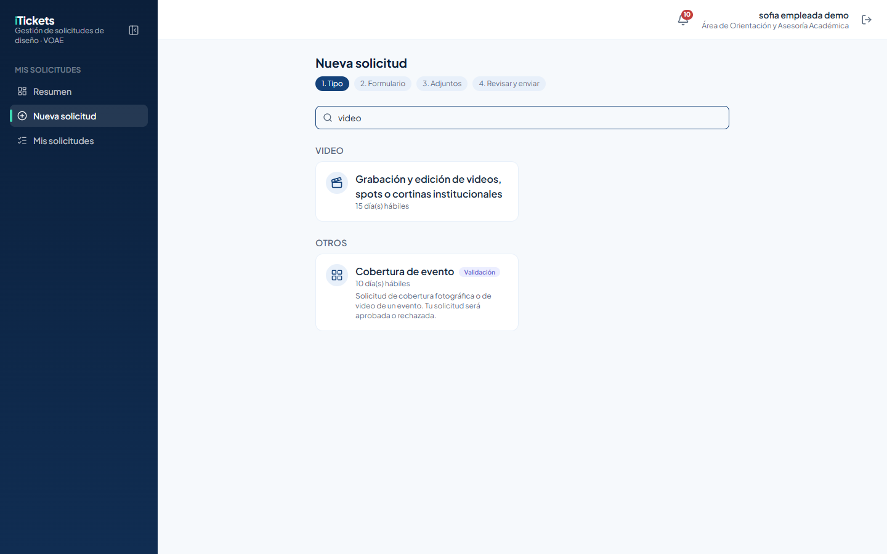

## 4.2 Llenar el formulario

Todas las solicitudes empiezan con los mismos datos generales:

- **Título**: un nombre corto para reconocer tu solicitud.
- **Fecha del evento**: el día en que se usará la pieza.
- **Dirigido a**: el público (estudiantes, docentes, personal administrativo…).
- **Alcance**: los campus donde se difundirá. Puedes usar **Seleccionar todos**.

Debajo vienen los campos propios de cada tipo. Los que tienen asterisco (`*`) son obligatorios.

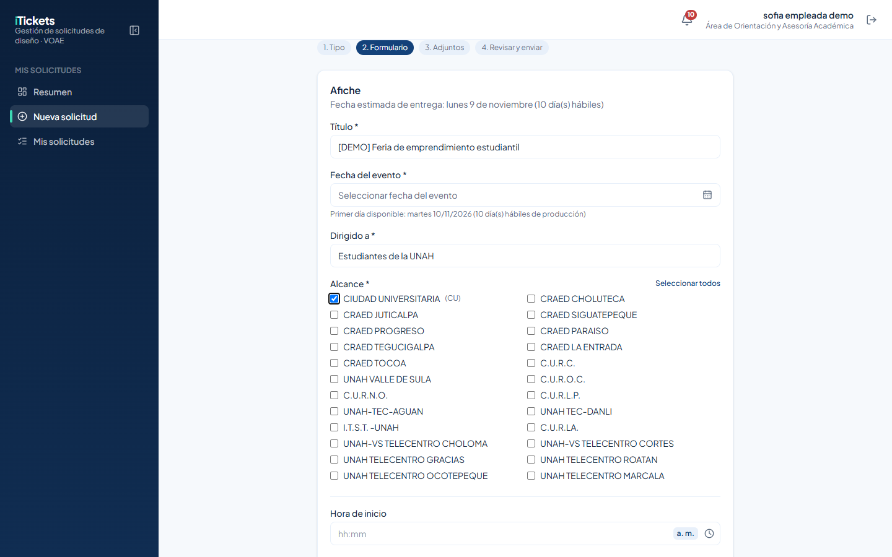

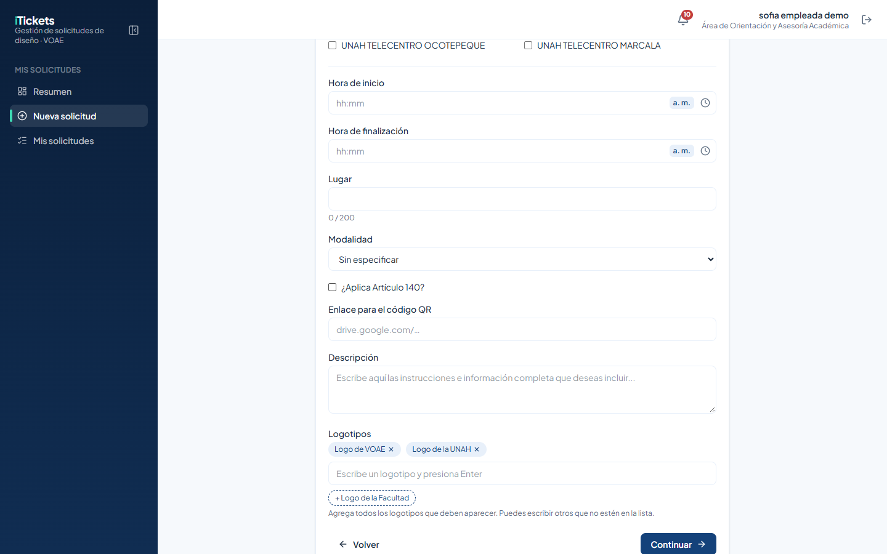

**Logotipos.** Pulsa las sugerencias (**+ Logo de VOAE**, **+ Logo de la UNAH**, **+ Logo de la Facultad**) o escribe otro y pulsa Enter. Cada logotipo queda como una etiqueta que puedes quitar con la ×.

**Enlaces.** Puedes pegar un enlace sin `https://`. iTickets lo completa por ti y te muestra debajo cómo se va a guardar ("Se guardará como…").

## 4.3 Elegir la fecha

Pulsa el campo de la fecha para abrir el calendario. Solo puedes elegir **días hábiles** que respeten el tiempo de producción del tipo:

- Los días rayados están bloqueados porque no alcanza el tiempo de producción.
- Los sábados, domingos y feriados aparecen en gris y no se pueden elegir.
- Debajo del campo se indica el **primer día disponible**.

> Algunos tipos cambian el nombre de la fecha. Por ejemplo, **Trifolio** y **Plantilla de Power Point** piden una **Fecha de entrega**, **Actualización en páginas web** pide una **Fecha de actualización** y **Cobertura de evento** pide solo una **Fecha**.

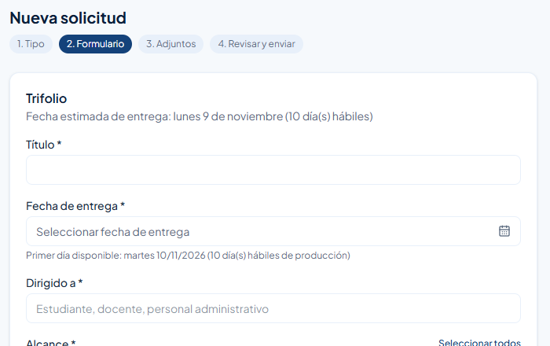

Algunos tipos traen un aviso al inicio del formulario. Léelo antes de continuar:

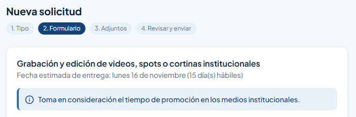

Pulsa **Continuar**. Si falta algún dato obligatorio, el campo se marca en rojo y aparece un aviso como "Completa "Objetivo"." Llénalo y vuelve a pulsar **Continuar**.

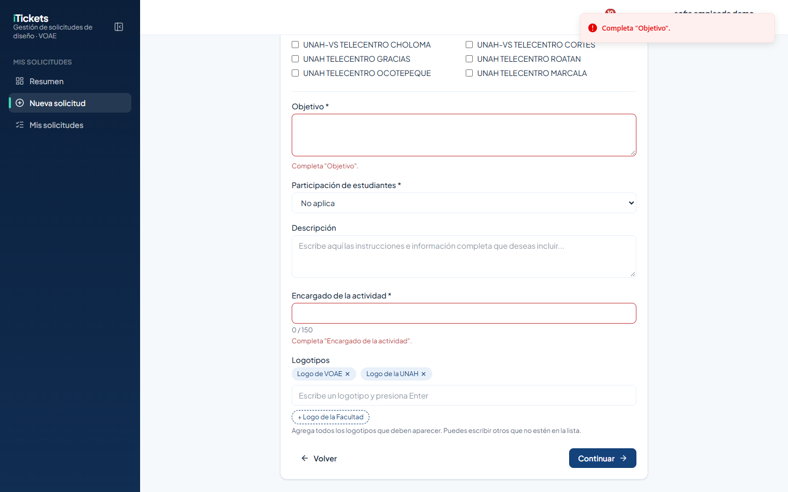

## 4.4 Agregar adjuntos

En el paso 3 adjunta lo que sirva para tu solicitud: logos, imágenes, textos o referencias. Puedes agregar hasta **10 adjuntos** en total, entre archivos y enlaces.

- **Archivos**: haz clic en el recuadro o arrastra los archivos (máximo 50 MB cada uno).
- **Enlaces**: escribe un título (por ejemplo "Fotos del evento"), pega el enlace y pulsa **Agregar**. Si son muchas fotos, comparte una carpeta de Drive.

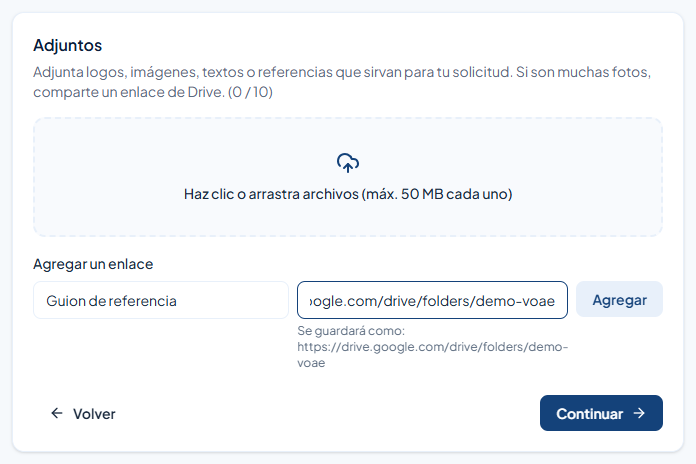

Pulsa **Continuar**.

## 4.5 Revisar y enviar

1. Revisa el resumen: tipo, datos generales, campos y adjuntos.
2. Si algo está mal, pulsa **Volver** para corregirlo.
3. Pulsa **Enviar solicitud**.

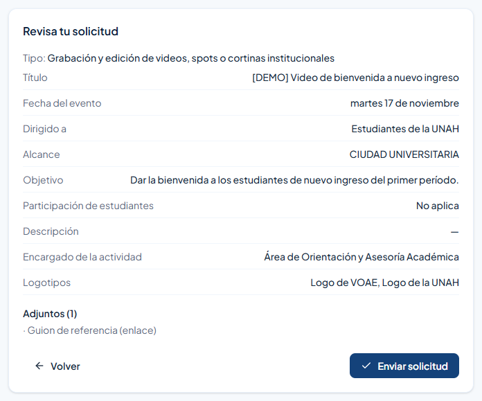

Si el tipo trae un aviso, aparece la ventana **Antes de enviar**. Léela y pulsa **Acepto, enviar solicitud** (o **Volver** si quieres revisar algo más).

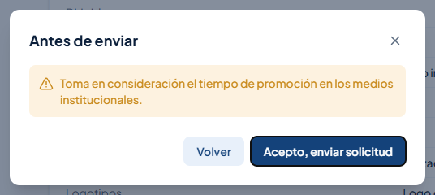

Al enviarla, aparece un aviso verde con el código de tu ticket, por ejemplo **"Solicitud AOAA-0022 enviada."**, y se abre el detalle de la solicitud.

> ¿Algo urgente que no alcanza los días de producción? Pídeselo a tu jefe de área: solo él o ella puede enviar una **solicitud excepcional**.

# 5. Seguir tus solicitudes

## 5.1 Mis solicitudes

**Mis solicitudes** muestra todos tus tickets como boletos, del más reciente al más antiguo. Cada boleto tiene el código, el título, el tipo, el área, la fecha de creación, la del evento, el vencimiento y el estado.

Usa los filtros **Todos los estados** y **Todos los tipos** para ver solo lo que buscas. A la derecha se indica cuántas solicitudes coinciden.

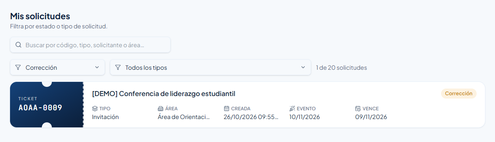

También puedes escribir en el buscador un código, un tipo o un área:

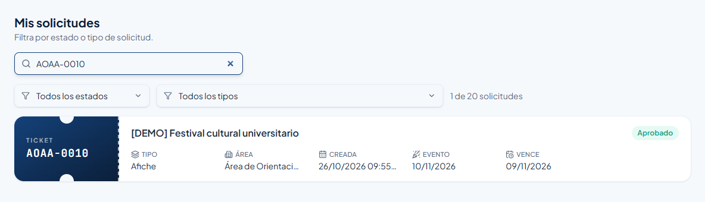

## 5.2 Estados de una solicitud

| Estado | Qué significa |
|---|---|
| **Enviado** | Tu solicitud llegó y espera que el equipo de diseño la tome. |
| **En proceso** | El equipo de diseño está trabajando en ella. |
| **Finalizado** | El diseño se entregó y tu jefe de área lo está revisando. |
| **Corrección** | Tu jefe de área pidió cambios y el equipo los está haciendo. |
| **Aprobado** | El diseño quedó aprobado. |
| **Aprobado (Automático)** | Se aprobó solo porque pasaron 24 horas hábiles sin revisión. |
| **Retrasado** | Pasó la fecha límite y el trabajo todavía no se entrega. |
| **Rechazado** | La solicitud no se va a atender (por ejemplo, una cobertura rechazada). |

## 5.3 Detalle de una solicitud

Pulsa un boleto para abrir el detalle. Ahí ves:

- El encabezado con el código, el estado, las fechas y el vencimiento.
- **Detalle de la solicitud**: lo que llenaste en el formulario.
- **Adjuntos del solicitante**: lo que tú adjuntaste.
- **Entregables**: los diseños que entregó el equipo, agrupados por versión. Pulsa **Ver** para abrirlos o descargarlos.
- **Progreso de la solicitud**: en qué paso va.

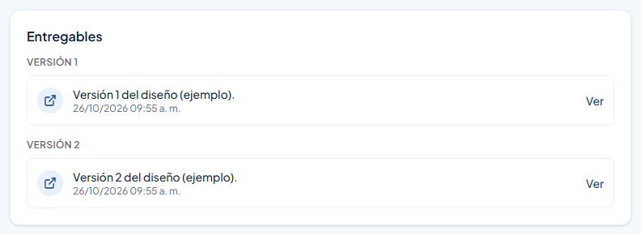

> En el detalle ves el estado y los entregables, pero no quién trabaja tu solicitud ni los comentarios internos de la revisión.

## 5.4 Agregar un adjunto después de enviar

Si olvidaste algo, abre el ticket y pulsa **Agregar** en **Adjuntos del solicitante**. Puedes subir un archivo o pegar un enlace. No se puede agregar adjuntos cuando el ticket ya está **Aprobado**, ni pasar de 10 en total.

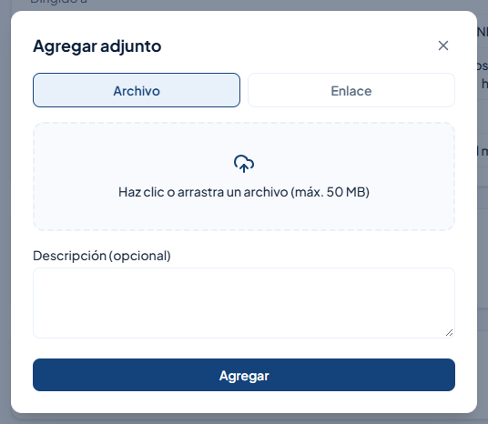

# 6. Pedir la aprobación de un afiche hecho con IA

Si tú preparaste un afiche (por ejemplo, con una herramienta de inteligencia artificial), el tipo **Aprobación de afiches con IA** sirve para que el área encargada de revisar lo apruebe antes de publicarlo. Aquí no interviene el equipo de diseño.

> Tienes hasta **5 intentos** y **10 días hábiles** para que tu afiche sea aprobado.

## 6.1 Crear la solicitud

1. En **Nueva solicitud**, elige **Aprobación de afiches con IA** (en **Otros**).
2. Llena el título, la fecha del evento, a quién va dirigido y el alcance. Pulsa **Continuar**.

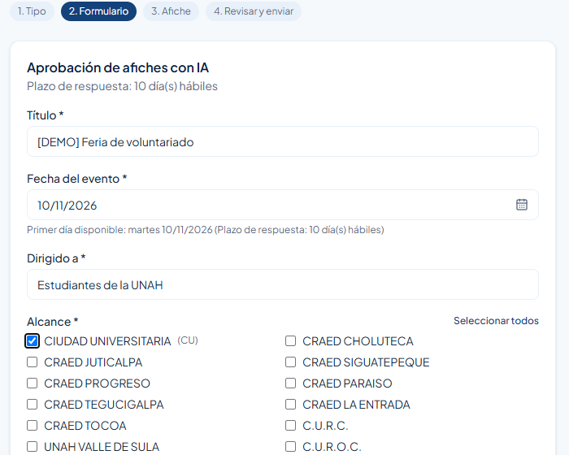

3. En el paso **3. Afiche**, sube tu afiche (PNG, JPG, WEBP o PDF, de 10 MB como máximo). Si quieres, escribe un **Comentario para quien revisa**. Pulsa **Continuar**.

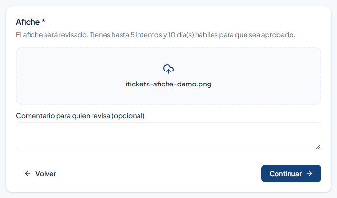

4. Revisa y pulsa **Enviar solicitud**.

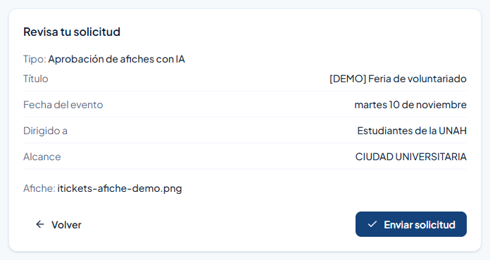

Se abre el detalle con tu afiche, el intento en curso y **Intentos restantes**:

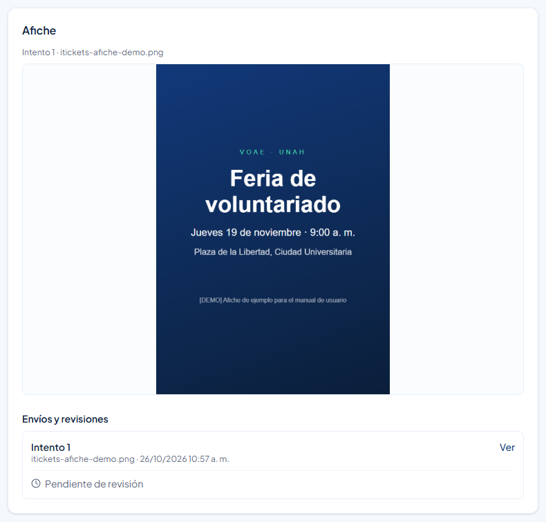

## 6.2 Si tu afiche es rechazado

Si el área encargada rechaza el afiche, la campana te avisa con el motivo, y en el detalle, bajo **Envíos y revisiones**, ves cada intento con su resultado y el comentario.

1. Abre el ticket. Su estado es **Corrección**.
2. Corrige el afiche según el comentario.
3. Pulsa **Reenviar afiche**, sube la nueva versión y confirma.

El ticket vuelve a **Enviado** y la revisión empieza de nuevo con el siguiente intento.

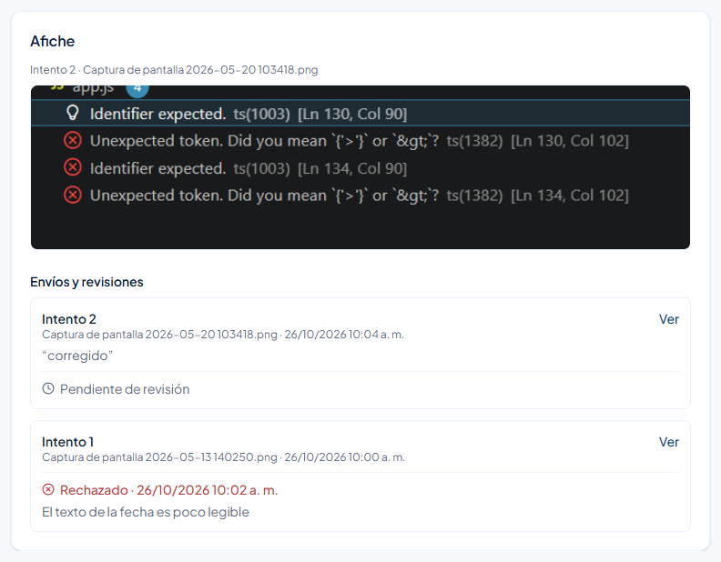

> Si el quinto intento también se rechaza, la solicitud queda **Rechazada** de forma definitiva.

## 6.3 Afiche aprobado

Cuando lo aprueban, el ticket queda **Aprobado** y el progreso se completa:

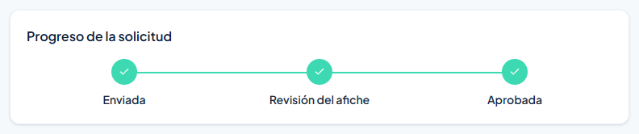

# 7. Pedir la cobertura de un evento

**Cobertura de evento** sirve para pedir fotografías o video de un evento. La solicitud se **aprueba o se rechaza**; no tiene correcciones.

1. En **Nueva solicitud**, elige **Cobertura de evento** (en **Otros**).
2. Llena el **Título**, la **Fecha**, **Dirigido a**, el **Alcance**, la **Hora**, el **Lugar** y la **Descripción** (di si necesitas fotos, video o ambos).
3. Adjunta lo que ayude a decidir (programa, invitación) y envíala.

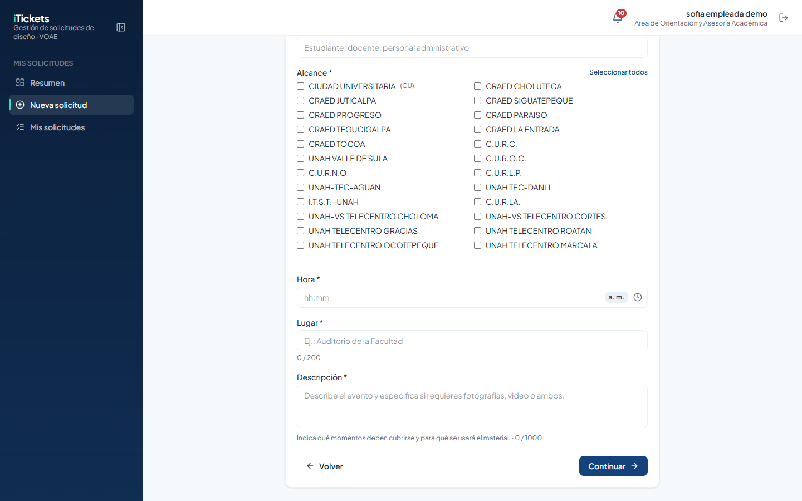

En el detalle verás la **Decisión de validación**:

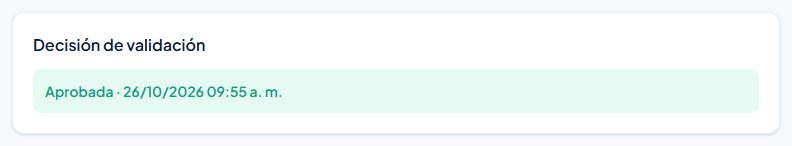

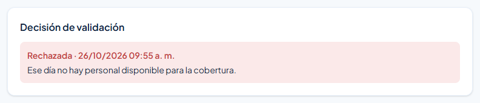

# 8. iTickets en el celular

Puedes usar iTickets desde el navegador de tu celular. Los boletos se acomodan en una sola columna y el menú se abre con el botón de tres rayas.

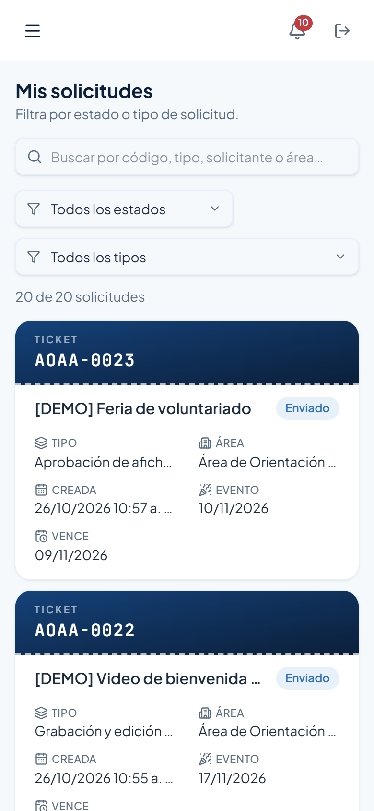

# 9. Reglas importantes

| Tema | Regla |
|---|---|
| Horario para enviar | De lunes a viernes, de 8:00 a. m. a 4:00 p. m. (hora de Honduras), sin feriados. |
| Tiempo de producción | Cada tipo tiene sus días hábiles (mínimo 10; Campaña publicitaria, 30). Se ven en la tarjeta del tipo. |
| Fechas | El calendario solo deja elegir días hábiles posteriores al tiempo de producción. Los feriados alargan el plazo. |
| Adjuntos | Hasta 10 por solicitud, entre archivos (50 MB cada uno) y enlaces. No se agregan si el ticket ya está aprobado. |
| Afiche con IA | Hasta 5 intentos y 10 días hábiles. Afiche en PNG, JPG, WEBP o PDF, de 10 MB como máximo. |
| Cobertura de evento | Se aprueba o se rechaza una sola vez, sin correcciones. |
| Revisión del diseño | Tu jefe de área tiene 24 horas hábiles para revisar cada entrega; si no lo hace, se aprueba sola. |
| Urgencias | Solo tu jefe de área puede enviar una solicitud excepcional. |
| Sesión | Se cierra sola tras 20 minutos sin actividad. |

# 10. Preguntas frecuentes y problemas comunes

| Situación | Qué hacer |
|---|---|
| "Correo o contraseña incorrectos." | Revisa las mayúsculas y vuelve a intentarlo. Si no la recuerdas, usa **¿Olvidaste tu contraseña?** |
| El botón **Enviar solicitud** está deshabilitado y dice que solo se envía en horario hábil | Estás fuera del horario (lunes a viernes, 8:00 a. m. a 4:00 p. m.). Vuelve en horario hábil; lo que llenaste se pierde si sales de la página. |
| "Para "Afiche" se necesitan 10 días hábiles de anticipación: la fecha del evento debe ser a partir del…" | Elige una fecha igual o posterior a la indicada. Si es urgente, habla con tu jefe de área. |
| "Completa "Objetivo"." (u otro campo) | Llena el campo marcado en rojo y vuelve a pulsar **Continuar**. |
| "El ticket … ya tiene el máximo de 10 adjuntos." | Comparte los demás archivos en una carpeta de Drive y agrega solo el enlace. |
| No puedo elegir un día en el calendario | Es fin de semana, feriado o no alcanza el tiempo de producción. Elige el primer día disponible o uno posterior. |
| Salí de la página y se cerró mi sesión | Pasaste 20 minutos sin actividad. Vuelve a iniciar sesión. |
| Quiero saber quién trabaja mi solicitud | Esa información no se muestra. Sigue el estado del ticket; la campana te avisa de cada cambio. |
| Mi afiche con IA está en **Corrección** | Lee el comentario en **Envíos y revisiones**, corrige el afiche y pulsa **Reenviar afiche**. |

# 11. Glosario

| Término | Significado |
|---|---|
| **Ticket** | Cada solicitud registrada en iTickets, con su código único (por ejemplo `AOAA-0010`). |
| **Tipo de solicitud** | La clase de pieza que pides (Afiche, Video, Trifolio…). Define el formulario y los días de producción. |
| **Días hábiles** | De lunes a viernes, sin feriados. |
| **Horario hábil** | De lunes a viernes, de 8:00 a. m. a 4:00 p. m., sin feriados. |
| **Adjunto** | Archivo o enlace que tú agregas a tu solicitud. |
| **Entregable** | El diseño que entrega el equipo de diseño, por versiones. |
| **Dictamen** | La decisión de tu jefe de área sobre el diseño: aprobarlo o pedir corrección. |
| **Intento** | Cada envío de un afiche con IA para revisión (máximo 5). |
| **Solicitud excepcional** | Pedido urgente que solo puede enviar un jefe de área. |
