# 1. Introducción

**iTickets** es el sistema de la Vicerrectoría de Orientación y Asuntos Estudiantiles (VOAE) para
pedir diseños y piezas de comunicación: afiches, banners, videos, invitaciones, señalización,
diplomas y más. Cada solicitud que envías se convierte en un **ticket** con un código único (por
ejemplo `ADH-0001`) que puedes seguir hasta que quede aprobado.

Como **Empleado** puedes:

- Enviar nuevas solicitudes de diseño.
- Adjuntar archivos o enlaces de referencia.
- Ver el estado de tus propias solicitudes y su historial simplificado.

No ves quién diseña tu solicitud ni los comentarios internos del equipo: solo el **estado** de tu
ticket (Enviado, En proceso, Finalizado, Corrección, Retrasado, Aprobado, Rechazado).

# 2. Acceso al sistema

## 2.1 Iniciar sesión

Entra a la dirección del sistema en tu navegador. Verás el boleto **iTickets** a la izquierda (en
pantallas grandes) y el formulario de inicio de sesión a la derecha:

1. Escribe tu **correo** y tu **contraseña**.
2. Pulsa **Ingresar**.

> Importante: usa el correo y la contraseña que te asignó el Administrador. Si olvidaste tu
> contraseña, usa el enlace **¿Olvidaste tu contraseña?**.

## 2.2 Primer ingreso y cambio de contraseña

La primera vez que entras con la contraseña temporal que te dieron, el sistema **te obliga a
cambiarla** antes de dejarte usar el resto de la aplicación: escribe una contraseña nueva y
confírmala para continuar. Mientras no la cambies, no puedes ver tus solicitudes ni enviar nuevas.

## 2.3 Conoce la pantalla

Una vez dentro verás:

- A la izquierda, el **menú lateral** con tus tres secciones: **Resumen**, **Nueva solicitud** y
  **Mis solicitudes**. Puedes plegarlo con el ícono de la esquina superior para ganar espacio.

  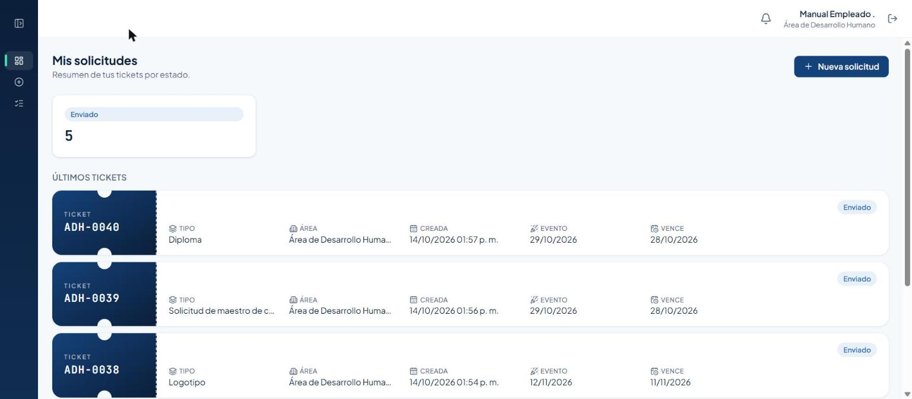

- Arriba a la derecha, la **campana de notificaciones** (te avisa en tiempo real cuando cambia el
  estado de tus tickets) y tu nombre con tu área.

  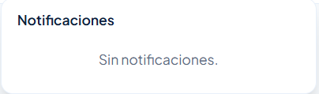

- Un botón para **cerrar sesión**, junto a tu nombre.

# 3. Enviar una solicitud nueva

## 3.1 Elegir el tipo

1. Pulsa **Nueva solicitud** en el menú, o el botón **+ Nueva solicitud** del Resumen.
2. Elige el tipo que necesitas, agrupado por categoría (Arte, Video, DIRCOM, Protocolo, Otros).
   Cada tarjeta muestra cuántos días hábiles de producción necesita.

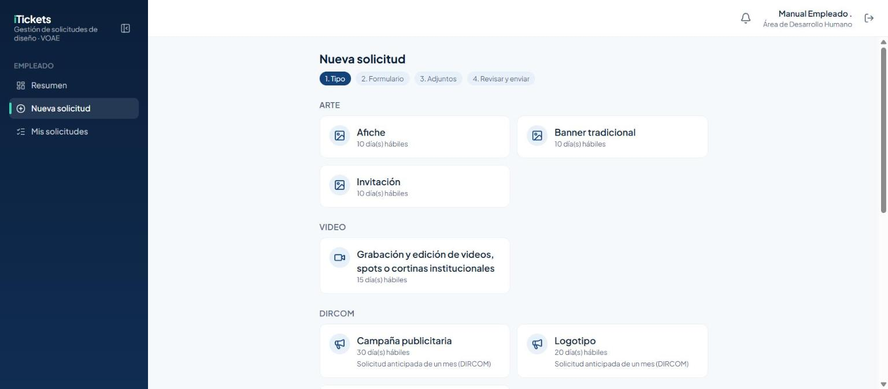

> Importante: entre más anticipación le des al equipo de diseño, mejor. Campaña publicitaria y
> Logotipo (DIRCOM) piden solicitud anticipada de un mes.

## 3.2 Llenar el formulario

El formulario cambia según el tipo que elegiste, pero **todos piden la fecha del evento**. El
calendario **bloquea automáticamente** los días que no alcanzan el plazo de producción: solo puedes
elegir desde el primer día disponible en adelante.

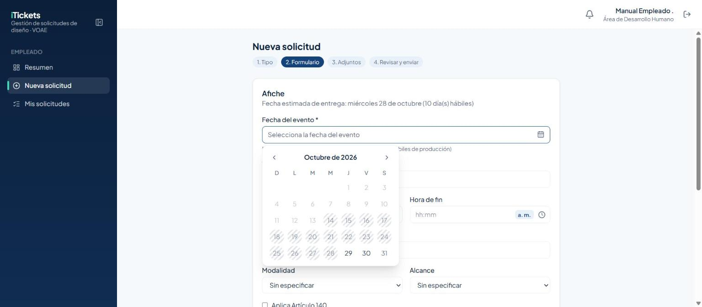

Ejemplos de los distintos formularios según el tipo elegido:

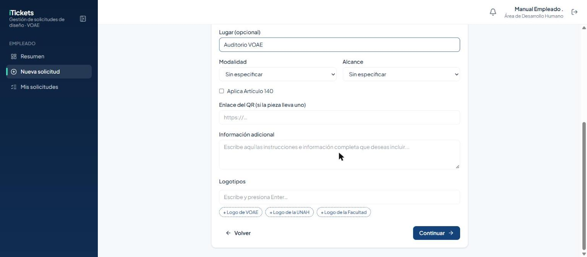
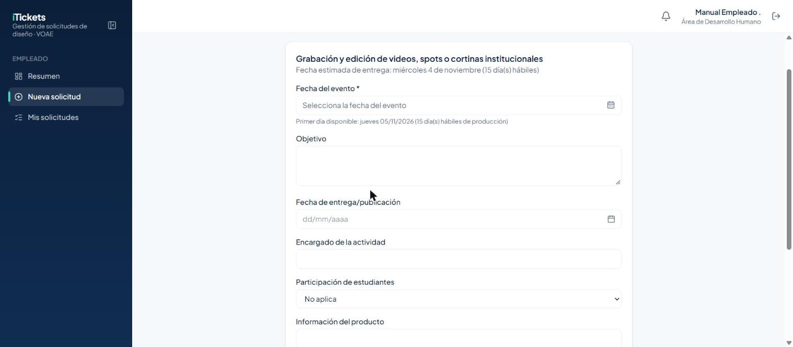
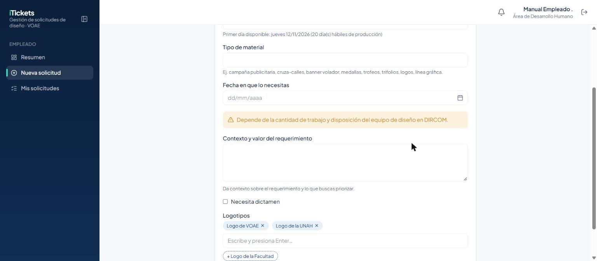
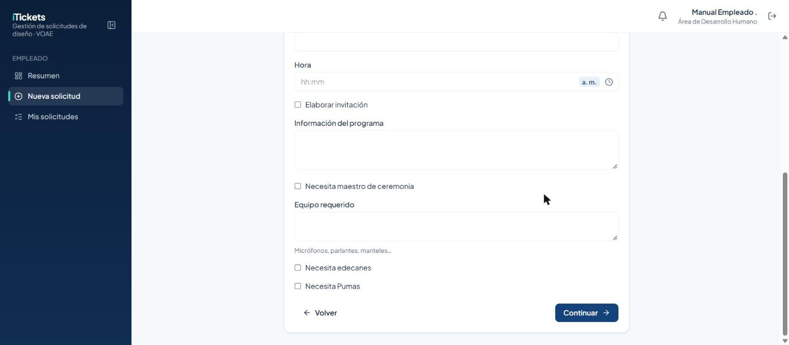
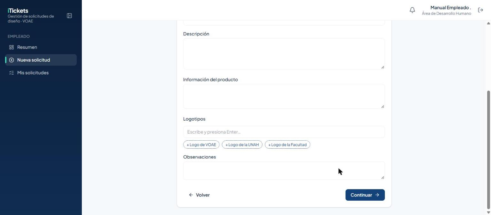

> Importante: ningún campo de fecha te deja elegir un día que ya pasó, ni uno que no alcance el
> plazo de producción del tipo que elegiste.

## 3.3 Adjuntar archivos o enlaces

En el paso **Adjuntos** puedes subir hasta **10 archivos** (máximo 50 MB cada uno) o agregar
**enlaces** (por ejemplo, una carpeta de Drive con muchas fotos). Es opcional, pero ayuda mucho al
diseñador a entender lo que necesitas.

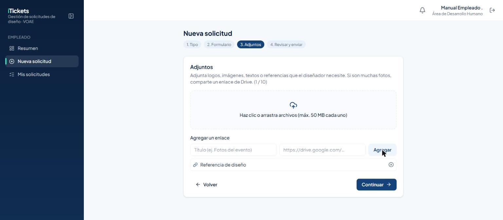

1. Arrastra un archivo al recuadro, o haz clic para elegirlo desde tu computadora.
2. Para un enlace, escribe un **título** corto y pega la **URL**, luego pulsa **Agregar**.

## 3.4 Revisar y enviar

El último paso te muestra un resumen de todo lo que escribiste, para que lo revises antes de
enviarlo.

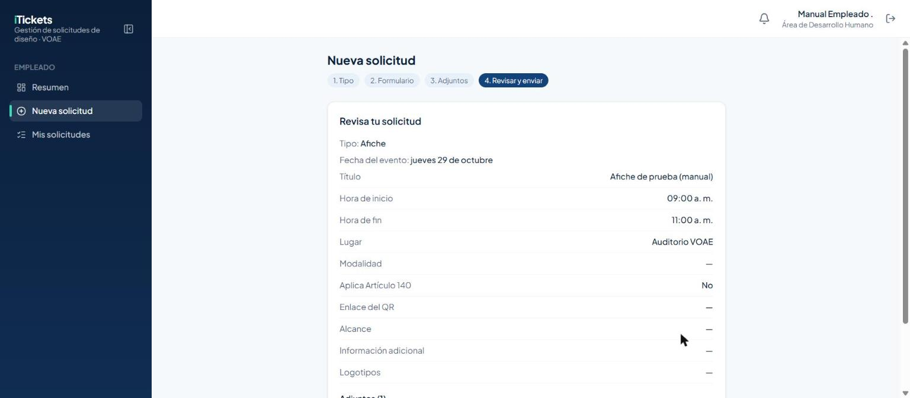

Pulsa **Enviar solicitud**. Verás un aviso con el **código** de tu nuevo ticket:

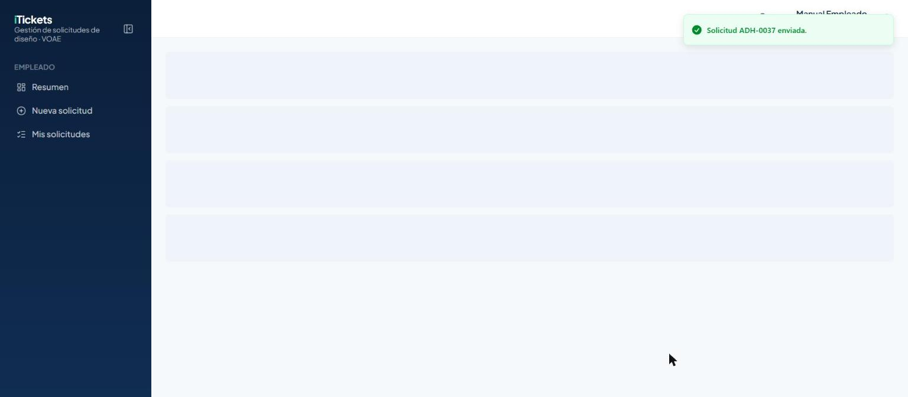

> Importante: fuera del horario hábil (lunes a viernes, 8:00 a. m. a 4:00 p. m., hora de Honduras)
> el sistema no te deja enviar una solicitud nueva; te lo avisa en pantalla.

# 4. Ver tus solicitudes

## 4.1 Resumen

La pantalla **Resumen** (la página de inicio) te muestra cuántos tickets tienes por estado y tus
últimos tickets.

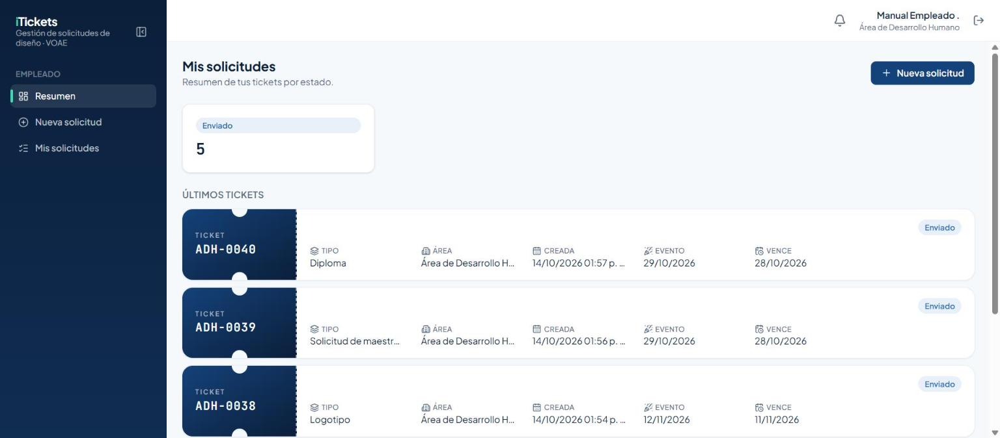

## 4.2 Mis solicitudes

Aquí ves **todas** tus solicitudes, con filtros y búsqueda.

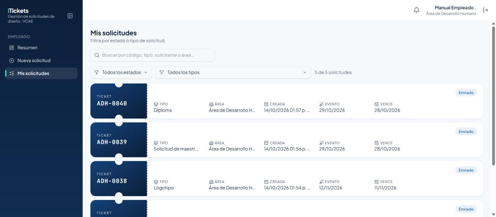

- **Buscar:** escribe el código, el tipo, tu nombre o el área. El buscador ignora mayúsculas,
  tildes, y para los códigos también ignora guiones y espacios — "adh 0038" encuentra `ADH-0038`
  igual que si lo escribieras con guion.

  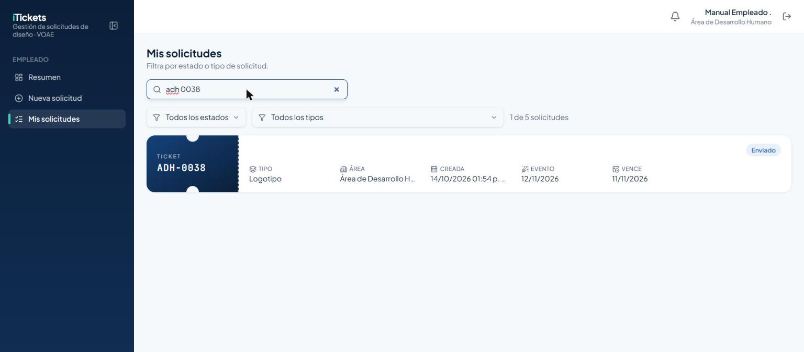

- **Filtros:** "Todos los estados" y "Todos los tipos" te dejan ver solo lo que te interesa.
- El contador "N de M solicitudes" te dice cuántas estás viendo del total.

## 4.3 Detalle del ticket

Al hacer clic en cualquier ticket ves su información completa: tipo, fechas, el detalle del
formulario que llenaste y tus adjuntos.

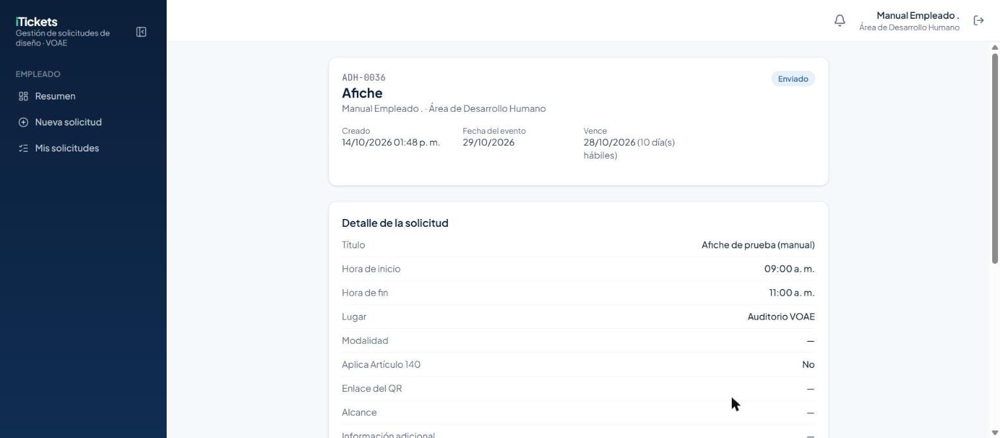

Como Empleado, en vez del historial completo de cambios ves una barra de **progreso simplificada**
con 4 pasos (Enviada → En diseño → Dictamen del jefe → Aprobada):

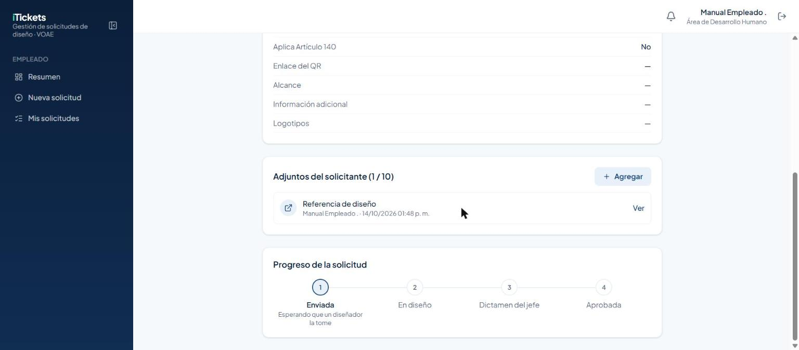

No ves quién diseña tu ticket, ni comentarios internos, ni el contador de correcciones — esa
información es solo para el equipo de diseño y el jefe de área.

> Importante: mientras tu ticket no esté **Aprobado**, puedes seguir agregando adjuntos desde su
> detalle (hasta el máximo de 10).

# 5. Reglas importantes

| Tema | Regla |
|---|---|
| Horario hábil | Lunes a viernes, 8:00 a. m. a 4:00 p. m. (hora de Honduras). Solo puedes enviar solicitudes en ese horario. |
| Fecha del evento | Obligatoria en todo formulario. El calendario bloquea los días que no alcanzan el plazo de producción del tipo elegido. |
| Días de producción | Varían según el tipo: 10 días hábiles es lo más común; Campaña publicitaria y Logotipo (DIRCOM) piden un mes de anticipación. Los feriados alargan el plazo. |
| Adjuntos | Hasta 10 por solicitud, máximo 50 MB cada archivo. Puedes seguir agregando mientras el ticket no esté Aprobado. |
| Lo que ves | Solo el estado de tu ticket. No ves quién lo diseña, comentarios del jefe, ni el contador de correcciones. |
| Búsqueda de códigos | Ignora mayúsculas, tildes, guiones y espacios: "adh 38" o "0038" encuentran `ADH-0038`. |
| Primer ingreso | Con la contraseña temporal, el sistema te obliga a cambiarla antes de dejarte continuar. |

# 6. Preguntas frecuentes y problemas comunes

| Situación | Qué hacer |
|---|---|
| No puedo enviar una solicitud ahorita | Revisa la hora: solo se envían de lunes a viernes, 8:00 a. m. a 4:00 p. m. |
| El calendario no me deja elegir la fecha que quiero | El calendario solo bloquea los días que no alcanzan el plazo mínimo de producción de ese tipo de solicitud; elige una fecha posterior al "primer día disponible" que indica el formulario. |
| Mi evento es antes del primer día disponible | Habla con tu Jefe de Área: solo él puede enviar una **solicitud excepcional**, con al menos 2 días hábiles de anticipación. |
| No encuentro mi ticket al buscar | Prueba sin el guion ni espacios del código (por ejemplo "0038" en vez de "ADH-0038"); el buscador los ignora igual. |
| No veo quién está diseñando mi ticket | Es normal: el Empleado solo ve el estado, no quién lo tiene asignado. |
| No puedo cambiar mi contraseña | Si es tu primer ingreso, el sistema te lo pide automáticamente; si ya tienes cuenta y la olvidaste, usa "¿Olvidaste tu contraseña?" en el inicio de sesión. |

# 7. Glosario

- **Ticket:** una solicitud de diseño, con su propio código (p. ej. `ADH-0001`).
- **Días hábiles:** lunes a viernes, sin contar los feriados activos registrados antes de que
  crearas el ticket.
- **Enviado:** tu ticket acaba de entrar y espera que un diseñador lo tome.
- **En proceso:** un diseñador ya está trabajando en tu ticket.
- **Finalizado:** el diseñador entregó el diseño; espera el dictamen del Jefe de Área.
- **Corrección:** el Jefe de Área pidió un ajuste antes de aprobar.
- **Retrasado:** pasó la fecha límite sin que el ticket avanzara.
- **Aprobado / Aprobado (Automático):** tu solicitud quedó lista; "automático" significa que
  pasaron 24 horas hábiles sin dictamen y el sistema lo aprobó solo.
- **Rechazado:** solo aplica a solicitudes excepcionales que el Asignador no aceptó.
- **Solicitud excepcional:** una solicitud urgente que solo puede enviar un Jefe de Área.
