# 1. Introducción

**iTickets** es el sistema de la Vicerrectoría de Orientación y Asuntos Estudiantiles (VOAE) de la UNAH para pedir, producir y aprobar piezas de diseño y comunicación. Cada pedido se convierte en un **ticket** con un código único (por ejemplo `AOAA-0008`).

Este manual es para el rol **Jefe de Área**. Como jefe o jefa de un área o de una coordinación puedes:

- **Dictaminar** los diseños que entrega el equipo de diseño: aprobarlos o pedir una corrección.
- Revisar el **historial** de las solicitudes de tu área y exportarlo.
- Enviar una **solicitud excepcional** cuando hay una urgencia.
- Enviar **solicitudes normales** y seguirlas en **Mis solicitudes**.
- Si diriges varias coordinaciones, ver y dictaminar las de todas.

Cada usuario pertenece a **un área** (AOAA, ADH o ADS) **o a una coordinación** (UROE, UCCR o UPLAN). El código de cada ticket empieza con ese prefijo: `AOAA-0001`, `UCCR-0001`…

# 2. Acceso al sistema

## 2.1 Iniciar sesión

Entra a la dirección de iTickets en tu navegador.

1. Escribe tu **Correo**.
2. Escribe tu **Contraseña**. Para verla mientras la escribes, pulsa el ojo que está a la derecha del campo.
3. Pulsa **Ingresar**.

Si el correo o la contraseña no coinciden, aparece el aviso **"Correo o contraseña incorrectos."**.

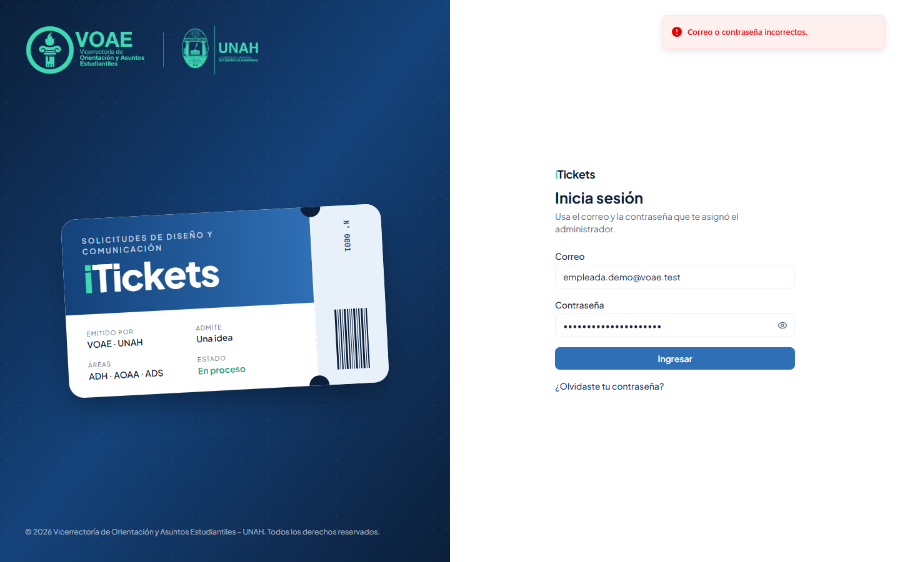

> ¿Olvidaste tu contraseña? Pulsa **¿Olvidaste tu contraseña?**, escribe tu correo y pulsa **Enviar enlace**.

## 2.2 Primer ingreso y cambio de contraseña

La primera vez entras con una **contraseña temporal**. iTickets te pide crear una propia: escribe la **Contraseña nueva**, repítela en **Confirmar contraseña** y pulsa **Guardar contraseña**.

## 2.3 Conoce la pantalla

- **Menú lateral**, sección **Mi área**: **Por dictaminar**, **Solicitud excepcional**, **Nueva solicitud** y **Mis solicitudes**. Con el botón junto a la palabra iTickets puedes plegarlo para dejar solo los íconos.
- **Campana**: te avisa en tiempo real de entregas listas para dictaminar y de lo que pasa con tus solicitudes. Al hacer clic en una notificación se abre el ticket.
- **Tu nombre y tu área**, y el botón para **cerrar sesión**.

> Por seguridad, la sesión se cierra sola después de **20 minutos** sin actividad.

# 3. Dictaminar un diseño

Cuando el equipo de diseño entrega un trabajo, el ticket pasa a **Finalizado** y aparece en **Por dictaminar**. Ahí decides si lo apruebas o pides una corrección.

## 3.1 Por dictaminar

Cada tarjeta muestra el código, el tipo, las correcciones usadas y un **cronómetro** con el tiempo que te queda.

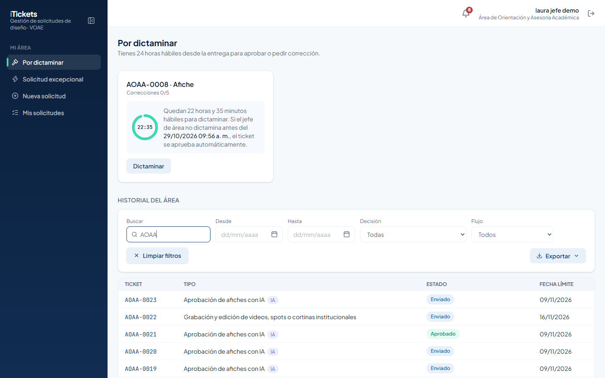

> Tienes **24 horas hábiles** desde la entrega para dictaminar. El cronómetro (horas:minutos) solo corre en horario hábil y se pausa de noche, en fines de semana y en feriados. Si no dictaminas a tiempo, el ticket se **aprueba automáticamente** y queda como **Aprobado (Automático)**.

## 3.2 Revisar la entrega

Pulsa el código del ticket para abrir el detalle. Arriba ves el estado, las fechas, las correcciones usadas y el cronómetro:

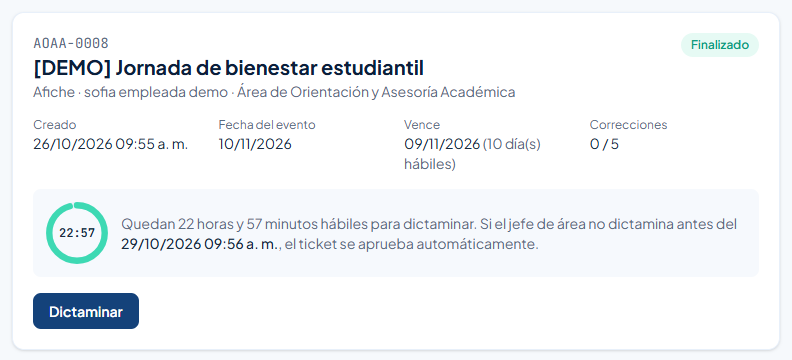

Más abajo están el **Detalle de la solicitud**, los **Adjuntos del solicitante** y los **Entregables**. Pulsa **Ver** para abrir cada versión del diseño.

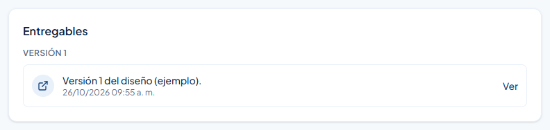

## 3.3 Aprobar

1. Pulsa **Dictaminar**.
2. Deja elegida la opción **Aprobar**.
3. Pulsa **Aprobar**.

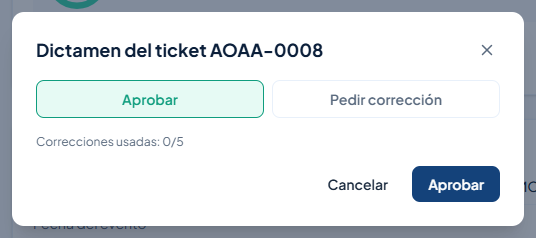

El ticket queda **Aprobado** y el solicitante recibe un aviso.

## 3.4 Pedir corrección

1. Pulsa **Dictaminar**.
2. Elige **Pedir corrección**.
3. Explica qué hay que cambiar. El comentario es **obligatorio**.
4. Pulsa **Pedir corrección**.

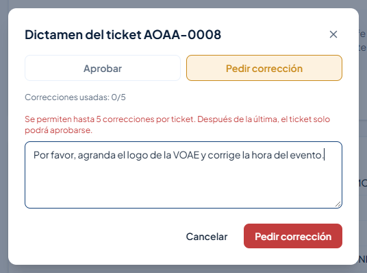

El ticket pasa a **Corrección**, el contador sube (por ejemplo **1 / 5**) y el equipo de diseño recibe tu comentario. Cuando entregue la nueva versión, el ticket vuelve a **Por dictaminar**.

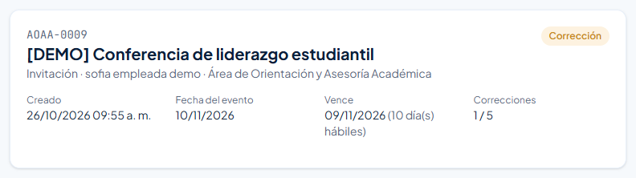

> Cada ticket admite hasta **5 correcciones**. La ventana muestra "Correcciones usadas: X/5". Después de la quinta, **Pedir corrección** queda deshabilitado y solo puedes aprobar.

> Los dictámenes solo se hacen en **horario hábil** (lunes a viernes, de 8:00 a. m. a 4:00 p. m.). Fuera de ese horario el botón **Dictaminar** aparece deshabilitado, salvo en las solicitudes excepcionales.

# 4. Historial del área

Debajo de **Por dictaminar** está el **Historial del área**: todas las solicitudes de tu área que no están esperando tu dictamen. No muestra quién las diseña.

Para encontrar algo rápido:

- **Buscar**: escribe un código, un tipo, el solicitante o un estado.
- **Desde** y **Hasta**: limita por fecha de registro.
- **Decisión**: Aprobado, Corrección, Aprobado (Automático), Rechazado o Retrasado.
- **Flujo**: Diseño o Aprobación con IA.
- **Limpiar filtros** quita todos los filtros a la vez.

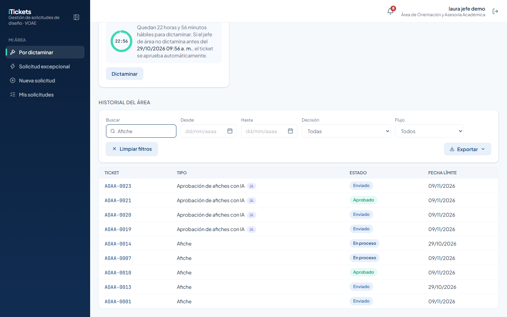

Para guardar el historial filtrado, pulsa **Exportar** y elige **CSV** (para Excel) o **PDF**.

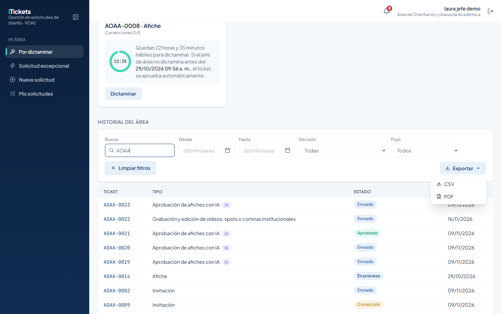

# 5. Solicitud excepcional

La **solicitud excepcional** es para urgencias que no alcanzan los días de producción normales. Solo un jefe de área puede enviarla.

> Puedes enviarla **cualquier día y a cualquier hora**, con al menos **2 días hábiles** de anticipación al evento. La revisa la persona que distribuye el trabajo de diseño: la acepta o la rechaza con un motivo. Si nadie la atiende antes de la fecha del evento, se rechaza automáticamente.

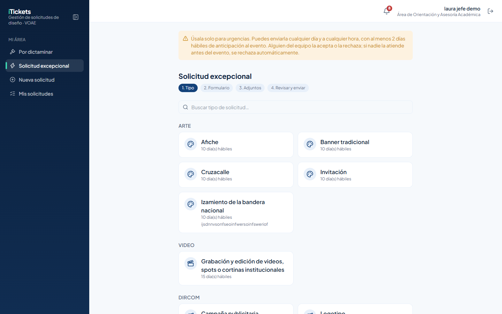

Para enviarla:

1. En el menú, pulsa **Solicitud excepcional**.
2. Elige el tipo de solicitud.
3. Llena el formulario igual que una solicitud normal. En el calendario, el primer día disponible está a **2 días hábiles**.
4. Agrega los adjuntos, revisa y pulsa **Enviar solicitud**.

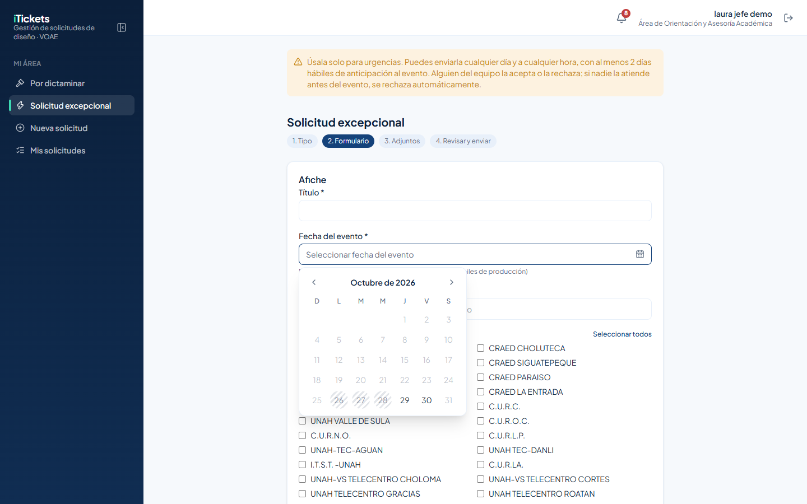

## 5.1 Mis solicitudes excepcionales

Al final de la página **Solicitud excepcional** está la lista **Mis solicitudes excepcionales**, con el estado de cada una:

- **Pendiente de aceptación**: todavía nadie la acepta.
- **Aceptada – En proceso**: el equipo de diseño ya está trabajando.
- **Rechazada**: con el motivo del rechazo.

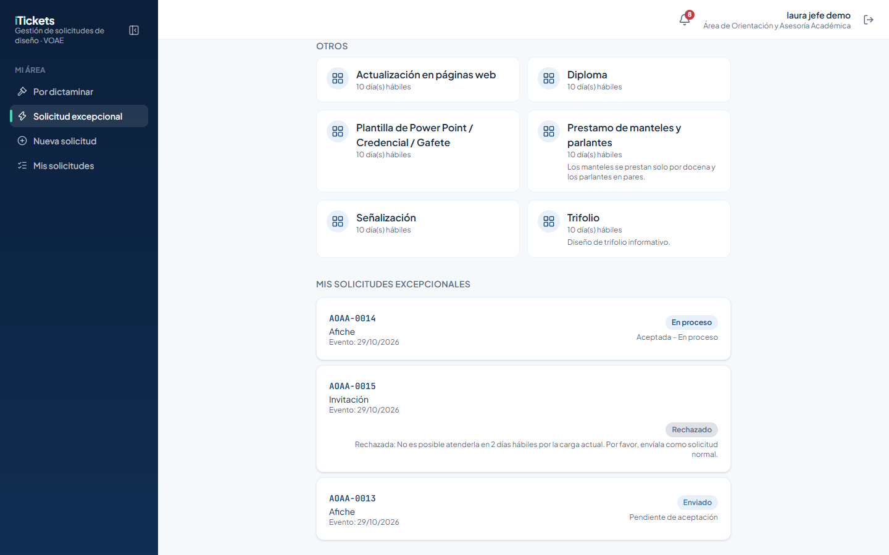

En el detalle de una excepcional aceptada ves la etiqueta **Excepcional** y el aviso **Aceptada – En proceso**:

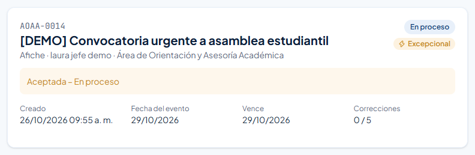

Si fue rechazada, el motivo aparece en el encabezado. Puedes enviarla de nuevo como solicitud normal si la fecha lo permite.

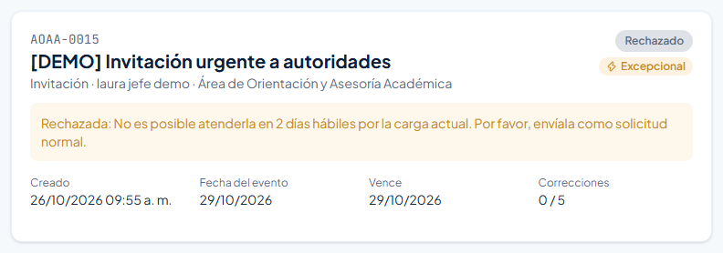

# 6. Si diriges varias coordinaciones

Un jefe de coordinación puede dirigir **varias coordinaciones** (por ejemplo, UROE, UCCR y UPLAN). En ese caso:

- **Por dictaminar** y el historial muestran los tickets de **todas** tus coordinaciones.
- Arriba a la derecha aparece el selector **Área / Coordinación** para ver solo una.
- El historial se titula **Historial de varias coordinaciones**.

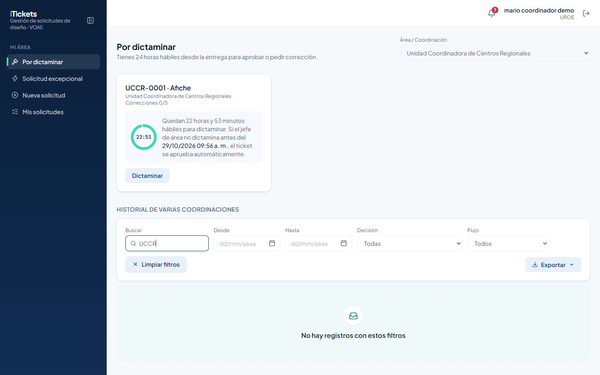

Dictaminas cada ticket igual que en la sección 3, sin importar de cuál de tus coordinaciones venga:

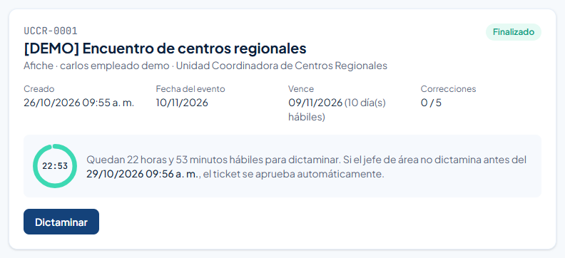

> El administrador del sistema es quien indica de qué otras coordinaciones eres jefe o jefa.

# 7. Enviar una solicitud normal

Como jefe de área también puedes pedir trabajos al equipo de diseño. El proceso es el mismo que para cualquier solicitante:

1. En el menú, pulsa **Nueva solicitud** y elige el tipo.
2. Llena el formulario. El calendario solo deja elegir días hábiles posteriores a los días de producción del tipo.
3. Agrega los adjuntos (hasta 10, entre archivos y enlaces).
4. Revisa y pulsa **Enviar solicitud**. Si el tipo trae un aviso, acéptalo en **Antes de enviar**.

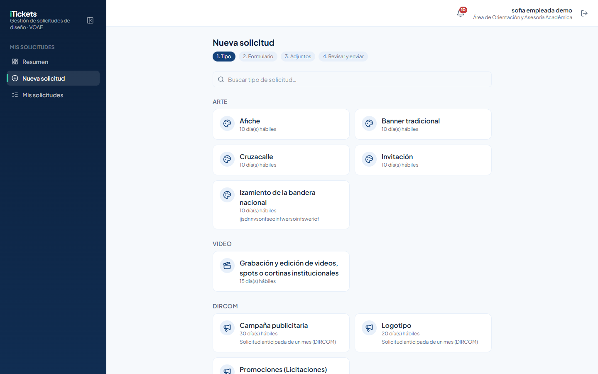

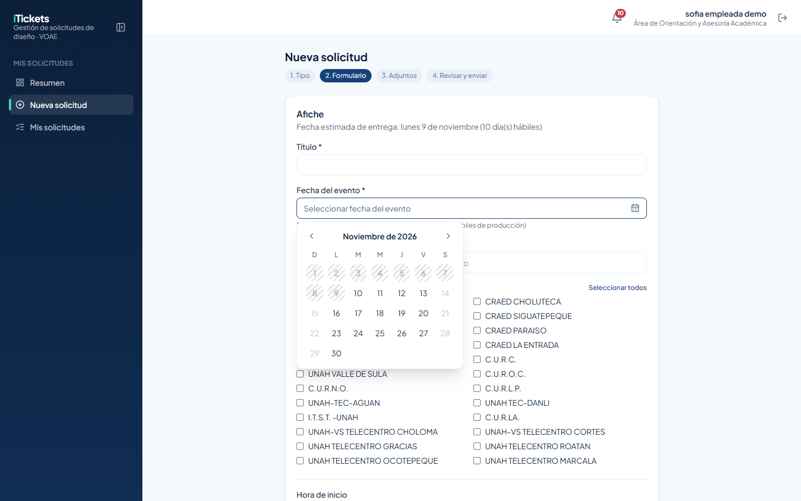

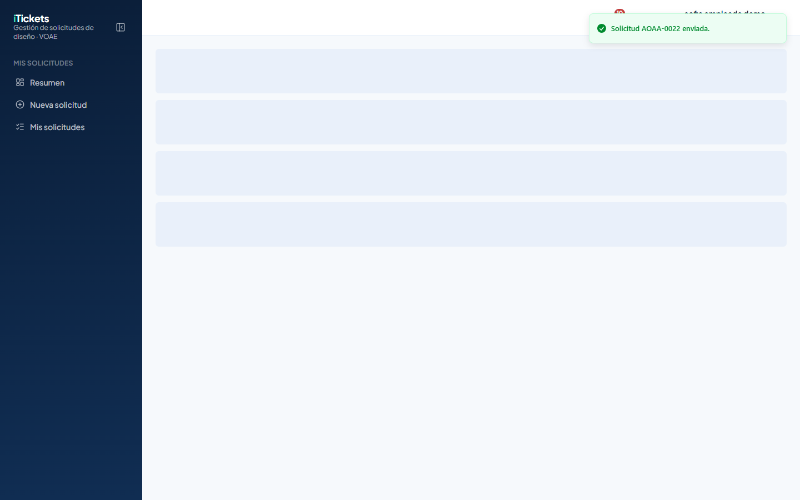

Tus solicitudes aparecen en **Mis solicitudes**, donde puedes filtrarlas por estado o tipo y abrir su detalle.

> Las solicitudes normales solo se envían en horario hábil. Las excepcionales, a cualquier hora.

# 8. Reglas importantes

| Tema | Regla |
|---|---|
| Plazo para dictaminar | 24 horas hábiles desde la entrega. Si no dictaminas, se aprueba solo (**Aprobado (Automático)**). |
| Horario para dictaminar | Lunes a viernes, de 8:00 a. m. a 4:00 p. m., sin feriados. Las excepcionales se dictaminan a cualquier hora. |
| Correcciones | Máximo 5 por ticket. El comentario es obligatorio. Después de la quinta, solo puedes aprobar. |
| Solicitud excepcional | Cualquier día y hora, con al menos 2 días hábiles de anticipación. Si nadie la atiende antes del evento, se rechaza sola. |
| Solicitud normal | Solo en horario hábil, respetando los días de producción del tipo. |
| Quién diseña | El sistema no muestra qué persona del equipo de diseño trabaja cada ticket. |
| Varias coordinaciones | Ves y dictaminas los tickets de todas las coordinaciones que diriges. |

# 9. Preguntas frecuentes y problemas comunes

| Situación | Qué hacer |
|---|---|
| El botón **Dictaminar** está deshabilitado y dice "Los dictámenes solo se hacen en horario hábil." | Vuelve de lunes a viernes entre 8:00 a. m. y 4:00 p. m. El cronómetro está pausado mientras tanto. |
| "Pedir corrección" está deshabilitado | Ya se usaron las 5 correcciones; solo puedes aprobar. |
| No puedo enviar la corrección | Escribe el comentario: es obligatorio. |
| "Venció el plazo de 24 horas hábiles para dictaminar el ticket …; quedó aprobado automáticamente." | El plazo se cumplió antes de tu decisión. El ticket ya está **Aprobado (Automático)**. |
| "Las solicitudes excepcionales necesitan 2 días hábiles de anticipación: la fecha del evento debe ser a partir del …" | Elige una fecha igual o posterior a la indicada. |
| Mi excepcional fue rechazada | Lee el motivo en **Mis solicitudes excepcionales** y, si hay tiempo, envíala como solicitud normal. |
| No veo los tickets de otra coordinación | Pide al administrador que te agregue esa coordinación en **También es jefe de**. |
| Quiero saber quién diseña un ticket | Esa información no se muestra a las jefaturas. |

# 10. Glosario

| Término | Significado |
|---|---|
| **Dictamen** | Tu decisión sobre un diseño entregado: aprobarlo o pedir corrección. |
| **Cronómetro** | Tiempo hábil que te queda para dictaminar (horas:minutos). |
| **Corrección** | Pedido de cambios al equipo de diseño, con un comentario. Máximo 5 por ticket. |
| **Aprobado (Automático)** | Ticket aprobado solo porque pasaron 24 horas hábiles sin dictamen. |
| **Solicitud excepcional** | Pedido urgente con 2 días hábiles de anticipación, que solo envía un jefe de área. |
| **Coordinación** | Unidad como UROE, UCCR o UPLAN. Un usuario pertenece a un área o a una coordinación. |
| **Historial** | Lista de solicitudes de tu área que no están esperando dictamen. |
| **Entregable** | Cada versión del diseño que entrega el equipo. |
