# 1. Introducción

**iTickets** es el sistema de la Vicerrectoría de Orientación y Asuntos Estudiantiles (VOAE) para
pedir, diseñar y aprobar solicitudes de diseño y comunicación: afiches, banners, videos, invitaciones,
señalización y más. Cada solicitud se convierte en un **ticket** con un código único (por ejemplo
`ADH-0001`) que se puede seguir de principio a fin.

Como **Jefe de Área** cierras el ciclo de cada solicitud de tu área. Este manual explica lo que solo
tú puedes hacer:

- Dictaminar los diseños que entrega el equipo: aprobarlos o pedir una corrección.
- Enviar una **solicitud excepcional** cuando tienes una urgencia fuera del proceso normal.
- Revisar el historial de solicitudes dictaminadas de tu área.

Como Jefe de Área también puedes **enviar solicitudes normales** y ver "Mis solicitudes", igual que
un Empleado — para esa parte, consulta el manual del rol **Empleado**.

# 2. Acceso al sistema

## 2.1 Iniciar sesión

Entra a la dirección del sistema en tu navegador. Verás el boleto **iTickets** a la izquierda (en
pantallas grandes) y el formulario de inicio de sesión a la derecha:

1. Escribe tu **correo** y tu **contraseña**.
2. Pulsa **Ingresar**.

> Importante: usa el correo y la contraseña que te asignó el Administrador. Si olvidaste tu
> contraseña, usa el enlace **¿Olvidaste tu contraseña?** de la pantalla de inicio de sesión.

## 2.2 Primer ingreso y cambio de contraseña

La primera vez que entras con la contraseña temporal que te dieron, el sistema **te obliga a
cambiarla** antes de dejarte usar el resto de la aplicación. Escribe una contraseña nueva y
confírmala para continuar.

## 2.3 Conoce la pantalla

Una vez dentro verás:

- A la izquierda, el **menú lateral** con cuatro secciones: **Por dictaminar**, **Solicitud
  excepcional**, **Nueva solicitud** y **Mis solicitudes**.
- Arriba a la derecha, la **campana de notificaciones** (te avisa en tiempo real de entregas listas
  para dictaminar y de lo que pasa con tus excepcionales) y tu nombre con tu área.
- Un botón para **cerrar sesión**, junto a tu nombre.

# 3. Dictaminar un ticket

**Por dictaminar** lista los tickets de tu área que el equipo de diseño ya entregó y están esperando
tu decisión. Si no hay ninguno, la pantalla lo dice con un mensaje vacío.

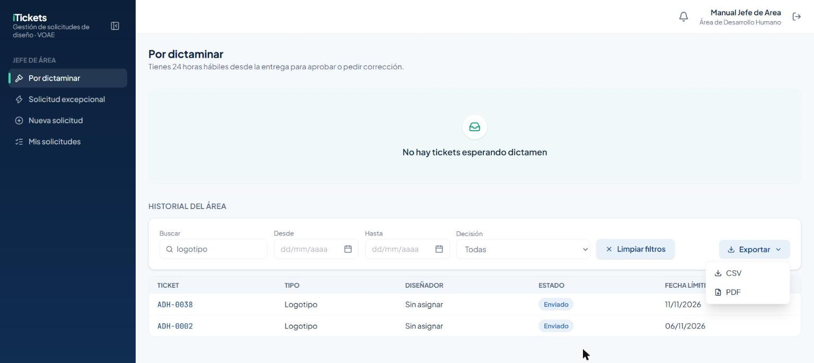

Tienes **24 horas hábiles** desde que el diseñador entrega, para aprobar o pedir corrección. Un
cronómetro te muestra cuánto tiempo queda (se pausa fuera del horario hábil); si no dictaminas a
tiempo, el ticket **se aprueba solo**.

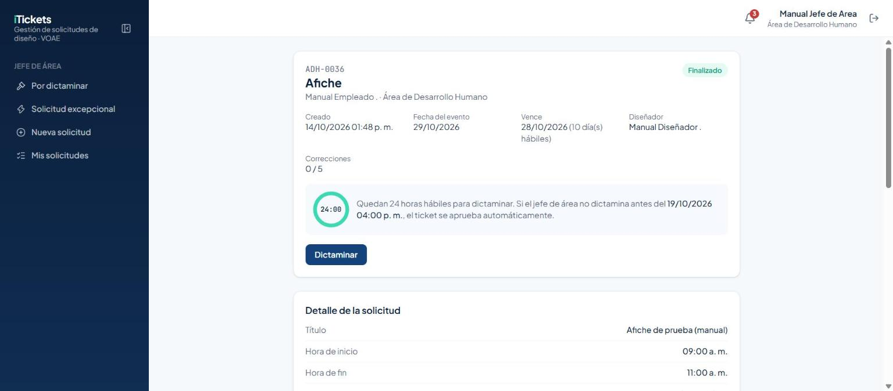

Debajo del cronómetro verás los **Adjuntos del solicitante**, los **Entregables** del diseñador
(agrupados por versión) y la barra de **Progreso de la solicitud**, para revisar el trabajo antes
de decidir.

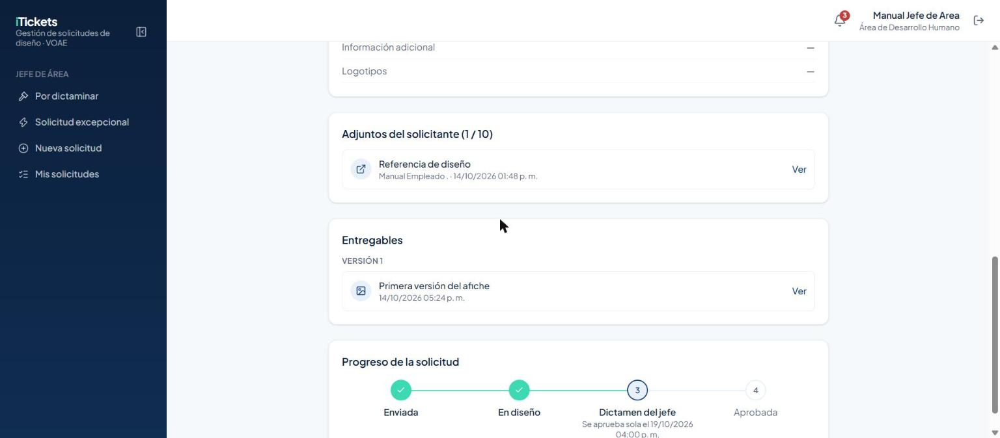

Para dictaminar, abre el ticket y pulsa el botón de dictamen:

1. Elige **Aprobar** o **Pedir corrección**.
2. Si eliges **Pedir corrección**, escribe un comentario explicando qué hay que cambiar — es
   obligatorio.
3. Pulsa **Confirmar**.

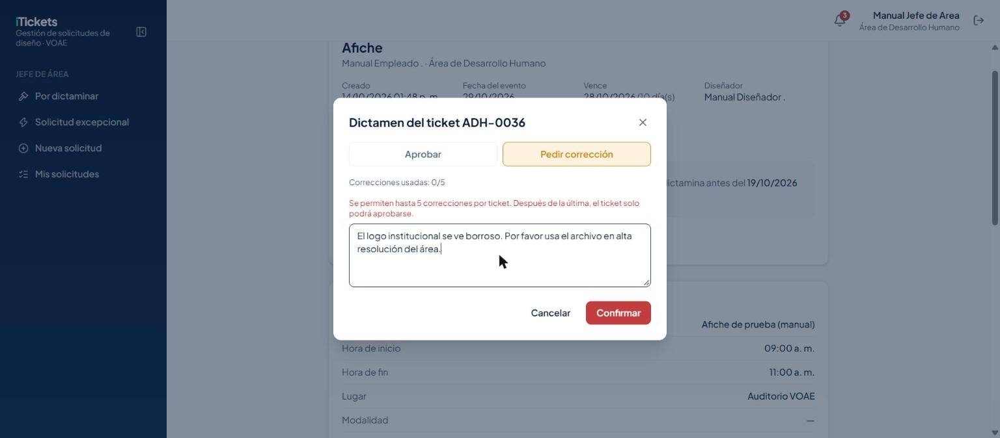

El ticket vuelve al diseñador con el estado **Corrección** y el contador de correcciones avanza:

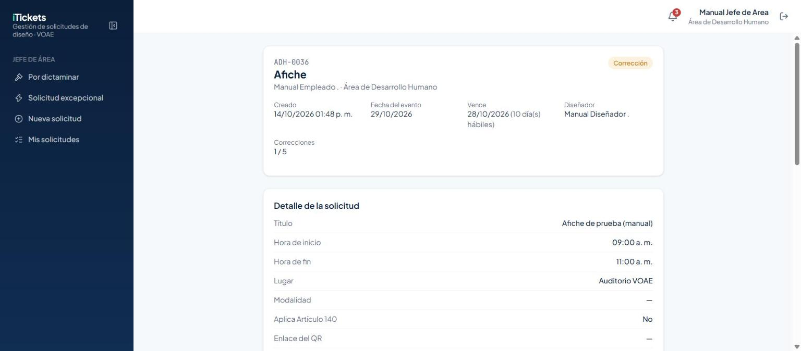

> Importante: cada ticket admite un máximo de **5 correcciones**. El modal te muestra
> "Correcciones usadas: X/5"; después de la quinta, la opción "Pedir corrección" se deshabilita y
> solo puedes aprobar.

Cuando el diseñador sube la siguiente versión, el ticket vuelve a "Por dictaminar". Si esta vez
apruebas:

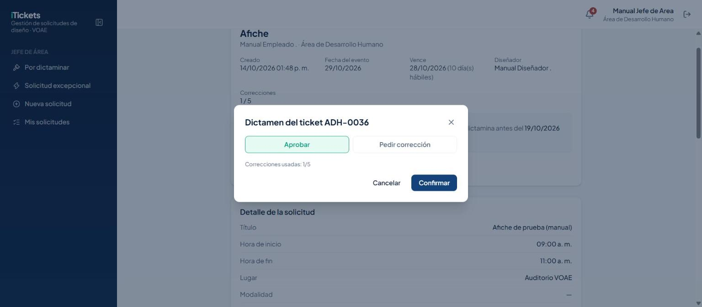

El ticket queda **Aprobado**, con el conteo final de correcciones usadas:

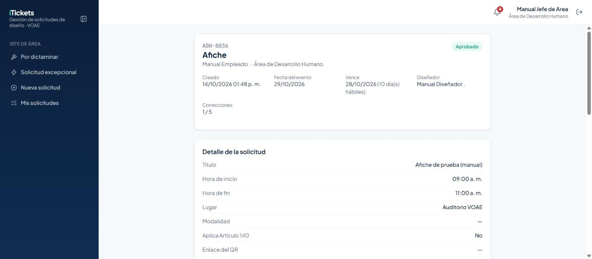

## 3.1 Historial del área

Debajo de "Por dictaminar" (ver la captura anterior), el **Historial del área** lista todas las
solicitudes de tu área, con buscador, rango de fechas, filtro por **Decisión** y los botones
**Limpiar filtros** y **Exportar** (CSV o PDF) — en la captura, filtrado por "logotipo" con el menú
Exportar abierto.

# 4. Solicitud excepcional

Úsala solo para **urgencias**: se puede enviar cualquier día y a cualquier hora, con al menos **2
días hábiles** de anticipación a la fecha del evento. El **Asignador** del equipo de diseño la acepta
o la rechaza; si nadie la atiende antes del evento, se **rechaza automáticamente**.

## 4.1 Enviarla

1. Entra a **Solicitud excepcional** en el menú lateral.
2. Elige el **tipo de solicitud**, igual que en una solicitud normal.

   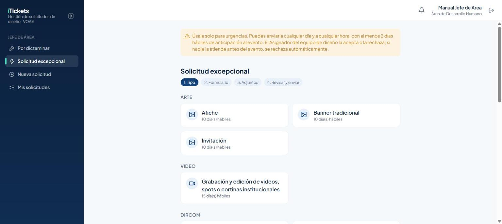

3. Completa el formulario del tipo elegido. En la **fecha del evento**, el calendario solo te deja
   elegir desde el primer día hábil que cumple el mínimo de 2 días hábiles de anticipación — los
   días anteriores aparecen bloqueados.

   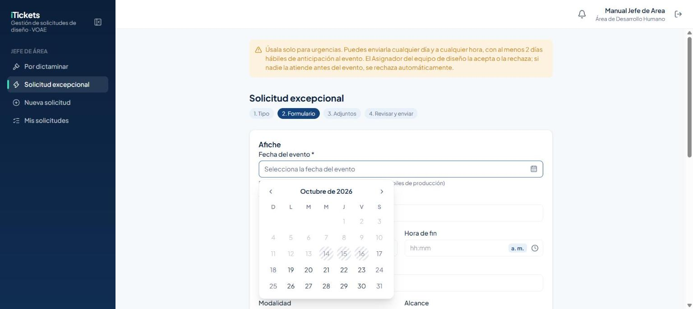

4. Adjunta lo que haga falta y revisa antes de enviar.

Al enviarla, el ticket queda **Enviado** con la etiqueta **Excepcional** y el aviso "Pendiente de
aceptación por el Asignador":

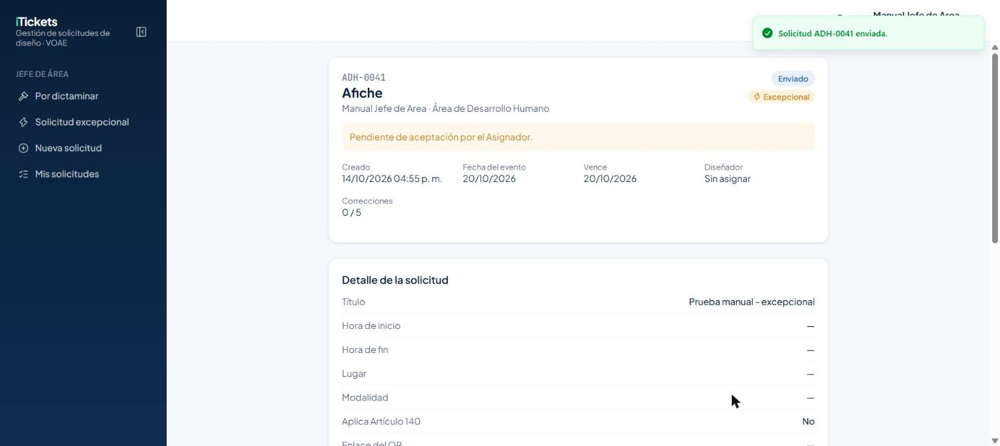

## 4.2 Seguirla en "Mis solicitudes excepcionales"

No es una pantalla aparte: es una sección al final de la misma página **Solicitud excepcional**, con
todas las que has enviado y su estado.

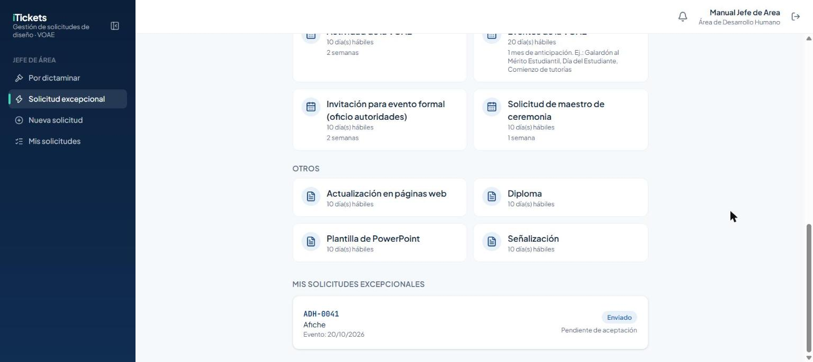

Cuando el Asignador la acepta, cambia a **En proceso** y te dice quién la está trabajando:

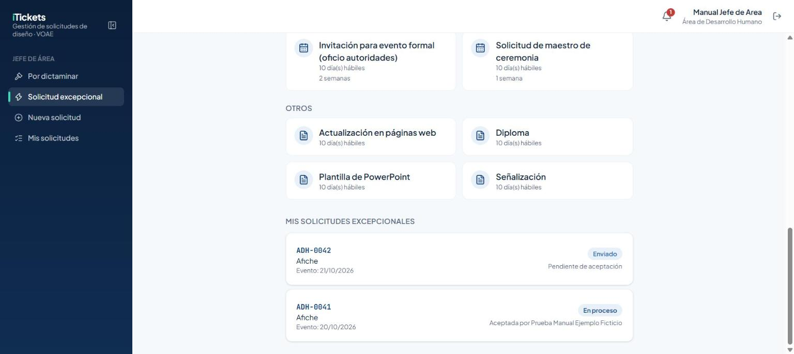

> El texto "Aceptada por…" nombra al **diseñador** que la va a trabajar, no al Asignador que tomó la
> decisión.

Si el Asignador la rechaza, queda **Rechazado** con el motivo que escribió:

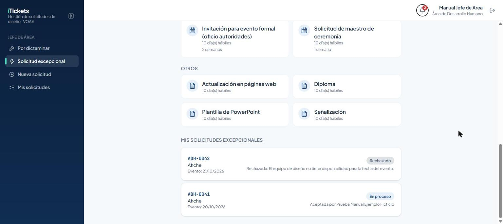

## 4.3 Notificaciones

La campana te avisa en cuanto el Asignador responde tu excepcional, con el código y el resultado:

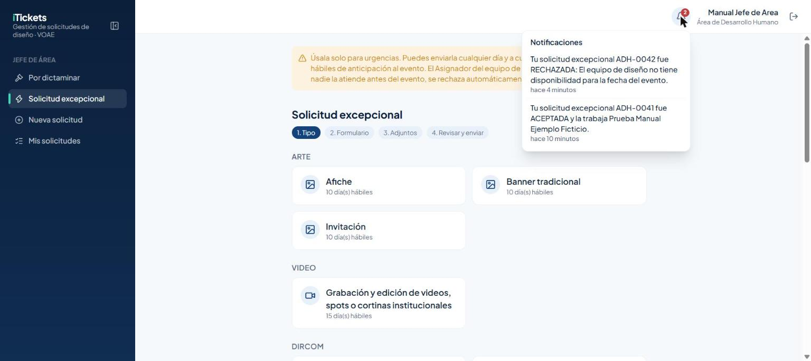

# 5. Reglas importantes

| Tema | Regla |
|---|---|
| Plazo de dictamen | 24 horas hábiles desde que el diseñador entrega. Si no dictaminas, el ticket se **aprueba solo**. |
| Correcciones | Máximo 5 por ticket. Después de la quinta, solo puedes aprobar. |
| Comentario de corrección | Obligatorio al pedir corrección. |
| Solicitud excepcional | La envías tú, con al menos 2 días hábiles de anticipación al evento. |
| Respuesta a la excepcional | La acepta o rechaza el **Asignador**, no tú. |
| Plazo de la excepcional | Si nadie responde antes del evento, se rechaza automáticamente. |
| "Mis solicitudes excepcionales" | Es una sección dentro de "Solicitud excepcional", no una pantalla aparte. |
| Horario de dictamen | Solo dictaminas en horario hábil (lunes a viernes, 8:00 a. m. a 4:00 p. m., hora de Honduras); el cronómetro se pausa fuera de ese horario. |

# 6. Preguntas frecuentes y problemas comunes

| Situación | Qué hacer |
|---|---|
| Ya pasaron las 24 horas y no alcancé a dictaminar | El ticket se aprueba solo; no necesitas hacer nada más. |
| Quiero pedir una sexta corrección | El sistema no lo permite: a partir de la quinta, solo puedes aprobar. |
| Envié una excepcional y no sé si la aceptaron | Revisa "Mis solicitudes excepcionales" al final de la página, o espera la notificación de la campana. |
| Mi excepcional se rechazó sin que nadie respondiera | Pasó la fecha límite de 2 días hábiles antes del evento sin que el Asignador la atendiera. |
| No puedo elegir una fecha cercana para la excepcional | El calendario bloquea los días que no alcanzan el mínimo de 2 días hábiles de anticipación. |
| No encuentro "Mis solicitudes excepcionales" como pantalla propia | No existe como pantalla aparte; está al final de "Solicitud excepcional". |

# 7. Glosario

- **Ticket:** una solicitud de diseño o comunicación, con su propio código (p. ej. `ADH-0001`).
- **Dictamen:** tu decisión sobre un diseño entregado: **Aprobar** o pedir **Corrección**.
- **Días hábiles:** lunes a viernes, sin contar los feriados activos registrados antes de crear el
  ticket.
- **Excepcional:** una solicitud urgente que solo puedes enviar tú (Jefe de Área), y que acepta o
  rechaza el Asignador.
- **Historial del área:** el listado completo de solicitudes de tu área, con filtros y exportación.
