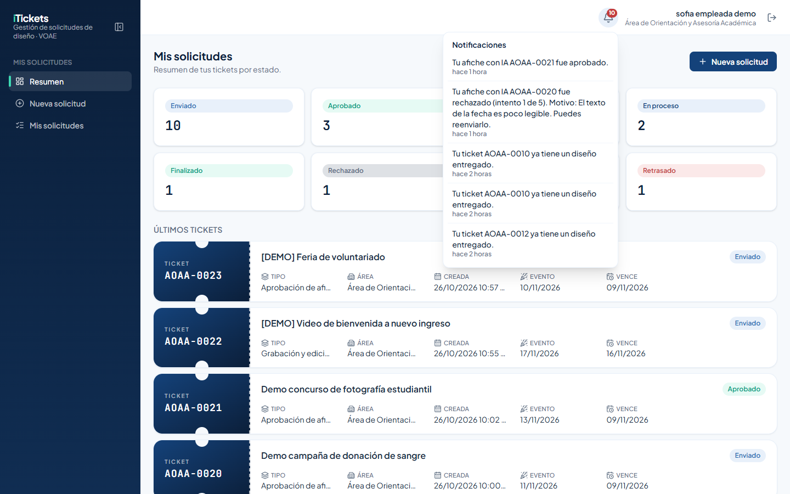
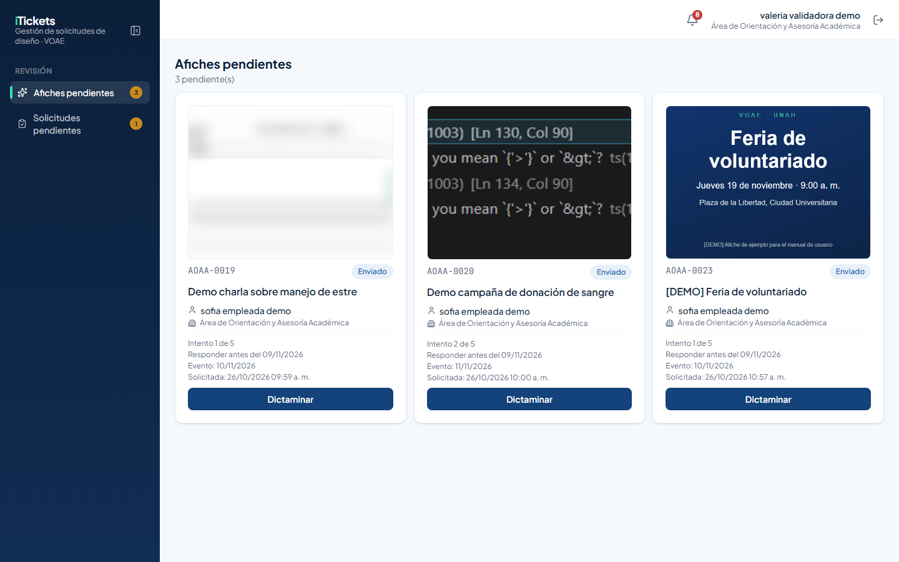
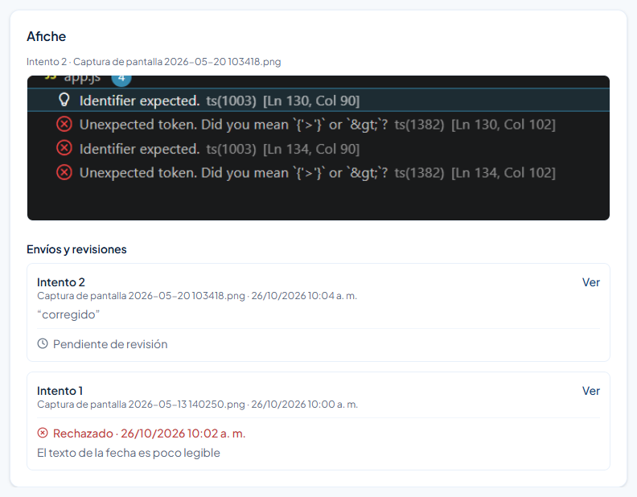
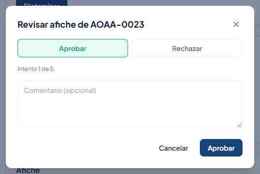
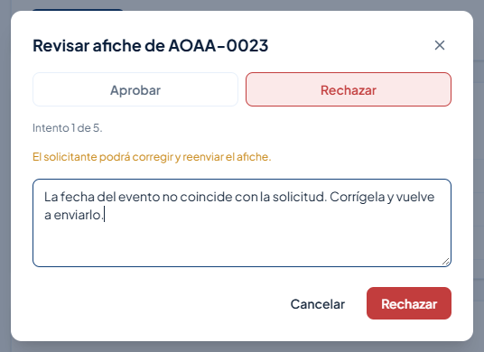
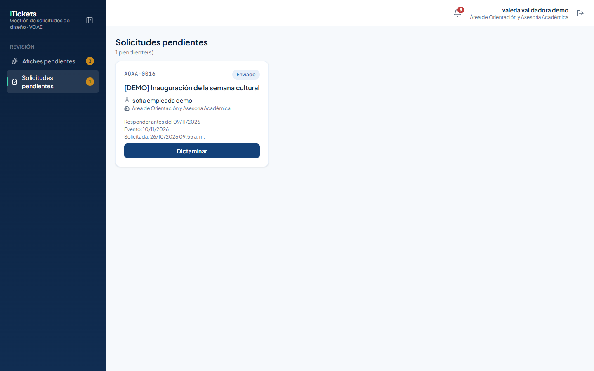
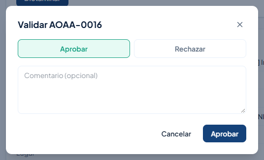
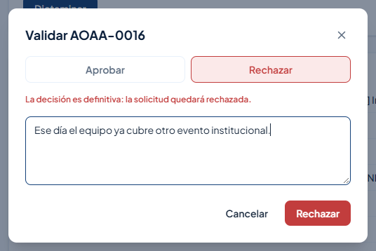
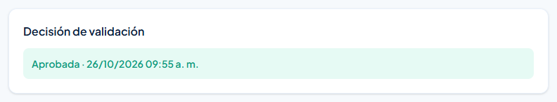
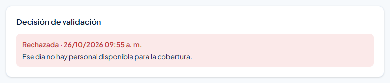

# 1. Introducción

**iTickets** es el sistema de la Vicerrectoría de Orientación y Asuntos Estudiantiles (VOAE) de la UNAH para pedir, producir y aprobar piezas de diseño y comunicación. Cada pedido es un **ticket** con un código único (por ejemplo `AOAA-0016`).

Este manual es para el rol **Validador**: el área encargada de revisar dos tipos de solicitudes que no pasan por el equipo de diseño.

- **Afiches hechos con IA**: el solicitante prepara su propio afiche y tú lo **apruebas** o lo **rechazas** con un comentario para que lo corrija. Tiene hasta **5 intentos**.
- **Coberturas de evento**: pedidos de fotografía o video de un evento, que **apruebas o rechazas una sola vez**.

A estas dos decisiones, en iTickets, se les llama **dictaminar**.

# 2. Acceso al sistema

## 2.1 Iniciar sesión

Entra a la dirección de iTickets en tu navegador.

1. Escribe tu **Correo**.
2. Escribe tu **Contraseña**. Para verla mientras la escribes, pulsa el ojo que está a la derecha del campo.
3. Pulsa **Ingresar**.

Si el correo o la contraseña no coinciden, aparece el aviso **"Correo o contraseña incorrectos."**.

> ¿Olvidaste tu contraseña? Pulsa **¿Olvidaste tu contraseña?**, escribe tu correo y pulsa **Enviar enlace**.

## 2.2 Primer ingreso y cambio de contraseña

La primera vez entras con una **contraseña temporal**. iTickets te pide crear una propia: escribe la **Contraseña nueva**, repítela en **Confirmar contraseña** y pulsa **Guardar contraseña**.

## 2.3 Conoce la pantalla

- **Menú lateral**, sección **Revisión**, con tus dos bandejas: **Afiches pendientes** y **Solicitudes pendientes**. El número amarillo junto a cada una indica cuántas solicitudes esperan tu decisión.
- **Campana**: te avisa en tiempo real de nuevos afiches, reenvíos y coberturas. Al hacer clic en una notificación se abre el ticket.
- **Tu nombre**, y el botón para **cerrar sesión**.

> Por seguridad, la sesión se cierra sola después de **20 minutos** sin actividad.

# 3. Afiches pendientes

**Afiches pendientes** muestra los afiches que esperan tu revisión, como tarjetas con:

- La **miniatura** del afiche.
- El código, el estado, el título, el solicitante y su área.
- **Intento X de 5**: cuántas veces se ha enviado.
- **Responder antes del**: la fecha límite para tu respuesta. Si ya pasó, la tarjeta se marca en rojo y arriba se indica cuántas están **fuera de plazo**.
- La fecha del evento y la de la solicitud.

Pulsa la tarjeta para ver el detalle, o **Dictaminar** para revisarlo de una vez.

## 3.1 Revisar el historial de intentos

En el detalle del ticket, la sección **Afiche** muestra la versión actual en grande. Debajo, **Envíos y revisiones** lista cada intento con su archivo, el comentario del solicitante (si escribió uno) y tu decisión anterior. Pulsa **Ver** para abrir el archivo original.

## 3.2 Aprobar un afiche

1. Pulsa **Dictaminar**. Se abre la ventana **Revisar afiche de** y el código.
2. Deja elegida la opción **Aprobar**.
3. Si quieres, escribe un **comentario** (opcional).
4. Pulsa **Aprobar**.

El ticket queda **Aprobado** y el solicitante recibe un aviso.

## 3.3 Rechazar un afiche

1. Pulsa **Dictaminar**.
2. Elige **Rechazar**.
3. Explica qué debe corregir. El comentario es **obligatorio**.
4. Pulsa **Rechazar**.

El ticket pasa a **Corrección** y el solicitante recibe tu comentario. Cuando reenvíe el afiche, vuelve a aparecer en **Afiches pendientes** con el siguiente intento.

> Cada solicitud tiene hasta **5 intentos**. En el quinto, la ventana avisa: "Es el último intento: si lo rechazas, la solicitud queda rechazada definitivamente."

# 4. Solicitudes pendientes (coberturas de evento)

**Solicitudes pendientes** muestra las coberturas de evento que esperan tu decisión, con el solicitante, su área, la fecha límite para responder, la fecha del evento y la de la solicitud.

Pulsa la tarjeta para leer el detalle (fecha, hora, lugar y descripción del evento, y adjuntos del solicitante) antes de decidir.

## 4.1 Aprobar o rechazar una cobertura

1. Pulsa **Dictaminar**. Se abre la ventana **Validar** y el código.
2. Elige **Aprobar** (con un comentario opcional) o **Rechazar**.
3. Si rechazas, escribe el **motivo**. Es obligatorio.
4. Pulsa **Aprobar** o **Rechazar**.

> La decisión sobre una cobertura es **definitiva**: cada solicitud se decide una sola vez y no tiene correcciones.

## 4.2 Ver una decisión tomada

En el detalle de una cobertura ya decidida, la sección **Decisión de validación** muestra el resultado, la fecha y, si fue rechazada, el motivo:

# 5. Reglas importantes

| Tema | Regla |
|---|---|
| Afiches con IA | Hasta 5 intentos por solicitud. Se aprueba con comentario opcional; se rechaza con comentario obligatorio. |
| Último intento | Rechazar el quinto intento deja la solicitud **Rechazada** de forma definitiva. |
| Plazo | Cada solicitud tiene una fecha **Responder antes del** (10 días hábiles). Las vencidas se marcan en rojo. |
| Coberturas de evento | Se aprueban o rechazan una sola vez, sin correcciones. El motivo del rechazo es obligatorio. |
| Notificaciones | El solicitante recibe un aviso con cada decisión. |

# 6. Preguntas frecuentes y problemas comunes

| Situación | Qué hacer |
|---|---|
| El botón **Rechazar** de la ventana está deshabilitado | Escribe el comentario o el motivo: es obligatorio para rechazar. |
| Una tarjeta aparece con borde rojo | Ya pasó su fecha **Responder antes del**. Atiéndela primero. |
| Quiero ver el afiche en tamaño completo | En **Envíos y revisiones**, pulsa **Ver** en el intento. |
| Rechacé una cobertura por error | La decisión es definitiva. El solicitante debe enviar una solicitud nueva. |
| No veo un afiche que reenviaron | Recarga la página. Si sigue sin aparecer, revisa la campana: el aviso abre el ticket. |

# 7. Glosario

| Término | Significado |
|---|---|
| **Dictaminar** | Tomar la decisión sobre una solicitud: aprobarla o rechazarla. |
| **Afiche con IA** | Afiche que prepara el propio solicitante y que tú revisas. |
| **Intento** | Cada envío de un afiche (máximo 5). |
| **Corrección** | Estado de un afiche rechazado que el solicitante todavía puede reenviar. |
| **Cobertura de evento** | Pedido de fotografía o video de un evento. |
| **Decisión de validación** | Resultado de una cobertura: aprobada o rechazada. |
